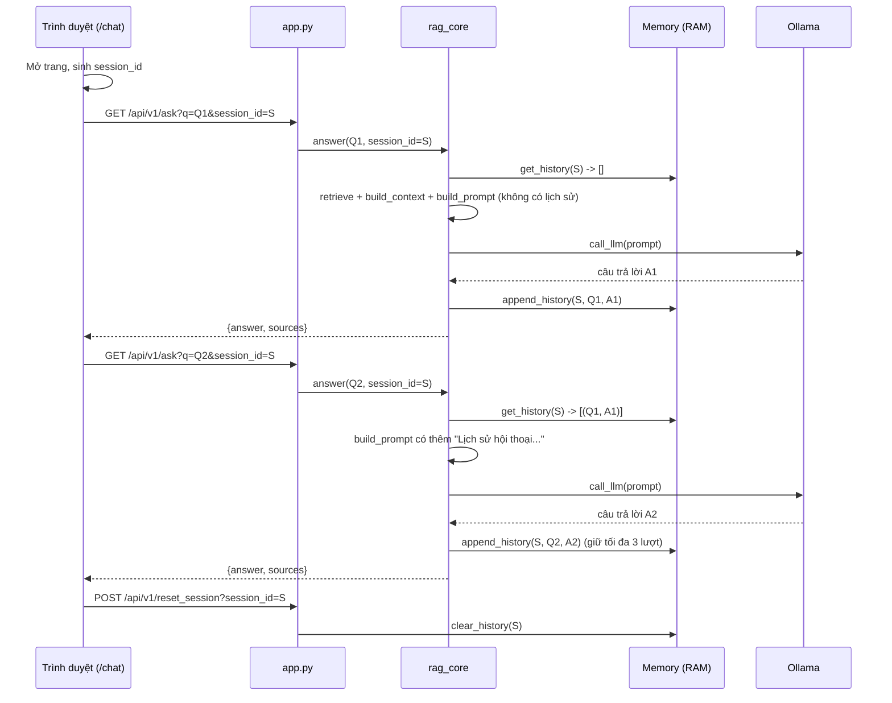
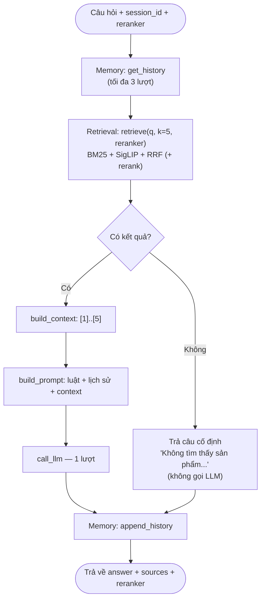
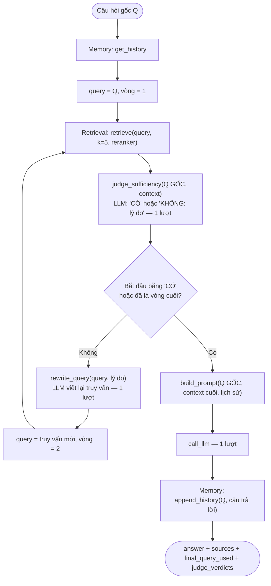
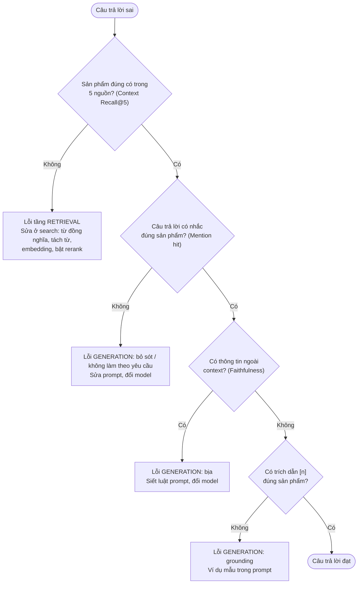

<div align="center">

**ĐẠI HỌC QUỐC GIA THÀNH PHỐ HỒ CHÍ MINH**<br>
**TRƯỜNG ĐẠI HỌC CÔNG NGHỆ THÔNG TIN**

**CỘNG HÒA XÃ HỘI CHỦ NGHĨA VIỆT NAM**<br>
**Độc lập – Tự do – Hạnh phúc**

# BÁO CÁO ĐỒ ÁN CUỐI KỲ — ASSIGNMENT A3
## Chatbot Tư vấn Sản phẩm ứng dụng RAG
### Mở rộng từ Hệ thống Tìm kiếm Ngữ nghĩa A1 — Naive RAG và Agentic RAG

*Môn: Thiết kế Hệ thống Thông tin Thông minh Dựa trên Truy hồi — IS6303*<br>
*Giảng viên phụ trách: Phạm Đỗ Kim Chi*

**Nhóm 12**

| MSSV | Họ và tên |
|---|---|
| 26848240 | Trần Thành Trung |
| 250101013 | Nguyễn Đức Thành Duy |
| 250104050 | Dương Thị Mỹ Phương |
| 250104039 | Nguyễn Tiến Khoa |
| 250104040 | Đặng Yến Linh |

</div>

---

## Mục lục

1. Giới thiệu và phạm vi
2. Kiến thức nền: RAG gồm những gì
3. Dữ liệu
4. Kiến trúc tổng thể
5. Các thành phần và cách hoạt động
   - 5.1 Retrieval
   - 5.2 Rerank
   - 5.3 Augmentation: context và prompt
   - 5.4 Generation: gọi LLM
   - 5.5 Memory
   - 5.6 Luồng Naive RAG
   - 5.7 Luồng Agentic RAG
   - 5.8 API và giao diện
6. Phương pháp đánh giá
7. Kết quả
8. Chẩn đoán lỗi: Retrieval hay Generation
9. Đạo đức AI
10. Hạn chế
11. Kết luận và hướng phát triển
12. Đối chiếu yêu cầu
- Phụ lục A. Cách chạy
- Phụ lục B. Nguyên văn các prompt
- Tài liệu tham khảo

> **Trạng thái số liệu (ngày 06/10/2026):**
> - Tầng **Retrieval**: đã đo đủ trên 250 câu với hệ thống hiện tại (dense = SigLIP), ngày 02/10/2026.
> - Tầng **Generation**: đã chạy đủ `step_ablation_rag.py` trên 250 câu × 4 cấu hình với `llama3.1` (Kaggle, 2 GPU T4), ngày 06/10/2026: 1000 lượt, 0 lỗi. Kết quả ở mục 7.2.

---

## 1. Giới thiệu và phạm vi

### 1.1 Bài toán

A1 xây hệ tìm kiếm ngữ nghĩa: người dùng nhập câu chữ hoặc ảnh, hệ thống trả về danh sách sản phẩm. A3 nâng cấp A1 thành **trợ lý hội thoại (chatbot)** theo kỹ thuật **Retrieval-Augmented Generation (RAG)**:
- Thay vì chỉ trả danh sách, hệ thống đưa các sản phẩm tìm được vào một **mô hình ngôn ngữ lớn (LLM)**.
- LLM viết **câu trả lời tự nhiên có trích dẫn nguồn** `[n]`.
- Hệ thống nhớ được các lượt hỏi trước trong cùng cuộc trò chuyện (**Memory**).

Ví dụ một lượt hỏi thật (LLM `llama3.1`, chạy ngày 29/09/2026):

> **Người dùng:** *something to keep pets from running out of drinking water automatically*
> **Chatbot:** *Để tránh tình trạng pets hết nước uống tự động, bạn có thể sử dụng [1] 1.58 Gallon Automatic Dog Water Bowl Dispenser. Sản phẩm này có khả năng tự cấp nước cho pets một cách liên tục.*
> **Nguồn [1]** là sản phẩm thật trong catalog, hiển thị kèm ảnh để người dùng đối chiếu.

### 1.2 Quan hệ với A1 và A2

- **A1 → A3:** A3 **không viết lại** phần tìm kiếm.
  - Toàn bộ Retrieval (BM25 + Dense SigLIP + RRF, tuỳ chọn rerank) là hàm `search_core.search()` của A1, gọi qua `rag_core.retrieve()`.
  - Dữ liệu, catalog và chỉ mục cũng là của A1.
  - A3 chỉ thêm các tầng phía trên: Augmentation, Generation, Memory, và giao diện chat.
- **A2 → A3:** paper A2 (Sun et al., EMNLP 2023) đề xuất **permutation distillation** (mục 4 của paper): huấn luyện một model nhỏ bắt chước cách ChatGPT xếp hạng. A3 dùng checkpoint do tác giả công bố (`deberta-10k-rank_net`) làm **lựa chọn reranker thứ hai**, bên cạnh cross-encoder MiniLM của A1.
- **Phần A3 không dùng từ paper A2:** dùng LLM trực tiếp để xếp hạng (RankGPT, RQ1 của paper). LLM trong A3 chỉ dùng để sinh câu trả lời và tự đánh giá.

### 1.3 Đóng góp chính

1. **Hai luồng RAG** dùng chung tầng Retrieval và Memory, khác nhau ở cách tầng Generation ra quyết định:
   - **Naive RAG** (baseline): tìm một lần, trả lời một lần.
   - **Agentic RAG** (nâng cấp): LLM tự đánh giá kết quả tìm kiếm, có thể viết lại câu truy vấn và tìm lại.
2. **Memory theo phiên hội thoại**, giúp hiểu câu hỏi nối tiếp (ví dụ "còn màu khác không").
3. **Ba lựa chọn rerank** trước khi đưa sản phẩm cho LLM: không rerank / cross-encoder MiniLM (A1) / DeBERTa distill (A2).
4. **Grounding:** context đánh số, prompt ràng buộc, trả kèm nguồn thật, và giao diện cho bấm vào sản phẩm được trích dẫn để xem chi tiết.
5. **Bộ đánh giá RAG tự viết, 7 metric:** đo riêng tầng Retrieval và tầng Generation, kèm script ablation lưu chi tiết từng câu.

### 1.4 Yêu cầu của đề bài

Theo bản ghi yêu cầu của nhóm, đồ án cuối kỳ chiếm 50% điểm môn:

| Tiêu chí | Điểm | Nội dung |
|---|---|---|
| Đề tài baseline | 5đ | Hệ RAG cơ bản |
| Hệ thống hoàn chỉnh | 2.5đ | Front-end, back-end, dữ liệu phù hợp |
| Nâng cấp engineering/research | 2.5đ | Cải tiến so với baseline, chứng minh bằng ablation |

Các yêu cầu khác được ghi lại:
- Nâng cấp hệ search A1 bằng LLM; có dạng chatbot.
- Đánh giá bằng đủ metric RAG.
- Ground truth tối thiểu 50 câu mỗi người, dùng chung với A1.
- Chẩn đoán được lỗi nằm ở tầng Retrieval hay Generation.
- Có đánh giá đạo đức AI.

---

## 2. Kiến thức nền: RAG gồm những gì

**RAG** (Lewis et al., 2020) giải quyết hai điểm yếu của LLM khi dùng một mình:
- LLM không biết dữ liệu riêng của doanh nghiệp, ở đây là 2.000 sản phẩm trong catalog.
- LLM có thể "bịa" thông tin nghe hợp lý (hallucination).

Cách làm là **tìm tài liệu liên quan trước, rồi buộc LLM trả lời dựa trên tài liệu đó**. Một hệ RAG có 3 tầng:

| Tầng | Câu hỏi nó trả lời | Trong đồ án |
|---|---|---|
| **Retrieval** (truy hồi) | Tài liệu nào liên quan tới câu hỏi? | `search()` của A1 lấy 5 sản phẩm, tuỳ chọn rerank |
| **Augmentation** (bổ sung ngữ cảnh) | Đưa tài liệu cho LLM theo cách nào? | `build_context()` đánh số `[1]..[5]`; `build_prompt()` thêm luật và lịch sử hội thoại |
| **Generation** (sinh) | LLM trả lời gì? | `call_llm()` gọi `llama3.1` qua Ollama |

Hai biến thể được xây:
- **Naive RAG:** đi thẳng một chiều Retrieval → Augmentation → Generation, đúng một lần.
- **Agentic RAG:** LLM đóng thêm vai **người ra quyết định**, nghĩa là xem kết quả tìm kiếm có đủ chưa; nếu chưa thì tự viết lại truy vấn và tìm lại. Đây là dạng đơn giản của ý tưởng "LLM tự đánh giá và sửa bước truy hồi" (gần với Self-RAG, Asai et al., 2024; Corrective RAG, Yan et al., 2024). Đồ án chỉ cài **phiên bản tối giản** của ý tưởng này, không cài lại các phương pháp đó.

Hệ quả quan trọng khi đánh giá: **Retrieval và Generation có thể sai độc lập.**
- Tìm đúng sản phẩm nhưng LLM vẫn trả lời sai hoặc bịa.
- Tìm sai thì LLM trả lời tốt đến đâu cũng không đúng.

Vì vậy cần **metric riêng cho từng tầng** (mục 6) và **khung chẩn đoán theo tầng** (mục 8).

---

## 3. Dữ liệu

### 3.1 Catalog sản phẩm (dùng lại của A1)

- **Nguồn:** `Shopify/product-catalogue` (Hugging Face, apache-2.0). A1 lấy 2.000 sản phẩm từ split train, xáo trộn với seed 42.
- **Mỗi sản phẩm có:** `id`, ảnh, `caption` (tên sản phẩm), `search_text` (tên + mô tả), `category`, `brand`.
- **Chỉ mục:** BM25 trên `search_text`; FAISS trên embedding ảnh **SigLIP** (768 chiều). Chi tiết ở báo cáo A1.

### 3.2 Bộ câu hỏi đánh giá: `data/eval_set.jsonl` (250 câu, dùng chung với A1)

| Nhóm | Số câu | Cách tạo |
|---|---|---|
| A1 viết tay | 30 | Trộn câu có từ khoá chính xác, câu diễn đạt lại, câu mơ hồ |
| A3 viết tay | 20 | Ban đầu viết tiếng Việt, viết lại bằng tiếng Anh cho khớp catalog |
| Sinh từ mẫu | 200 | 10 mẫu câu, điền 8 từ đầu của tên sản phẩm và brand của sản phẩm chọn ngẫu nhiên |

Mỗi dòng có:
- `relevant_ids`: đúng 1 sản phẩm đúng.
- `answer_should_mention`: brand và 3 từ đầu của tên sản phẩm. Trường này **A3 thêm vào** để kiểm tra câu trả lời có thực sự nhắc đúng sản phẩm không.

Ví dụ:
```json
{"query": "something to keep pets from running out of drinking water automatically",
 "relevant_ids": [121], "answer_should_mention": ["STALTWO", "1.58 Gallon Automatic"]}
```

**Hạn chế:** 200 câu sinh từ mẫu chứa nguyên văn một phần tên sản phẩm, nên dễ hơn câu thực tế. Kết quả vì vậy luôn được báo cáo riêng cho **50 câu viết tay**.

### 3.3 Giới hạn thông tin trong context

Mỗi sản phẩm đưa vào prompt **chỉ có tên sản phẩm và điểm RRF**. Không có mô tả, category, brand riêng, và catalog cũng **không có trường giá**. Hệ quả:
- Câu hỏi về giá hoặc thuộc tính không nằm trong tên sản phẩm thì LLM phải trả lời là không có thông tin (theo luật trong prompt).
- **Metric Mention hit có mức trần dưới 1.** Brand thường không nằm trong tên sản phẩm, nên LLM không thể nhắc đúng brand. Mức trần tính từ dữ liệu, tức tỷ lệ từ khoá `answer_should_mention` có trong tên sản phẩm đúng:

| Tập câu | Mức trần Mention hit |
|---|---|
| 250 câu | 0.708 |
| 50 câu viết tay | 0.760 |
| 200 câu sinh từ mẫu | 0.695 |

---

## 4. Kiến trúc tổng thể

### 4.1 Sơ đồ thành phần


### 4.2 Các file

| Thành phần | File | Vai trò |
|---|---|---|
| Giao diện chatbot | `frontend/chat.html`, `frontend/style.css` (trang `/chat`) | Khung chat, công tắc rerank và Agentic, danh sách nguồn, chi tiết sản phẩm |
| API | `app.py` | `/api/v1/ask`, `/api/v1/rerankers`, `/api/v1/products/{id}`, `/api/v1/reset_session` |
| Lõi RAG | `rag_core.py` | `retrieve`, `build_context`, `build_prompt`, `call_llm`, `answer`, `answer_agentic`, Memory |
| Tìm kiếm (A1) | `search_core.py` | `search()`, `rerank()` (MiniLM), `distilled_rerank()` (DeBERTa), `get_product()` |
| Metric RAG | `rag_metrics.py` | Context Precision, Faithfulness, Answer Relevancy |
| Thực nghiệm | `step_ablation_rag.py` | 4 cấu hình × 7 metric, lưu kết quả và chi tiết từng câu |
| Cấu hình | `.env` (mẫu: `.env.example`) | `OLLAMA_MODEL`, `OLLAMA_URL` |

---

## 5. Các thành phần và cách hoạt động

### 5.1 Retrieval

`rag_core.retrieve(query, k=5, reranker)` gọi `search_core.search()` của A1:

1. **BM25:** tách câu hỏi thành từ (`lower().split()`), chấm điểm BM25 trên toàn bộ 2.000 sản phẩm, lấy `top_n` sản phẩm điểm cao nhất.
2. **Dense:** SigLIP biến câu hỏi thành vector 768 chiều (đã chuẩn hoá). FAISS tìm `top_n` ảnh sản phẩm có tích vô hướng (cosine) lớn nhất.
   - Ảnh và câu chữ nằm trong cùng không gian vector, nên câu chữ tìm được ảnh.
3. **RRF** (Cormack et al., 2009): gộp hai danh sách theo **thứ hạng**, không theo điểm, vì điểm BM25 và cosine khác thang đo:

   score(d) = Σ_{danh sách} 1 / (k_RRF + hạng của d),  với k_RRF = 60, hạng tính từ 1.

   *Ví dụ:* sản phẩm đứng hạng 1 ở cả hai danh sách được 1/61 + 1/61 = 0,0328. Sản phẩm chỉ có ở một danh sách, hạng 1, được 1/61 = 0,0164.
4. **Cắt kết quả:**
   - Không rerank: lấy 5 sản phẩm đầu (`top_n = 50` mỗi nhánh).
   - Có rerank: lấy **30 ứng viên** đầu sau RRF (`top_n = 30` mỗi nhánh), chuyển sang bước 5.2.

Kết quả là danh sách 5 sản phẩm `{id, image_path, caption, score}`, gọi là **sources**.

### 5.2 Rerank (tuỳ chọn, mặc định tắt)

Cả hai reranker đều là **cross-encoder chấm từng cặp**: model đọc **đồng thời** câu hỏi và tên sản phẩm, cho ra **một điểm liên quan**. 30 ứng viên được sắp lại theo điểm này, rồi giữ 5 sản phẩm đầu.

| | Cross-encoder MiniLM (A1) | DeBERTa distill (A2) |
|---|---|---|
| Model | `cross-encoder/ms-marco-MiniLM-L-6-v2` (Nogueira & Cho, 2019, bản distill nhỏ) | `deberta-10k-rank_net`, DeBERTa-v3-base, ~184M tham số |
| Học từ | Nhãn liên quan do **người** gán trên MS MARCO | **Thứ tự do ChatGPT xếp** cho 10K câu hỏi MS MARCO, loss RankNet (Sun et al., 2023, mục 4 và Appendix D.1) |
| Nguồn | Hugging Face | Repo github.com/sunnweiwei/RankGPT, mục "Download data and model" |
| Thời gian thêm (CPU, 30 ứng viên) | ~0,3 s mỗi câu | ~2,5 s mỗi câu |

**Vì sao cần rerank:** BM25 + Dense + RRF tìm nhanh nhưng xếp hạng chưa kỹ. Cross-encoder chính xác hơn vì đọc câu hỏi và sản phẩm cùng lúc, nhưng chậm vì phải chạy model cho từng cặp. Nên chỉ dùng cho vài chục ứng viên đã được lọc sẵn.

Reranker **không gọi LLM** và áp dụng **như nhau** cho cả Naive lẫn Agentic.

### 5.3 Augmentation: context và prompt

**`build_context(sources)`** viết mỗi sản phẩm một dòng, đánh số để LLM trích dẫn:
```
[1] 1.58 Gallon Automatic Dog Water Bowl Dispenser, Large Capacity Water Feeder ... (score=0.0325)
[2] ...
[5] ...
```

**`build_prompt(query, context, history)`** ghép 4 phần:

| Phần | Nội dung | Mục đích |
|---|---|---|
| Luật grounding | "CHỈ được dùng thông tin trong danh sách... KHÔNG được bịa thêm chi tiết (giá, tính năng...)... Nếu không có sản phẩm phù hợp, hãy nói rõ là không tìm thấy thay vì đoán." | Giảm bịa thông tin |
| Lịch sử hội thoại | Tối đa 3 lượt gần nhất (mục 5.5); trống nếu không có | Hiểu câu hỏi nối tiếp |
| Context | Danh sách `[1]..[5]` ở trên | Nguồn thông tin duy nhất được phép dùng |
| Yêu cầu trả lời | "Trả lời ngắn gọn bằng tiếng Việt, TRÍCH DẪN số thứ tự trong ngoặc vuông (ví dụ [1])..." | Định dạng câu trả lời, buộc trích dẫn |

Nguyên văn prompt ở Phụ lục B.

### 5.4 Generation: gọi LLM

`call_llm(prompt)` gửi `POST` tới Ollama (`/api/generate`, `stream=false`) và nhận về câu trả lời dạng text.

| Thiết lập | Giá trị | Ghi chú |
|---|---|---|
| Model | `OLLAMA_MODEL` trong `.env`, mặc định `llama3.1` (8B, lượng tử hoá Q4_K_M) | Chạy local, không cần API key, dữ liệu không ra khỏi máy |
| Địa chỉ | `OLLAMA_URL`, mặc định `http://localhost:11434/api/generate` | |
| Timeout | 600 s | Model 8B trên CPU có thể chậm |
| Thử lại | Tối đa 3 lần (chờ 5 s, 10 s) khi mất kết nối, timeout, lỗi 5xx | Lỗi 4xx (ví dụ sai tên model) báo ngay, không thử lại |
| Lỗi trả cho giao diện | HTTP 503, kèm lý do Ollama trả về | Ví dụ: *"Ollama trả 404: model 'llama3.1' not found"* |

**Chọn model là một quyết định có số liệu** (mục 7.2). Với cùng prompt, `qwen2.5:3b` (3B) chỉ trả về chuỗi `"[1]"`, còn `llama3.1` (8B) trả lời thành câu đầy đủ. Hệ thống vì vậy dùng `llama3.1`.

### 5.5 Memory

**Mục đích:** cho chatbot hiểu câu hỏi nối tiếp, ví dụ người dùng hỏi "black jacket", rồi hỏi tiếp "còn cái nào rẻ hơn không".

**Cấu trúc dữ liệu** (`rag_core._SESSION_STORE`): một dict trong RAM của server.
```python
{
  "session-p57iqj4jb4s": [
      {"query": "finding for me a black jacket", "answer": "Tôi tìm thấy ... [1] Michael Kors ..."},
      {"query": "...", "answer": "..."}
  ],
  "session-xyz...": [...]
}
```

**Vòng đời một phiên:**
1. Mở trang `/chat`: trình duyệt sinh `session_id` ngẫu nhiên và gửi kèm **mọi** câu hỏi.
2. **Đọc** (`get_history`): mỗi câu hỏi lấy danh sách lượt cũ của phiên.
3. **Chèn vào prompt** (`_format_history`): mỗi lượt thành một dòng, câu trả lời cũ **cắt còn 150 ký tự**:
   ```
   Lịch sử hội thoại trước đó (để hiểu ngữ cảnh câu hỏi hiện tại):
   - Khách hỏi: "finding for me a black jacket" -> Đã trả lời: "Tôi tìm thấy một số sản phẩm đen. Bạn có thể tham khảo [1] Michael Kors Men's Perforated Faux-Leather Moto Jacket XL Black hoặc [2] 3120-2129 . Pivo..."
   ```
4. **Ghi** (`append_history`): sau khi có câu trả lời, thêm lượt mới vào cuối. Nếu quá **3 lượt**, xoá lượt cũ nhất (cửa sổ trượt).
5. **Xoá:** nút "Mới" gọi `POST /api/v1/reset_session`, xoá lịch sử và đổi sang `session_id` mới.



**Giới hạn của cách cài đặt này** (nêu rõ, không giấu):
- **Lịch sử chỉ được đưa vào prompt sinh câu trả lời, không dùng khi tìm kiếm.** Câu "còn cái nào rẻ hơn không" được tìm kiếm **nguyên văn**, nên kết quả tìm kiếm của lượt 2 không liên quan tới áo khoác. LLM chỉ "nhớ" qua phần lịch sử trong prompt.
- **LLM có thể kéo lịch sử vào sai chỗ.** Ví dụ thật khi thử giao diện (`llama3.1`): người dùng hỏi "waterproof hiking boots for winter", rồi hỏi tiếp "portable outdoor storage shed with zipper doors". Câu trả lời thứ hai mở đầu bằng *"Tôi nghĩ bạn đang hỏi về một loại bốt đi bộ chống nước..."*, dù câu mới hỏi chuyện khác hẳn.
- **Lưu trong RAM:** mất khi khởi động lại server; không dùng chung được nếu chạy nhiều server. Production cần Redis hoặc cơ sở dữ liệu.
- **Cửa sổ ngắn:** chỉ 3 lượt, mỗi câu trả lời cũ 150 ký tự. Đủ cho câu nối tiếp gần, không đủ cho hội thoại dài.

### 5.6 Luồng Naive RAG (baseline): `answer()`



Đặc điểm: **tuyến tính**, tìm kiếm đúng một lần, gọi LLM tối đa một lần. Naive RAG không bao giờ tìm lại, dù kết quả tìm kiếm tốt hay xấu.

### 5.7 Luồng Agentic RAG (nâng cấp): `answer_agentic(max_iters=2)`



Các quy tắc:
- **Đánh giá luôn so với câu hỏi gốc,** không so với truy vấn đã viết lại, để không "trôi" khỏi ý người dùng.
- **Câu trả lời cuối dùng câu hỏi gốc,** nhưng dùng context của lần tìm kiếm cuối.
- **`max_iters = 2`** là giới hạn cứng để không lặp vô hạn.
- **Trả thêm `final_query_used`** (giao diện hiện nếu khác câu hỏi gốc) và **`judge_verdicts`** (các phán đoán của LLM, dùng khi phân tích lỗi).

**Số lượt gọi LLM mỗi câu hỏi:**

| Tình huống | Naive | Agentic |
|---|---|---|
| Kết quả tìm kiếm rỗng | 0 | 2 (Agentic chưa có kiểm tra này) |
| LLM đánh giá "đủ" ngay vòng 1 | 1 | 2 |
| LLM đánh giá "chưa đủ" | — | 4 (đánh giá, viết lại, đánh giá, trả lời) |

**So sánh hai luồng:**

| Khía cạnh | Naive RAG | Agentic RAG |
|---|---|---|
| Số lần tìm kiếm | 1 | 1–2 |
| Tự đánh giá kết quả | Không | Có (`judge_sufficiency`) |
| Tự viết lại truy vấn | Không | Có (`rewrite_query`), khi chưa đủ |
| Lượt gọi LLM | 1 | 2–4 |
| Memory, Grounding, Reranker | Dùng chung | Dùng chung |

### 5.8 API và giao diện

**API:**

| Endpoint | Tham số | Trả về |
|---|---|---|
| `GET /api/v1/ask` | `q`, `k=5`, `agentic=false`, `reranker=none\|cross_encoder\|deberta`, `session_id` | `{answer, sources, reranker}`, Agentic thêm `final_query_used`, `judge_verdicts`. 400 nếu reranker không hợp lệ; 503 nếu không gọi được Ollama |
| `GET /api/v1/rerankers` | — | Reranker dùng được (`deberta` chỉ có khi đã tải checkpoint) |
| `GET /api/v1/products/{id}` | — | Tên, brand, category, mô tả (tối đa 2.000 ký tự) của một sản phẩm trong catalog |
| `POST /api/v1/reset_session` | `session_id` | Xoá Memory của phiên |
| `GET /chat` | — | Trang chatbot (A1 có trang riêng `/search`) |

**Giao diện `/chat`:**
- **Công tắc "Rerank trước khi đưa vào context":** chỉ khi bật mới chọn được MiniLM hoặc DeBERTa.
- **Công tắc "Agentic".**
- **Khung chat nhiều lượt.** Dưới mỗi câu trả lời có **thẻ sản phẩm** cho từng nguồn được LLM trích dẫn `[n]`.
- **Cột phải:** danh sách 5 nguồn đã đưa vào context (ảnh, `[n]`, điểm RRF và điểm rerank), và **khung chi tiết sản phẩm** hiện khi bấm vào một thẻ hoặc một nguồn.

```mermaid
sequenceDiagram
    participant U as Người dùng
    participant B as chat.html
    participant A as app.py
    participant R as rag_core / search_core
    participant L as Ollama

    U->>B: Nhập câu hỏi, chọn rerank / Agentic
    B->>A: GET /api/v1/ask
    A->>R: answer() hoặc answer_agentic()
    R->>R: retrieve() — A1 search (+ rerank)
    R->>L: call_llm()
    L-->>R: câu trả lời có [n]
    R-->>A: answer + sources
    A-->>B: JSON
    B->>B: Hiện câu trả lời; tách các [n] → thẻ sản phẩm; hiện 5 nguồn
    U->>B: Bấm thẻ [1]
    B->>A: GET /api/v1/products/{id}
    A->>R: get_product(id) — catalog A1
    A-->>B: tên, brand, category, mô tả
    B->>B: Hiện chi tiết sản phẩm ở cột phải
```

---

## 6. Phương pháp đánh giá

### 6.1 Quy trình

Script `step_ablation_rag.py` chạy từng cấu hình trên các câu của `data/eval_set.jsonl`:
1. Với mỗi câu, gọi `answer()` hoặc `answer_agentic()` với `k = 5`, đo thời gian.
2. Từ kết quả, tính 7 metric ở mục 6.2. Faithfulness gọi thêm 1 lượt LLM.
3. Ghi **ngay** chi tiết câu đó vào `data/rag_ablation_details.jsonl`: câu hỏi, câu trả lời, id nguồn, từng metric, truy vấn đã viết lại, phán đoán của LLM.
   - Nếu một câu vẫn lỗi sau 3 lần thử lại, câu đó được ghi kèm lỗi và đếm vào cột "Lỗi", không bị loại âm thầm.
   - Bị ngắt giữa chừng thì chạy lại với `--resume`.
4. Lấy trung bình theo cấu hình, cho **toàn bộ** và **50 câu viết tay**, rồi lưu vào `data/rag_ablation_results.json`.

### 6.2 Metric và cách tính

Ký hiệu: với mỗi câu hỏi, *G* là tập id sản phẩm đúng (ở đây |G| = 1), *S = (s₁, ..., s₅)* là 5 nguồn đưa vào context theo thứ tự, *A* là câu trả lời của LLM. Mỗi metric tính cho từng câu, rồi **lấy trung bình** trên các câu (câu có giá trị `None` bị bỏ qua).

| Tầng | Metric | Công thức | Ý nghĩa |
|---|---|---|---|
| Retrieval | Context Recall@5 | \|S ∩ G\| / \|G\| | Sản phẩm đúng có được đưa cho LLM không |
| Retrieval | Context Precision@5 | (1/min(\|G\|, 5)) · Σ_{i: sᵢ∈G} (số id đúng trong i nguồn đầu) / i | Sản phẩm đúng có đứng cao không |
| Generation | Faithfulness | (số claim SUPPORTED) / (tổng số claim) | Câu trả lời có bịa ngoài context không |
| Generation | Answer Relevancy | cos(e(câu hỏi), e(A)) | Câu trả lời có đúng chủ đề câu hỏi không |
| Generation | Mention hit | (số từ khoá trong `answer_should_mention` xuất hiện trong A) / (số từ khoá) | Câu trả lời có nhắc đúng sản phẩm không |
| Generation | Citation rate | 1 nếu A có ít nhất một `[n]`, ngược lại 0 | Có tuân thủ yêu cầu trích dẫn không |
| Hệ thống | Latency | Thời gian gọi `answer()` / `answer_agentic()` (giây) | Đánh đổi tốc độ |
| Agentic | Rewrite rate | Tỷ lệ câu có `final_query_used` ≠ câu hỏi gốc | Agentic phải tìm lại bao nhiêu lần |

Giải thích và ví dụ cho từng metric:

**Context Recall@5** (`metrics.recall_at_k`, dùng lại của A1). Mỗi câu có đúng 1 sản phẩm đúng, nên giá trị là 1 nếu sản phẩm đúng nằm trong 5 nguồn, 0 nếu không. Trung bình trên các câu là **tỷ lệ câu mà LLM có được sản phẩm đúng để trả lời**.

**Context Precision@5** (`rag_metrics.context_precision_at_k`). Đây là Average Precision giới hạn trong top-5. Với |G| = 1, giá trị bằng **1/hạng** của sản phẩm đúng, hoặc 0 nếu nó không có trong top-5.
- *Ví dụ:* sản phẩm đúng ở `[3]` thì precision tại hạng 3 là 1/3, nên Context Precision@5 = 0,333. Nếu ở `[1]` thì bằng 1,0.
- Recall không phân biệt hai trường hợp này. Precision thì có, và điều này quan trọng vì LLM thường ưu tiên trích dẫn `[1]`.

**Faithfulness** (`rag_metrics.faithfulness`), theo ý tưởng RAGAS (Es et al., 2024) nhưng **đơn giản hoá, tự viết**:
1. Gửi cho LLM giám khảo (cùng model `OLLAMA_MODEL`) context và câu trả lời. Yêu cầu tách câu trả lời thành các **claim** (nhận định độc lập), và với mỗi claim in một dòng `CLAIM: <nội dung> | SUPPORTED` hoặc `| NOT_SUPPORTED`.
2. Đọc các dòng bằng biểu thức chính quy `CLAIM:\s*(.+?)\s*\|\s*(SUPPORTED|NOT_SUPPORTED)`.
3. Faithfulness = số SUPPORTED / tổng số claim đọc được.
   - Trả `None` (không phải 0) nếu không đọc được claim nào, vì "không chấm được" khác với "sai hết".
- *Ví dụ:* câu trả lời được tách thành 5 claim, giám khảo đánh 4 SUPPORTED thì Faithfulness = 0,8.
- **Giới hạn:** giám khảo là **chính model sinh câu trả lời**, nên có thể thiên vị. Mục 7.2 và 7.3c cho thấy điểm này dao động mạnh.
- **Khi nào ra None:** câu trả lời hoặc context rỗng, hoặc giám khảo không in được dòng nào đúng dạng `CLAIM: ... | SUPPORTED/NOT_SUPPORTED`. Giá trị trung bình chỉ tính trên các câu có điểm (bỏ None).

**Answer Relevancy** (`rag_metrics.answer_relevancy`): đơn giản hoá so với RAGAS. RAGAS gốc sinh các câu hỏi giả định từ câu trả lời rồi so với câu hỏi gốc; bản này **so thẳng** embedding câu hỏi và câu trả lời bằng `sentence-transformers/all-MiniLM-L6-v2` (đã chuẩn hoá, nên tích vô hướng = cosine), cho ra giá trị trong [−1, 1].
- *Ví dụ thật:* câu trả lời `"[1]"` của `qwen2.5:3b` được khoảng 0,01–0,08; câu trả lời đầy đủ của `llama3.1` được 0,39–0,69.
- **Giới hạn:** model embedding là model tiếng Anh, trong khi câu hỏi là tiếng Anh và câu trả lời là tiếng Việt. Nên chỉ dùng để **so sánh giữa các cấu hình**, không đọc như giá trị tuyệt đối.

**Mention hit:** so khớp chuỗi, không phân biệt hoa thường.
- *Ví dụ thật:* câu hỏi "pets drinking water", `answer_should_mention = ["STALTWO", "1.58 Gallon Automatic"]`. Câu trả lời của `llama3.1` có "1.58 Gallon Automatic" nhưng không có "STALTWO", nên Mention hit = 1/2 = 0,5.
- Brand "STALTWO" **không có trong context** (mục 3.3), nên 0,5 đã là mức cao nhất có thể với câu này. Phải so với mức trần 0,708 (250 câu) hoặc 0,760 (50 câu viết tay), không so với 1.

**Citation rate:** chỉ kiểm tra **định dạng**, tức câu trả lời có `[n]` hay không. Nó không kiểm tra `[n]` có trỏ đúng sản phẩm.
- *Ví dụ:* câu trả lời `"[1]"` của `qwen2.5:3b` vẫn đạt Citation = 1, dù không có nội dung. Vì vậy Citation rate phải đọc cùng Mention hit và Answer Relevancy.

**Latency:** đo bằng `time.time()` quanh lời gọi trả lời. Không gồm lượt chấm Faithfulness. Lần gọi đầu tiên sau khi khởi động gồm cả thời gian Ollama nạp model (57 s trong lần chạy thử, so với ~15 s ở các câu sau); lần chạy đủ trên Kaggle đã nạp model trước khi bắt đầu đo. Khi chạy song song nhiều câu, Latency gồm cả thời gian chờ GPU (mục 7.2).

### 6.3 Các cấu hình ablation

| Cấu hình | Khác baseline ở | Đo được gì |
|---|---|---|
| Naive RAG | — (baseline) | Mốc so sánh |
| Naive + MiniLM | Rerank cross-encoder MiniLM trên 30 ứng viên | Tác dụng của reranker A1 |
| Naive + DeBERTa | Rerank DeBERTa distill trên 30 ứng viên | Tác dụng của kỹ thuật lấy từ paper A2 |
| Agentic RAG | Thêm tự đánh giá và viết lại truy vấn | Tác dụng của vòng lặp agentic |

- Mỗi cấu hình khác baseline **đúng một thành phần**, cùng model LLM, cùng prompt, cùng bộ câu hỏi.
- **Số lượt gọi LLM:** Naive 2 lượt mỗi câu (1 trả lời + 1 chấm Faithfulness); Agentic 3 hoặc 5 lượt.

---

## 7. Kết quả

### 7.1 Tầng Retrieval (đã đo, không cần LLM)

Đo bằng chính hàm `rag_core.retrieve(q, k=5, reranker)` mà chatbot dùng, với dense = SigLIP (index hiện tại), ngày 02/10/2026.
- "Không rerank" gọi `search(k=5)` mặc định: mỗi nhánh top-50, RRF, lấy 5.
- "MiniLM" và "DeBERTa" lấy 30 ứng viên sau RRF (mỗi nhánh top-30), xếp lại, giữ 5.
- Thời gian là của cả bước `retrieve()` trên CPU, chưa gồm thời gian LLM.

| Reranker | Tập câu | Context Recall@5 | Context Precision@5 | Sản phẩm đúng ở [1] | Không có trong 5 nguồn | Thời gian / câu |
|---|---|---|---|---|---|---|
| Không rerank | 250 | 0.984 | 0.939 | 227/250 (90.8%) | 4 | 0.08 s |
| Cross-encoder MiniLM (A1) | 250 | 0.984 | **0.981** | **245/250 (98.0%)** | 4 | 0.29 s |
| DeBERTa distill (A2) | 250 | **0.988** | 0.979 | 243/250 (97.2%) | **3** | 3.16 s |
| Không rerank | 50 viết tay | **0.940** | 0.851 | 39/50 (78%) | **3** | 0.07 s |
| Cross-encoder MiniLM (A1) | 50 viết tay | 0.920 | **0.905** | **45/50 (90%)** | 4 | 0.24 s |
| DeBERTa distill (A2) | 50 viết tay | **0.940** | 0.895 | 43/50 (86%) | **3** | 3.24 s |

**Nhận xét:**
- **Không rerank, SigLIP đã đưa được sản phẩm đúng vào 5 nguồn ở 94% câu viết tay** (3/50 câu không có). Với 3 câu đó, LLM không thể trả lời đúng; lỗi nằm ở Retrieval.
- **Rerank chủ yếu cải thiện thứ hạng, không cải thiện độ phủ.** Trên 50 câu viết tay:
  - Tỷ lệ sản phẩm đúng ở `[1]` tăng từ 78% lên 90% (MiniLM) hoặc 86% (DeBERTa); Context Precision@5 tăng từ 0.851 lên 0.905 hoặc 0.895.
  - Context Recall@5 thì **không tăng**: DeBERTa giữ nguyên 0.940, còn MiniLM **giảm** xuống 0.920 (thêm 1 câu mất sản phẩm đúng). Nguyên nhân có thể là pool rerank nhỏ hơn (mỗi nhánh top-30, so với top-50 khi không rerank), hoặc reranker đẩy sản phẩm đúng ra khỏi top-5. Chưa tách riêng hai nguyên nhân này.
- **MiniLM và DeBERTa chênh nhau 1–2 câu** trên 50 câu viết tay, chưa đủ để nói reranker nào tốt hơn. DeBERTa chậm hơn khoảng 11–13 lần trên CPU.
- **So với lúc dùng CLIP** (đo ngày 25/09, trước khi A1 đổi sang SigLIP), không rerank trên 50 câu viết tay:
  - Context Recall@5: 0.840 lên 0.940.
  - Sản phẩm đúng ở `[1]`: 58% lên 78%.
  - Việc đổi embedding ở A1 cải thiện trực tiếp chất lượng context đưa cho LLM ở A3.

### 7.2 Tầng Generation

**Điều kiện chạy:** `step_ablation_rag.py`, 250 câu × 4 cấu hình, LLM `llama3.1` (8B) qua Ollama, `k = 5`, có chấm Faithfulness. Chạy trên Kaggle với 2 GPU T4 (mỗi GPU một `ollama serve`, mỗi server xử lý 2 yêu cầu cùng lúc, `--workers 4`). Kết quả: 1000 lượt, **0 lỗi**, không trùng lặp. File: `data/rag_ablation_results.json`, `data/rag_ablation_details.jsonl`.

> **Lưu ý về Latency:** 4 câu được xử lý song song trên 2 GPU, nên mỗi lượt gọi LLM có thể phải chờ lượt khác trên cùng GPU. Latency trong bảng dùng để **so sánh giữa các cấu hình** trong cùng lần chạy, không phải thời gian một người dùng đơn lẻ sẽ chờ. Tham khảo: trên CPU máy local, một câu trả lời `llama3.1` mất khoảng 14–16 s.

**Bảng 7.2a: 250 câu**

| Cấu hình | Ctx Recall@5 | Ctx Precision@5 | Faithfulness | Answer Relevancy | Mention hit | Citation | Latency (s) | Rewrite |
|---|---|---|---|---|---|---|---|---|
| Naive RAG | 0.984 | 0.939 | 0.701 | 0.571 | 0.656 | 0.708 | 6.2 | — |
| Naive + MiniLM | 0.984 | **0.981** | **0.711** | **0.580** | **0.676** | 0.736 | 6.0 | — |
| Naive + DeBERTa | **0.988** | 0.979 | 0.688 | 0.571 | 0.666 | **0.756** | **5.4** | — |
| Agentic RAG | 0.924 | 0.863 | 0.692 | 0.572 | 0.636 | 0.688 | 11.4 | 0.516 |

**Bảng 7.2b: 50 câu viết tay**

| Cấu hình | Ctx Recall@5 | Ctx Precision@5 | Faithfulness | Answer Relevancy | Mention hit | Citation | Latency (s) | Rewrite |
|---|---|---|---|---|---|---|---|---|
| Naive RAG | **0.940** | 0.851 | 0.685 | **0.553** | 0.660 | **0.840** | **3.9** | — |
| Naive + MiniLM | 0.920 | **0.905** | **0.707** | 0.499 | 0.640 | 0.820 | 8.8 | — |
| Naive + DeBERTa | **0.940** | 0.895 | 0.655 | 0.492 | **0.680** | **0.840** | 5.8 | — |
| Agentic RAG | 0.900 | 0.805 | 0.695 | 0.471 | 0.570 | 0.780 | 7.2 | 0.600 |

**Bảng 7.2c: 200 câu sinh từ mẫu**

| Cấu hình | Ctx Recall@5 | Ctx Precision@5 | Faithfulness | Answer Relevancy | Mention hit | Citation | Latency (s) | Rewrite |
|---|---|---|---|---|---|---|---|---|
| Naive RAG | 0.995 | 0.961 | 0.706 | 0.576 | 0.655 | 0.675 | 6.8 | — |
| Naive + MiniLM | **1.000** | **1.000** | **0.712** | **0.600** | **0.685** | 0.715 | 5.3 | — |
| Naive + DeBERTa | **1.000** | **1.000** | 0.696 | 0.590 | 0.662 | **0.735** | 5.3 | — |
| Agentic RAG | 0.930 | 0.878 | 0.691 | 0.597 | 0.652 | 0.665 | 12.5 | 0.495 |

- Mức trần của Mention hit (mục 3.3): 0.708 trên 250 câu, 0.760 trên 50 câu viết tay.
- Số câu Faithfulness = None (giám khảo không in đúng định dạng claim, mục 6.2): Naive 60, MiniLM 58, DeBERTa 43, Agentic 49 trên 250. Trung bình Faithfulness chỉ tính trên các câu còn lại, nên các cấu hình được tính trên tập câu hơi khác nhau.
- Ctx Recall/Precision của ba cấu hình Naive trùng với mục 7.1 (cùng hàm `retrieve()`), xác nhận Retrieval trong lần chạy này giống lần đo riêng.

**Nhận xét:**

1. **Agentic RAG kém hơn Naive ở hầu hết metric và chậm gần gấp đôi.** Trên 250 câu, Context Recall@5 giảm từ 0.984 xuống 0.924, Mention hit từ 0.656 xuống 0.636, Citation từ 0.708 xuống 0.688. Nguyên nhân phân tích ở mục 7.3. Như vậy **nâng cấp Agentic, với thiết kế hiện tại, không cải thiện hệ thống**; đây là kết quả âm và được báo cáo đúng như vậy.
2. **Rerank cải thiện Retrieval rõ, Generation chỉ nhích nhẹ.** Trên 250 câu, MiniLM tăng Context Precision@5 từ 0.939 lên 0.981, Mention hit từ 0.656 lên 0.676 (+2 điểm phần trăm), Citation từ 0.708 lên 0.736. DeBERTa tăng Citation lên 0.756 nhưng Faithfulness giảm nhẹ (0.701 xuống 0.688).
3. **Trên 50 câu viết tay, rerank không thắng rõ ràng.** MiniLM tăng Precision nhưng Recall giảm (0.940 xuống 0.920), Mention hit giảm (0.660 xuống 0.640) và Answer Relevancy giảm. DeBERTa có Mention hit cao nhất (0.680) nhưng Faithfulness và Answer Relevancy thấp hơn Naive. Chênh lệch 1–2 câu trên 50 câu không đủ để kết luận reranker nào tốt hơn.
4. **Lợi ích của rerank chủ yếu nằm ở 200 câu sinh từ mẫu** (Recall/Precision lên 1.000). Đây là phần câu dễ hơn thực tế (mục 3.2), nên không nên khái quát mức cải thiện này cho câu hỏi thật.
5. **Khoảng cách lớn nhất nằm ở Generation, không ở Retrieval.** Context Recall@5 của Naive là 0.984, nhưng Mention hit chỉ 0.656 (mức trần 0.708) và 29% câu trả lời không có trích dẫn `[n]`. Chi tiết ở mục 7.3.

### 7.3 Phân tích lỗi trên kết quả chạy đủ

Các con số dưới đây đếm trực tiếp từ `data/rag_ablation_details.jsonl`.

**(a) Vì sao Agentic kém hơn Naive**

| Hiện tượng | Số đo |
|---|---|
| `judge_sufficiency` vòng 1 trả "KHÔNG" | 127/250 câu |
| Trong đó, sản phẩm đúng **đã có** trong 5 nguồn (theo Naive cùng câu) | 123 câu |
| Số câu bị viết lại truy vấn (Rewrite rate) | 129/250 |
| Truy vấn viết lại bị bọc trong ngoặc kép, vd `"wheelbarrow replacement handle"` | 109/129 |
| Truy vấn viết lại có chữ tiếng Việt | 31/129 |
| Ctx Recall@5 trên 129 câu bị viết lại: trước (Naive) → sau (Agentic) | 0.969 → 0.853 |
| Ctx Recall@5 trên 121 câu không bị viết lại | 1.000 |
| Câu Naive có sản phẩm đúng nhưng Agentic làm mất | 17 |
| Câu Naive không có nhưng Agentic tìm được | 2 |

Chuỗi lỗi:
1. **Giám khảo đánh giá sai:** gần một nửa số câu bị đánh "chưa đủ" dù sản phẩm đúng đã có trong context (123 câu). Lý do có thể là context chỉ có tên sản phẩm (mục 3.3), nên LLM cho rằng "thiếu thông tin" để trả lời đầy đủ.
2. **Truy vấn viết lại kém hơn truy vấn gốc:** LLM giữ ngoặc kép từ prompt (`"..."`), nên BM25 (tách từ bằng khoảng trắng) nhận token `"wheelbarrow` thay vì `wheelbarrow` và không khớp từ nào ở đầu/cuối truy vấn. Một phần truy vấn bị viết sang tiếng Việt, bất lợi khi tìm trên catalog tiếng Anh. Trong 17 câu bị mất sản phẩm đúng, 14 câu có ngoặc kép và 9 câu có tiếng Việt.
3. **Không có cơ chế quay về kết quả cũ:** Agentic luôn dùng kết quả của lượt tìm cuối, kể cả khi lượt đầu tốt hơn. Vì vậy mỗi lần viết lại sai làm mất hẳn sản phẩm đúng (17 câu), trong khi chỉ cứu được 2 câu.

**(b) Lỗi Generation ở cả bốn cấu hình**

| | Naive | MiniLM | DeBERTa | Agentic |
|---|---|---|---|---|
| Câu trả lời có cụm "không tìm thấy" | 47 | 51 | 50 | 58 |
| Trong đó sản phẩm đúng có trong 5 nguồn | 45 | 47 | 48 | 41 |
| Câu trả lời không có trích dẫn `[n]` | 73 | 66 | 61 | 78 |

- **LLM từ chối trả lời dù context đúng:** khoảng 45–48/250 câu ở ba cấu hình Naive, sản phẩm đúng đã có trong 5 nguồn nhưng `llama3.1` vẫn nói không tìm thấy. Prompt yêu cầu "nói rõ là không tìm thấy thay vì đoán"; khi context chỉ có tên sản phẩm, model áp luật này quá chặt. Đây là lỗi tầng Generation (mục 8), chiếm phần lớn khoảng cách giữa Context Recall (0.984) và Mention hit (0.656).
- **Thiếu trích dẫn:** 61–78 câu trả lời không có `[n]`. Một phần là các câu "không tìm thấy" (không có sản phẩm nào để trích), phần còn lại là câu có nêu sản phẩm nhưng quên trích dẫn.

**(c) So sánh model LLM khi chạy thử (trước lần chạy đủ)**

Trước khi chạy đủ, đã chạy thử 3 câu đầu của eval set để chọn model. Phần này chỉ để giải thích vì sao chọn `llama3.1`; 3 câu là quá ít để dùng làm kết quả.

**So sánh model LLM, cấu hình Naive, 3 câu:**

| | `qwen2.5:3b` (3B) | `llama3.1` (8B) |
|---|---|---|
| Câu trả lời | `"[1]"` ở cả 3 câu | Câu đầy đủ, nêu tên sản phẩm và trích dẫn `[1]` |
| Context Recall@5 | 1,0 | 1,0 |
| Faithfulness | 0,8 / 1,0 / 1,0 | 0,44 / 0,60 / 1,0 |
| Answer Relevancy | −0,004 / 0,01 / 0,08 | 0,47 / 0,69 / 0,39 |
| Mention hit | 0 / 0 / 0 | 0,5 / 0,5 / 0,5 (mức trần của 3 câu này là 0,5) |
| Citation | 1 / 1 / 1 | 1 / 1 / 1 |
| Thời gian trả lời | ~6–18 s | 57 s (gồm nạp model) / 14 s / 16 s |

**Agentic RAG với `qwen2.5:3b`, 3 câu:** LLM đánh giá "KHÔNG" ở cả 3 câu, ví dụ *"KHÔNG: Không sản phẩm trong danh sách tìm được liên quan đến 'portable outdoor storage shed with zipper doors'."*, trong khi sản phẩm đúng **nằm ở [1]** (Context Recall = 1,0). Hiện tượng giám khảo đánh giá sai này vẫn xảy ra với `llama3.1` khi chạy đủ (123 câu, mục 7.3a).

**Quan sát từ chạy thử:**
1. **Chọn model ảnh hưởng quyết định tới tầng Generation.** Với cùng Retrieval (đều đúng), model 3B không tạo được câu trả lời có nội dung, còn model 8B thì có. Đây đúng kiểu lỗi "LLM mã nguồn mở nhỏ làm theo hướng dẫn kém" mà paper A2 cũng ghi nhận ở Table 6 (với tác vụ xếp hạng).
2. **Faithfulness không ổn định khi giám khảo là cùng model nhỏ.** `qwen2.5:3b` cho Faithfulness 0,8–1,0 với câu trả lời `"[1]"`, vốn gần như không có claim nào để chấm. Khi chạy đủ với `llama3.1`, 43–60/250 câu mỗi cấu hình không chấm được (None).

---

## 8. Chẩn đoán lỗi: Retrieval hay Generation

A3 có hai tầng, nên khi câu trả lời sai phải xác định **tầng gây lỗi** trước khi sửa. Sửa nhầm tầng sẽ không cải thiện gì.



| Dấu hiệu | Tầng lỗi | Cách xác nhận |
|---|---|---|
| Sản phẩm đúng không có trong `sources` | Retrieval | Context Recall@5 = 0 |
| Sản phẩm đúng có trong `sources` nhưng câu trả lời không nhắc, hoặc trích dẫn sai `[n]` | Generation | Mention hit thấp; đối chiếu `[n]` với nguồn |
| Câu trả lời có thông tin không có trong context | Generation (bịa) | Faithfulness thấp |
| Câu trả lời không có `[n]` | Generation (grounding) | Citation = 0 |

**Ví dụ có số đo thật:**

1. **Tầng Retrieval** (không cần LLM): theo bảng mục 7.1, khi không rerank có **3/50 câu viết tay** không có sản phẩm đúng trong 5 nguồn. Ví dụ câu *"device that helps someone relearn to walk after an injury"*, sản phẩm đúng là "Drive Medical tk 1000 Trekker Gait Trainer".
   - Câu hỏi dùng ngôn ngữ đời thường, còn tên sản phẩm dùng thuật ngữ chuyên ngành ("gait trainer"). Không có từ nào trùng nên BM25 không tìm thấy; báo cáo A1 ghi ca này sai ở mọi cấu hình khi còn dùng CLIP.
   - Thứ hạng chính xác của ca này với SigLIP **chưa được đo lại** trong báo cáo này.
   - Khi sản phẩm không vào được 5 nguồn, LLM không thể nêu đúng. Cần sửa ở search (từ đồng nghĩa theo domain, embedding tốt hơn), không phải sửa prompt.

2. **Tầng Generation, từ chối dù context đúng** (`llama3.1`, Naive, câu #16 viết tay): câu hỏi *"cart used to carry anesthesia supplies in a hospital"*. Sản phẩm đúng "Harloff Treatment Cart Classic Line Steel..." nằm ở **`[1]`** (Context Recall = 1), nhưng câu trả lời là *"Không tìm thấy sản phẩm phù hợp cho câu hỏi..."*. Retrieval đúng, lỗi ở Generation: model áp luật "nói không tìm thấy thay vì đoán" quá chặt khi tên sản phẩm không có chữ "anesthesia". Hiện tượng này xảy ra ở 45/250 câu của Naive (mục 7.3b). Hướng sửa: sửa prompt (cho phép chọn sản phẩm gần nhất và nói rõ mức độ chắc chắn), đưa thêm mô tả vào context.
3. **Tầng Generation, tự đánh giá sai làm hỏng Retrieval** (`llama3.1`, Agentic, câu #12 viết tay): câu hỏi *"replacement handle for wheelbarrow"*. Lượt tìm đầu có "Upper Handle Assembly for 60V Wheelbarrow" ở `[2]`, nhưng `judge_sufficiency` trả *"KHÔNG: Không có thông tin về wheelbarrow trong danh sách."*. LLM viết lại thành `"wheelbarrow replacement handle"` (có ngoặc kép), lượt tìm thứ hai **mất** sản phẩm đúng. Lỗi bắt nguồn từ **phần ra quyết định** của tầng Generation, rồi lan sang Retrieval. Có 17 câu như vậy (mục 7.3a).
4. **Tầng Generation, câu trả lời rỗng nội dung** (`qwen2.5:3b`, chạy thử, mục 7.3c): Context Recall = 1, nhưng câu trả lời chỉ là `"[1]"`, nên Mention hit = 0. Cách sửa đã áp dụng: **đổi sang `llama3.1`**, và câu trả lời có nội dung.
5. **Memory kéo ngữ cảnh sai** (`llama3.1`, mục 5.5): câu trả lời cho câu hỏi mới lại nhắc câu hỏi trước. Lỗi do cách đưa lịch sử vào prompt.

---

## 9. Đạo đức AI

| Rủi ro | Ví dụ | Biện pháp trong hệ thống |
|---|---|---|
| Bịa thông tin | LLM tự thêm giá hoặc tính năng không có | Luật trong prompt; context không có giá, nên mọi con số giá đều là bịa và kiểm được ngay |
| Trích dẫn sai nguồn | Ghi `[2]` nhưng mô tả sản phẩm `[1]` | Hiện 5 nguồn kèm `[n]`; thẻ sản phẩm và khung chi tiết để người dùng tự kiểm |
| Trả lời khi không có dữ liệu | LLM cố trả lời dù không tìm thấy gì | Naive không gọi LLM khi kết quả tìm kiếm rỗng (Agentic chưa có kiểm tra này) |
| Vòng lặp Agentic không dừng | LLM liên tục đánh giá "chưa đủ" | `max_iters = 2` |
| Thiên lệch khi xếp hạng sản phẩm | Paper A2 (Ethics Statement) không khuyến nghị dùng LLM để xếp hạng sản phẩm | Không dùng LLM để xếp hạng; DeBERTa (học từ ChatGPT) là tuỳ chọn, mặc định tắt |
| Lộ dữ liệu hội thoại | Lịch sử chat lưu trên server | Chỉ trong RAM, 3 lượt, xoá được; LLM chạy local, không gửi dữ liệu ra dịch vụ ngoài |
| Giấy phép model | DeBERTa distill học từ output ChatGPT | Paper A2 ghi model distill chịu điều khoản của OpenAI; chỉ dùng cho mục đích học tập |

---

## 10. Hạn chế

**Đánh giá:**
- Mỗi cấu hình chỉ chạy **1 lần** với 1 model LLM (`llama3.1`); chưa đo độ dao động giữa các lần chạy, nên chênh lệch nhỏ (1–2 điểm phần trăm) giữa các cấu hình Naive có thể chỉ là nhiễu.
- Faithfulness do cùng model sinh câu trả lời chấm; 43–60/250 câu mỗi cấu hình không chấm được (None).
- Latency đo khi chạy song song 4 câu trên 2 GPU, không phản ánh thời gian chờ của một người dùng đơn lẻ.
- **Lệch ngôn ngữ:** câu hỏi và catalog tiếng Anh, câu trả lời tiếng Việt. Answer Relevancy dùng model embedding tiếng Anh. Mention hit so khớp chuỗi nên tên sản phẩm bị dịch sẽ không khớp.
- Mention hit có mức trần 0,71–0,76 do brand không có trong context.
- 200/250 câu sinh từ mẫu, dễ hơn thực tế.

**Hệ thống:**
- `judge_sufficiency` chỉ nhận câu trả lời bắt đầu bằng "CÓ". Nếu LLM trả `"CÓ"` có ngoặc kép, in đậm hoặc "Yes", câu trả lời bị coi là "chưa đủ".
- Với `max_iters = 2`, kết quả đánh giá ở vòng cuối luôn bị bỏ qua (tốn 1 lượt LLM).
- `rewrite_query` nhận truy vấn hiện tại, không phải câu hỏi gốc. Prompt tiếng Việt sinh truy vấn tiếng Việt ở 31/129 lần viết lại, và truy vấn bị bọc ngoặc kép ở 109/129 lần (mục 7.3a); code không làm sạch kết quả viết lại.
- Agentic luôn dùng kết quả của lượt tìm cuối, không so sánh hay gộp với lượt đầu, nên một lần viết lại sai làm mất hẳn sản phẩm đúng.
- Prompt trả lời khiến `llama3.1` nói "không tìm thấy" ở khoảng 45/250 câu dù sản phẩm đúng có trong context (mục 7.3b).
- Agentic vẫn gọi LLM khi kết quả tìm kiếm rỗng.
- Memory chỉ dùng khi sinh câu trả lời, không dùng khi tìm kiếm; có thể kéo lịch sử vào sai chỗ (mục 5.5).
- Context chỉ có tên sản phẩm; chatbot chỉ nhận câu hỏi bằng chữ.
- Chạy LLM 8B trên CPU chậm (khoảng 15 s mỗi câu trả lời).

---

## 11. Kết luận và hướng phát triển

### 11.1 Kết luận

- **Retrieval:** A3 dùng lại nguyên tầng Retrieval của A1 (BM25 + SigLIP + RRF; Recall@10 hybrid = 0,996 trên 250 câu theo báo cáo A1).
- **Hai luồng RAG:** Naive (tuyến tính, 1 lượt LLM) và Agentic (tự đánh giá và tìm lại, 2–4 lượt LLM), dùng chung Memory, Grounding và lựa chọn reranker.
- **Rerank:** trên 50 câu viết tay, cả hai reranker (MiniLM của A1, DeBERTa từ paper A2) nâng tỷ lệ sản phẩm đúng ở `[1]` từ 78% lên 86–90%, nhưng không tăng số câu có sản phẩm đúng trong 5 nguồn (mục 7.1).
- **Generation (250 câu × 4 cấu hình, `llama3.1`):**
  - **Agentic RAG không cải thiện mà làm giảm chất lượng** so với Naive: Context Recall@5 0.984 → 0.924, Mention hit 0.656 → 0.636, Latency gần gấp đôi. Nguyên nhân chính: giám khảo đánh "chưa đủ" sai ở 123 câu, truy vấn viết lại kém hơn truy vấn gốc (ngoặc kép, tiếng Việt), và không có cơ chế giữ kết quả tốt hơn.
  - **Rerank giúp nhẹ:** MiniLM tăng Mention hit 0.656 → 0.676 và Citation 0.708 → 0.736 trên 250 câu; DeBERTa tăng Citation lên 0.756. Trên 50 câu viết tay, không reranker nào thắng rõ ràng.
  - **Điểm nghẽn là Generation:** Retrieval đưa được sản phẩm đúng vào context ở 98% câu, nhưng LLM vẫn nói "không tìm thấy" ở khoảng 45 câu có context đúng, và 29% câu trả lời không trích dẫn.
- **Chọn model:** chạy thử cho thấy `qwen2.5:3b` không làm theo được prompt hiện tại, `llama3.1` thì làm được.

### 11.2 Hướng phát triển

Theo thứ tự ưu tiên, dựa trên lỗi đo được ở mục 7.3:
1. **Sửa Agentic:**
   - Làm sạch truy vấn viết lại (bỏ ngoặc kép, yêu cầu viết bằng tiếng Anh như catalog), và viết lại từ câu hỏi gốc.
   - Gộp kết quả lượt đầu và lượt sau (vd RRF hai danh sách) thay vì bỏ hẳn lượt đầu.
   - Đọc phán đoán của `judge_sufficiency` khoan dung hơn (bỏ ngoặc kép và định dạng, chấp nhận "Yes"); bỏ lượt đánh giá thừa ở vòng cuối.
   - Chạy lại ablation để kiểm chứng.
2. **Sửa prompt trả lời** để model không từ chối khi đã có sản phẩm gần đúng (nêu sản phẩm kèm mức độ chắc chắn), và nhắc trích dẫn `[n]`.
3. Đưa thêm brand và một đoạn mô tả vào context, để LLM trả lời được nhiều thuộc tính hơn và Mention hit không bị giới hạn.
4. Dùng một model **khác và mạnh hơn** làm giám khảo Faithfulness; chạy nhiều lần để ước lượng độ dao động.
5. Dùng Memory cả khi tìm kiếm: viết lại câu hỏi nối tiếp thành câu hỏi đầy đủ trước khi tìm.
6. Thêm tầng Recommendation theo kiến trúc Search → RAG → Recommendation của môn học.

---

## 12. Đối chiếu yêu cầu

| Yêu cầu | Mức đáp ứng | Ở đâu |
|---|---|---|
| Baseline RAG | Có | Naive RAG, mục 5.6 |
| Hệ thống hoàn chỉnh (front, back, dữ liệu) | Có | `/chat`, API (mục 5.8), dữ liệu A1 |
| Nâng cấp engineering/research | Có | Agentic RAG (5.7); rerank MiniLM/DeBERTa (5.2) |
| Chứng minh nâng cấp bằng ablation | Có | Retrieval (7.1); Generation 250 câu × 4 cấu hình (7.2, 7.3). Kết quả: rerank giúp nhẹ, Agentic **không** cải thiện |
| Chatbot nhiều lượt | Có | Memory (5.5) |
| Đủ metric RAG | Có trong code | 7 metric (6.2) |
| Ground truth ≥ 250 câu, dùng chung A1 | Có | `data/eval_set.jsonl` (3.2) |
| Chẩn đoán Retrieval/Generation | Có | Mục 8, có ví dụ thật |
| Đạo đức AI | Có | Mục 9 |

---

## Phụ lục A. Cách chạy

```powershell
# 1. Ollama: cài từ https://ollama.com, rồi tải model
ollama pull llama3.1

# 2. Cấu hình: copy .env.example thành .env, sửa nếu dùng model khác
#    OLLAMA_MODEL=llama3.1

# 3. Chạy web
uvicorn app:app --port 8000
#    Chatbot: http://localhost:8000/chat     Tìm kiếm A1: http://localhost:8000/search

# 4. Đánh giá
python step_ablation_rag.py --sample 3          # chạy thử
python step_ablation_rag.py --sample 50         # 50 câu viết tay
python step_ablation_rag.py --sample 50 --resume  # chạy tiếp nếu bị ngắt

# 5. Chạy đủ 250 câu trên Kaggle GPU (cách đã dùng cho mục 7.2)
python kaggle/make_kaggle_rag_bundle.py         # tạo dist/kaggle_rag_bundle.zip, upload làm Kaggle Dataset
#    Notebook Kaggle (GPU T4 x2, Internet On): chạy kaggle/kaggle_run_rag_ablation.py
#    Tải rag_ablation_output.zip ở tab Output, giải nén 2 file json vào data/
```

DeBERTa distill cần thư mục `models/deberta-10k-rank_net`. Tải từ mục "Download data and model" của github.com/sunnweiwei/RankGPT.

## Phụ lục B. Nguyên văn các prompt

**Prompt sinh câu trả lời** (`build_prompt`):
```
Bạn là trợ lý tư vấn sản phẩm. CHỈ được dùng thông tin trong danh sách sản phẩm dưới đây để trả lời. KHÔNG được bịa thêm chi tiết (giá, tính năng...) không có trong danh sách. Nếu danh sách không có sản phẩm phù hợp, hãy nói rõ là không tìm thấy thay vì đoán.
{lịch sử hội thoại, nếu có}
Danh sách sản phẩm tìm được:
{context [1]..[5]}

Câu hỏi của người dùng: "{câu hỏi}"

Trả lời ngắn gọn bằng tiếng Việt, TRÍCH DẪN số thứ tự trong ngoặc vuông (ví dụ [1]) mỗi khi nhắc tới 1 sản phẩm cụ thể. Nếu câu hỏi hiện tại tham chiếu tới lượt hỏi trước (ví dụ "còn màu khác không", "cái đó giá bao nhiêu"), dùng lịch sử hội thoại ở trên để hiểu đúng ý khách đang hỏi về sản phẩm nào.
```

**Prompt tự đánh giá** (`judge_sufficiency`):
```
Câu hỏi: "{câu hỏi gốc}"
Danh sách sản phẩm tìm được:
{context}

Danh sách trên có đủ thông tin để trả lời câu hỏi không?
Trả lời CHỈ theo đúng 1 trong 2 dạng:
"CÓ"
hoặc
"KHÔNG: <lý do ngắn gọn>"
```

**Prompt viết lại truy vấn** (`rewrite_query`):
```
Người dùng hỏi: "{truy vấn hiện tại}"
Kết quả tìm kiếm hiện tại KHÔNG đủ vì: {lý do}
Hãy viết lại thành 1 câu truy vấn NGẮN GỌN, dùng từ khoá cụ thể hơn để tìm kiếm tốt hơn.
CHỈ trả về câu truy vấn mới, không giải thích gì thêm.
```

**Prompt chấm Faithfulness** (`rag_metrics._build_faithfulness_prompt`): yêu cầu tách câu trả lời thành các claim và in mỗi claim một dòng `CLAIM: <nội dung> | SUPPORTED` hoặc `| NOT_SUPPORTED`, chỉ dựa vào context. Nguyên văn trong `rag_metrics.py`.

---

## Tài liệu tham khảo

1. Lewis, P., Perez, E., Piktus, A., et al. "Retrieval-Augmented Generation for Knowledge-Intensive NLP Tasks." *NeurIPS*, 2020.
2. Sun, W., Yan, L., Ma, X., Wang, S., Ren, P., Chen, Z., Yin, D., Ren, Z. "Is ChatGPT Good at Search? Investigating Large Language Models as Re-Ranking Agents." *Proceedings of EMNLP 2023*, pp. 14918–14937.
3. Nogueira, R., Cho, K. "Passage Re-ranking with BERT." arXiv:1901.04085, 2019.
4. Cormack, G. V., Clarke, C. L. A., Büttcher, S. "Reciprocal Rank Fusion Outperforms Condorcet and Individual Rank Learning Methods." *SIGIR*, 2009.
5. Es, S., James, J., Espinosa-Anke, L., Schockaert, S. "RAGAS: Automated Evaluation of Retrieval Augmented Generation." *EACL 2024 (System Demonstrations)*.
6. Zhai, X., Mustafa, B., Kolesnikov, A., Beyer, L. "Sigmoid Loss for Language Image Pre-Training." *ICCV*, 2023.
7. Reimers, N., Gurevych, I. "Sentence-BERT: Sentence Embeddings using Siamese BERT-Networks." *EMNLP*, 2019.
8. Asai, A., Wu, Z., Wang, Y., Sil, A., Hajishirzi, H. "Self-RAG: Learning to Retrieve, Generate, and Critique through Self-Reflection." *ICLR*, 2024.
9. Yan, S.-Q., Gu, J.-C., Zhu, Y., Ling, Z.-H. "Corrective Retrieval Augmented Generation." arXiv:2401.15884, 2024.
10. Grattafiori, A., et al. (Llama Team, Meta). "The Llama 3 Herd of Models." arXiv:2407.21783, 2024.
11. Shopify. "Shopify/product-catalogue." Hugging Face Datasets. huggingface.co/datasets/Shopify/product-catalogue.
12. Sun, W. et al. RankGPT repository. github.com/sunnweiwei/RankGPT (checkpoint `deberta-10k-rank_net`).
