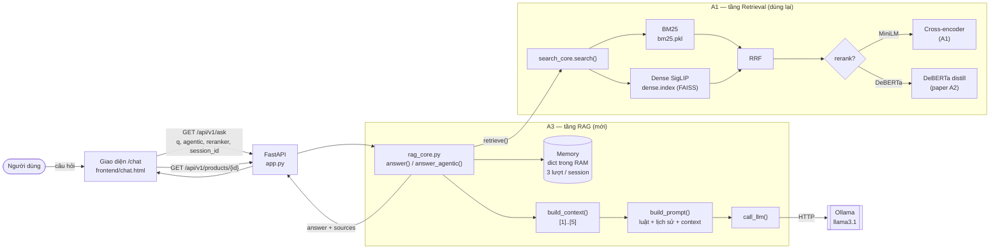
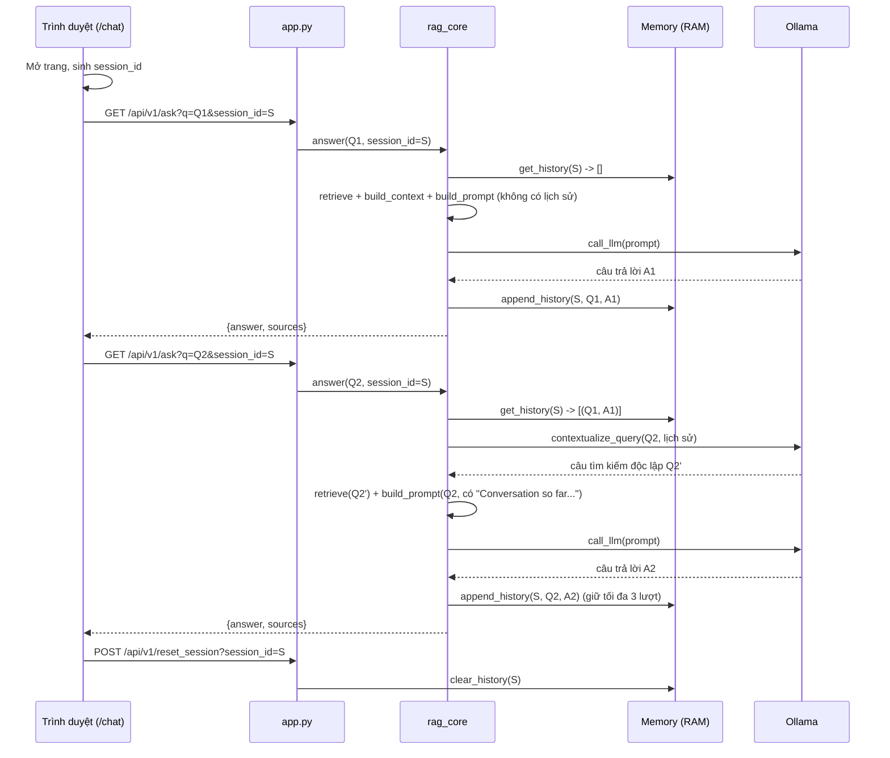
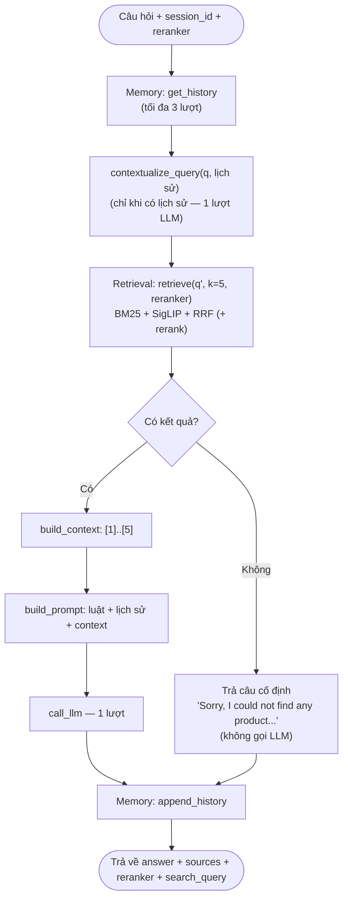
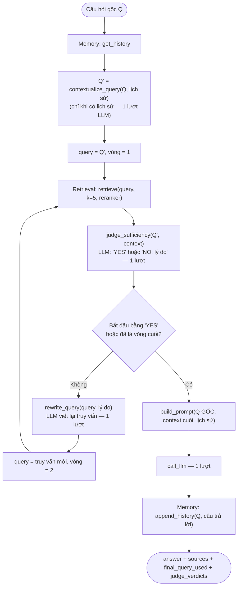

<div align="center">

**ĐẠI HỌC QUỐC GIA THÀNH PHỐ HỒ CHÍ MINH**<br>
**TRƯỜNG ĐẠI HỌC CÔNG NGHỆ THÔNG TIN**

**CỘNG HÒA XÃ HỘI CHỦ NGHĨA VIỆT NAM**<br>
**Độc lập – Tự do – Hạnh phúc**

# BÁO CÁO ĐỒ ÁN CUỐI KỲ — ASSIGNMENT A3
## Chatbot Tư vấn Sản phẩm ứng dụng RAG
### Mở rộng từ Hệ thống Tìm kiếm Ngữ nghĩa A1 — Naive RAG và Agentic RAG

*Môn: Thiết kế Hệ thống Thông tin Thông minh Dựa trên Truy hồi — IS6303*<br>
*Giảng viên phụ trách: Phạm Đỗ Kim Chi*

**Nhóm 12**

| MSSV | Họ và tên |
|---|---|
| 26848240 | Trần Thành Trung |
| 250101013 | Nguyễn Đức Thành Duy |
| 250104050 | Dương Thị Mỹ Phương |
| 250104039 | Nguyễn Tiến Khoa |
| 250104040 | Đặng Yến Linh |

</div>

---

## Mục lục

1. Giới thiệu và phạm vi
2. Kiến thức nền: RAG gồm những gì
3. Dữ liệu
4. Kiến trúc tổng thể
5. Các thành phần và cách hoạt động
   - 5.1 Retrieval
   - 5.2 Rerank
   - 5.3 Augmentation: context và prompt
   - 5.4 Generation: gọi LLM
   - 5.5 Memory
   - 5.6 Luồng Naive RAG
   - 5.7 Luồng Agentic RAG
   - 5.8 API và giao diện
6. Phương pháp đánh giá
7. Kết quả
8. Chẩn đoán lỗi: Retrieval hay Generation
9. Đạo đức AI
10. Hạn chế
11. Kết luận và hướng phát triển
12. Đối chiếu yêu cầu
- Phụ lục A. Cách chạy
- Phụ lục B. Nguyên văn các prompt
- Tài liệu tham khảo

> **Trạng thái số liệu (ngày 13/10/2026):** mọi kết quả ở mục 7 lấy từ lần chạy cuối, ngày 12/10/2026, với code hiện tại (prompt tiếng Anh, ground truth qrels): `step_ablation_rag.py` 250 câu × 6 cấu hình, `step18_ablation_image_rag.py` 100 ảnh × 3 cấu hình, `step19_ablation_multiturn.py` 500 hội thoại. LLM `llama3.1`, Kaggle 2 GPU T4, 0 lỗi.

---

## 1. Giới thiệu và phạm vi

### 1.1 Bài toán

A1 xây hệ tìm kiếm ngữ nghĩa: người dùng nhập câu chữ hoặc ảnh, hệ thống trả về danh sách sản phẩm. A3 nâng cấp A1 thành **trợ lý hội thoại (chatbot)** theo kỹ thuật **Retrieval-Augmented Generation (RAG)**:
- Thay vì chỉ trả danh sách, hệ thống đưa các sản phẩm tìm được vào một **mô hình ngôn ngữ lớn (LLM)**.
- LLM viết **câu trả lời tự nhiên có trích dẫn nguồn** `[n]`.
- Hệ thống nhớ được các lượt hỏi trước trong cùng cuộc trò chuyện (**Memory**).

Ví dụ một lượt hỏi thật (LLM `llama3.1`, cấu hình Naive, lần chạy ngày 12/10/2026):

> **Người dùng:** *something to keep pets from running out of drinking water automatically*
> **Chatbot:** *I think the [1] 1.58 Gallon Automatic Dog Water Bowl Dispenser would be a good option to keep pets from running out of drinking water automatically.*
> **Nguồn [1]** là sản phẩm thật trong catalog, hiển thị kèm ảnh để người dùng đối chiếu.

### 1.2 Quan hệ với A1 và A2

- **A1 → A3:** A3 **không viết lại** phần tìm kiếm.
  - Toàn bộ Retrieval (BM25 + Dense SigLIP + RRF, tuỳ chọn rerank) là hàm `search_core.search()` của A1, gọi qua `rag_core.retrieve()`.
  - Dữ liệu, catalog và chỉ mục cũng là của A1.
  - A3 chỉ thêm các tầng phía trên: Augmentation, Generation, Memory, và giao diện chat.
- **A2 → A3:** paper A2 (Sun et al., EMNLP 2023) đề xuất **permutation distillation** (mục 4 của paper): huấn luyện một model nhỏ bắt chước cách ChatGPT xếp hạng. A3 dùng checkpoint do tác giả công bố (`deberta-10k-rank_net`) làm **lựa chọn reranker thứ hai**, bên cạnh cross-encoder MiniLM của A1.
- **Phần A3 không dùng từ paper A2:** dùng LLM trực tiếp để xếp hạng (RankGPT, RQ1 của paper). LLM trong A3 chỉ dùng để sinh câu trả lời và tự đánh giá.

### 1.3 Đóng góp chính

1. **Hai luồng RAG** dùng chung tầng Retrieval và Memory, khác nhau ở cách tầng Generation ra quyết định:
   - **Naive RAG** (baseline): tìm một lần, trả lời một lần.
   - **Agentic RAG** (nâng cấp): LLM tự đánh giá kết quả tìm kiếm, có thể viết lại câu truy vấn và tìm lại.
2. **Memory theo phiên hội thoại**, dùng ở cả tầng Retrieval (viết lại câu hỏi nối tiếp thành câu tìm kiếm độc lập) và tầng Generation, giúp hiểu câu hỏi nối tiếp (ví dụ "any other color?"). Có ablation riêng trên 500 hội thoại (mục 7.5).
3. **Ba lựa chọn rerank** trước khi đưa sản phẩm cho LLM: không rerank / cross-encoder MiniLM (A1) / DeBERTa distill (A2).
4. **Grounding:** context đánh số, prompt ràng buộc, trả kèm nguồn thật, và giao diện cho bấm vào sản phẩm được trích dẫn để xem chi tiết.
5. **Bộ đánh giá RAG tự viết, 8 metric:** đo riêng tầng Retrieval và tầng Generation, kèm script ablation lưu chi tiết từng câu.
6. **Hỏi bằng ảnh (cải tiến so với A1 và bản A3 đầu tiên):** chatbot nhận ảnh sản phẩm, có thể kèm câu chữ. Ảnh được tìm bằng nhánh SigLIP của A1, rồi LLM trả lời trên các sản phẩm tìm được (mục 5.1.1).
7. **Ground truth qrels đa mức (cải tiến so với A1):** A1 chỉ ghi 1 sản phẩm đúng cho mỗi câu, nhãn nhị phân. A3 gán nhãn 0–3 cho mọi sản phẩm trong pool ứng viên (5.064 cặp câu hỏi–sản phẩm), theo đúng cách xây qrels kiểu TREC (mục 3.2.1).

### 1.4 Yêu cầu của đề bài

Theo bản ghi yêu cầu của nhóm, đồ án cuối kỳ chiếm 50% điểm môn:

| Tiêu chí | Điểm | Nội dung |
|---|---|---|
| Đề tài baseline | 5đ | Hệ RAG cơ bản |
| Hệ thống hoàn chỉnh | 2.5đ | Front-end, back-end, dữ liệu phù hợp |
| Nâng cấp engineering/research | 2.5đ | Cải tiến so với baseline, chứng minh bằng ablation |

Các yêu cầu khác được ghi lại:
- Nâng cấp hệ search A1 bằng LLM; có dạng chatbot.
- Đánh giá bằng đủ metric RAG.
- Ground truth tối thiểu 50 câu mỗi người, dùng chung với A1.
- Chẩn đoán được lỗi nằm ở tầng Retrieval hay Generation.
- Có đánh giá đạo đức AI.

---

## 2. Kiến thức nền: RAG gồm những gì

**RAG** (Lewis et al., 2020) giải quyết hai điểm yếu của LLM khi dùng một mình:
- LLM không biết dữ liệu riêng của doanh nghiệp, ở đây là 2.000 sản phẩm trong catalog.
- LLM có thể "bịa" thông tin nghe hợp lý (hallucination).

Cách làm là **tìm tài liệu liên quan trước, rồi buộc LLM trả lời dựa trên tài liệu đó**. Một hệ RAG có 3 tầng:

| Tầng | Câu hỏi nó trả lời | Trong đồ án |
|---|---|---|
| **Retrieval** (truy hồi) | Tài liệu nào liên quan tới câu hỏi? | `search()` của A1 lấy 5 sản phẩm, tuỳ chọn rerank |
| **Augmentation** (bổ sung ngữ cảnh) | Đưa tài liệu cho LLM theo cách nào? | `build_context()` đánh số `[1]..[5]`; `build_prompt()` thêm luật và lịch sử hội thoại |
| **Generation** (sinh) | LLM trả lời gì? | `call_llm()` gọi `llama3.1` qua Ollama |

Hai biến thể được xây:
- **Naive RAG:** đi thẳng một chiều Retrieval → Augmentation → Generation, đúng một lần.
- **Agentic RAG:** LLM đóng thêm vai **người ra quyết định**, nghĩa là xem kết quả tìm kiếm có đủ chưa; nếu chưa thì tự viết lại truy vấn và tìm lại. Đây là dạng đơn giản của ý tưởng "LLM tự đánh giá và sửa bước truy hồi" (gần với Self-RAG, Asai et al., 2024; Corrective RAG, Yan et al., 2024). Đồ án chỉ cài **phiên bản tối giản** của ý tưởng này, không cài lại các phương pháp đó.

Hệ quả quan trọng khi đánh giá: **Retrieval và Generation có thể sai độc lập.**
- Tìm đúng sản phẩm nhưng LLM vẫn trả lời sai hoặc bịa.
- Tìm sai thì LLM trả lời tốt đến đâu cũng không đúng.

Vì vậy cần **metric riêng cho từng tầng** (mục 6) và **khung chẩn đoán theo tầng** (mục 8).

---

## 3. Dữ liệu

### 3.1 Catalog sản phẩm (dùng lại của A1)

- **Nguồn:** `Shopify/product-catalogue` (Hugging Face, apache-2.0). A1 lấy 2.000 sản phẩm từ split train, xáo trộn với seed 42.
- **Mỗi sản phẩm có:** `id`, ảnh, `caption` (tên sản phẩm), `search_text` (tên + mô tả), `category`, `brand`.
- **Chỉ mục:** BM25 trên `search_text`; FAISS trên embedding ảnh **SigLIP** (768 chiều). Chi tiết ở báo cáo A1.

### 3.2 Bộ câu hỏi đánh giá: `data/eval_set.jsonl` (250 câu, dùng chung với A1)

| Nhóm | Số câu | Cách tạo |
|---|---|---|
| A1 viết tay | 30 | Trộn câu có từ khoá chính xác, câu diễn đạt lại, câu mơ hồ |
| A3 viết tay | 20 | Ban đầu viết tiếng Việt, viết lại bằng tiếng Anh cho khớp catalog |
| Sinh từ mẫu | 200 | 10 mẫu câu, điền 8 từ đầu của tên sản phẩm và brand của sản phẩm chọn ngẫu nhiên |

Mỗi dòng có:
- `qrels`: nhãn liên quan 0–3 cho từng sản phẩm trong pool ứng viên của câu đó (mục 3.2.1). **A3 thêm vào.**
- `relevant_ids`: các sản phẩm có nhãn ≥ 2. Đây là tập *G* mà Context Recall/Precision dùng.
- `target_ids`: sản phẩm đúng gốc của A1 (known item), luôn mang nhãn 3.
- `answer_should_mention`: brand và 3 từ đầu của tên sản phẩm. Trường này **A3 thêm vào** để kiểm tra câu trả lời có thực sự nhắc đúng sản phẩm không.

Ví dụ (rút gọn `qrels`):
```json
{"query": "tool lanyard with a carabiner for working at height",
 "target_ids": [827], "relevant_ids": [379, 827],
 "qrels": {"379": 3, "827": 3, "271": 1, "757": 1, "851": 1, "1183": 1, "...": 0},
 "answer_should_mention": ["Ergodyne", "Lanyard"]}
```

**Hạn chế:** 200 câu sinh từ mẫu chứa nguyên văn một phần tên sản phẩm, nên dễ hơn câu thực tế. Mục 7 báo cáo trên toàn bộ 250 câu; script vẫn lưu riêng kết quả của 50 câu viết tay trong `data/rag_ablation_results.json`.

#### 3.2.1 Cải tiến so với A1: ground truth dạng qrels đa mức

**Vấn đề của ground truth A1.** Mỗi câu chỉ có đúng 1 sản phẩm đúng, nhãn nhị phân (known-item search). Hệ quả:
- Recall@k chỉ còn là tỷ lệ "trúng hoặc trượt", và nDCG nhị phân gần như mang cùng thông tin với MRR.
- Nếu catalog có một sản phẩm khác cũng thoả mãn câu hỏi, hệ thống trả về sản phẩm đó vẫn bị tính là sai.
- nDCG "đa mức" của A1 không dùng nhãn thật. Nó **đoán mức 1 theo category** (cùng category với sản phẩm đúng thì được 1), trong khi hai sản phẩm cùng category chưa chắc liên quan tới câu hỏi.

**Cách làm ở A3** (`step16_build_qrels.py`), theo quy trình xây qrels của TREC:
1. **Pooling:** với mỗi câu, gộp top-10 của BM25, Dense (SigLIP) và Hybrid (RRF), cộng thêm sản phẩm đúng gốc. Trung bình 20,3 ứng viên/câu, tổng 5.064 cặp câu hỏi–sản phẩm (`data/qrels_pool.jsonl`).
2. **Gán nhãn 0–3** cho từng cặp, **chỉ dựa trên tên, brand, category và mô tả của sản phẩm trong catalog**:

| Nhãn | Ý nghĩa | Quy tắc |
|---|---|---|
| 3 | Đúng hoàn toàn | Đúng loại sản phẩm và thoả mọi ràng buộc trong câu (brand, model, kích thước, tính năng, tương thích) |
| 2 | Liên quan tốt | Đúng loại sản phẩm, lệch nhẹ hoặc không kiểm chứng được một ràng buộc phụ |
| 1 | Một phần | Phụ kiện, linh kiện, cùng nhóm sản phẩm, hoặc chỉ khớp một khía cạnh |
| 0 | Không liên quan | — |

   Hai quy tắc chặn trần: khác loại sản phẩm thì tối đa 1; vi phạm ràng buộc cứng (sai model, sai brand khi câu có nêu brand) thì tối đa 1.
   Nhãn được LLM chấm theo từng lô 25 câu (`data/qrels_judgments/`), sau đó **rà soát thủ công** mọi nhãn 2–3 không phải sản phẩm đúng gốc. Có 6 nhãn 2 vi phạm quy tắc chặn trần bị hạ xuống 1, ví dụ "power rack" cho câu hỏi "smith machine", hay guiro LP306A cho câu hỏi nêu model LP305.
3. **Đối chiếu sản phẩm đúng gốc với toàn văn catalog.** Có 3 câu mà truy vấn mâu thuẫn với chính sản phẩm đúng. Nhóm **sửa truy vấn cho khớp dữ liệu** thay vì ép nhãn 3 cho một sản phẩm không khớp, rồi chạy lại pooling và chấm lại 3 câu này:

| Truy vấn cũ | Dữ liệu thật của sản phẩm đúng | Truy vấn mới |
|---|---|---|
| cornhole board set with eagle flag design | id 192 là bộ decal dán bảng (*Boards Wraps*) | cornhole board wraps with eagle flag design |
| fast fold portable projection screen | id 1758 là tấm màn thay thế (*Replacement Surface*) | replacement screen surface for a fast fold projection screen |
| slide stopper accessory for a trombone | mô tả id 1397: "*trumpet* slide stopper" | slide stopper accessory for a trumpet |

4. Sản phẩm ngoài pool được coi là nhãn 0 (giả định chuẩn của pooling). Sản phẩm đúng gốc luôn giữ nhãn 3.

**Kết quả:**

| Tập câu | Số cặp đã chấm | Nhãn 3 | Nhãn 2 | Nhãn 1 | Nhãn 0 | Câu có > 1 sản phẩm liên quan (≥ 2) | Câu có sản phẩm nhãn 1 |
|---|---|---|---|---|---|---|---|
| 250 câu | 5.064 | 252 | 10 | 397 | 4.405 | 10 | 179 |
| 50 viết tay | 1.017 | 52 | 6 | 114 | 845 | 6 | 42 |
| 200 sinh từ mẫu | 4.047 | 200 | 4 | 283 | 3.560 | 4 | 137 |

- **Phần lớn câu vẫn chỉ có 1 sản phẩm thực sự đúng.** Catalog gồm 2.000 sản phẩm trải trên rất nhiều ngành hàng, nên hiếm khi có hai sản phẩm cùng thoả một câu hỏi. Đây là đặc điểm của dữ liệu, không phải do chấm thiếu.
- **Câu viết tay hưởng lợi nhiều hơn** (6/50 câu có thêm sản phẩm liên quan, so với 4/200). Câu viết tay diễn đạt theo nhu cầu, ví dụ "device that helps someone relearn to walk after an injury" có 4 sản phẩm liên quan, nên nhiều sản phẩm có thể thoả. Câu sinh từ mẫu chép tên sản phẩm, nên chỉ khớp đúng một sản phẩm.
- **Nhãn 1 xuất hiện ở 179/250 câu.** Nhờ vậy nDCG đa mức phân biệt được giữa đưa vào context một phụ kiện liên quan và đưa vào một sản phẩm hoàn toàn lạc đề, điều mà nhãn nhị phân của A1 không làm được.

**So sánh ground truth A1 và A3:**

| | A1 | A3 |
|---|---|---|
| Số sản phẩm có nhãn / câu | 1 | 20,3 (pool) |
| Thang nhãn | Nhị phân | 0–3 |
| nDCG đa mức | Đoán từ category | Dùng nhãn đã gán |
| Số câu có nhiều sản phẩm đúng | 0 | 10 |
| Kiểm tra sản phẩm đúng với dữ liệu | Không | Có (sửa 3 câu) |
| Code đo Recall/MRR | `metrics.py` | Giữ nguyên; chỉ `ndcg_at_k_graded` đọc thêm `qrels` |

### 3.3 Giới hạn thông tin trong context

Mỗi sản phẩm đưa vào prompt **chỉ có tên sản phẩm và điểm RRF**. Không có mô tả, category, brand riêng, và catalog cũng **không có trường giá**. Hệ quả:
- Câu hỏi về giá hoặc thuộc tính không nằm trong tên sản phẩm thì LLM phải trả lời là không có thông tin (theo luật trong prompt).
- **Metric Mention hit có mức trần dưới 1.** Brand thường không nằm trong tên sản phẩm, nên LLM không thể nhắc đúng brand. Mức trần tính từ dữ liệu, tức tỷ lệ từ khoá `answer_should_mention` có trong tên sản phẩm đúng:

| Tập câu | Mức trần Mention hit |
|---|---|
| 250 câu | 0.708 |
| 50 câu viết tay | 0.760 |
| 200 câu sinh từ mẫu | 0.695 |

---

## 4. Kiến trúc tổng thể

### 4.1 Sơ đồ thành phần



### 4.2 Các file

| Thành phần | File | Vai trò |
|---|---|---|
| Giao diện chatbot | `frontend/chat.html`, `frontend/style.css` (trang `/chat`) | Khung chat, công tắc rerank và Agentic, danh sách nguồn, chi tiết sản phẩm |
| API | `app.py` | `/api/v1/ask`, `/api/v1/rerankers`, `/api/v1/products/{id}`, `/api/v1/reset_session` |
| Lõi RAG | `rag_core.py` | `retrieve`, `build_context`, `build_prompt`, `call_llm`, `answer`, `answer_agentic`, Memory |
| Tìm kiếm (A1) | `search_core.py` | `search()`, `rerank()` (MiniLM), `distilled_rerank()` (DeBERTa), `get_product()` |
| Metric RAG | `rag_metrics.py` | Context Precision, Faithfulness, Answer Relevancy |
| Thực nghiệm | `step_ablation_rag.py` | 6 cấu hình × 8 metric, lưu kết quả và chi tiết từng câu |
| Thực nghiệm | `step17_eval_image_rag_retrieval.py`, `step18_ablation_image_rag.py` | Hỏi bằng ảnh: tầng Retrieval; cả hai tầng (chỉ chữ / chỉ ảnh / ảnh + chữ) |
| Thực nghiệm | `step19_ablation_multiturn.py` | Memory khi tìm kiếm: 500 hội thoại hai lượt × 4 cách tìm |
| Cấu hình | `.env` (mẫu: `.env.example`) | `OLLAMA_MODEL`, `OLLAMA_URL` |

---

## 5. Các thành phần và cách hoạt động

### 5.1 Retrieval

`rag_core.retrieve(query, k=5, reranker)` gọi `search_core.search()` của A1:

1. **BM25:** tách câu hỏi thành từ (`lower().split()`), chấm điểm BM25 trên toàn bộ 2.000 sản phẩm, lấy `top_n` sản phẩm điểm cao nhất.
2. **Dense:** SigLIP biến câu hỏi thành vector 768 chiều (đã chuẩn hoá). FAISS tìm `top_n` ảnh sản phẩm có tích vô hướng (cosine) lớn nhất.
   - Ảnh và câu chữ nằm trong cùng không gian vector, nên câu chữ tìm được ảnh.
3. **RRF** (Cormack et al., 2009): gộp hai danh sách theo **thứ hạng**, không theo điểm, vì điểm BM25 và cosine khác thang đo:

   score(d) = Σ_{danh sách} 1 / (k_RRF + hạng của d),  với k_RRF = 60, hạng tính từ 1.

   *Ví dụ:* sản phẩm đứng hạng 1 ở cả hai danh sách được 1/61 + 1/61 = 0,0328. Sản phẩm chỉ có ở một danh sách, hạng 1, được 1/61 = 0,0164.
4. **Cắt kết quả:**
   - Không rerank: lấy 5 sản phẩm đầu (`top_n = 50` mỗi nhánh).
   - Có rerank: lấy **30 ứng viên** đầu sau RRF (`top_n = 30` mỗi nhánh), chuyển sang bước 5.2.

Kết quả là danh sách 5 sản phẩm `{id, image_path, caption, score}`, gọi là **sources**.

#### 5.1.1 Hỏi bằng ảnh: `retrieve(query, k, image=...)`

A1 là hệ tìm kiếm đa phương thức, nhưng bản A3 đầu tiên chỉ nhận câu chữ. Bản hiện tại cho người dùng gửi kèm **một ảnh sản phẩm**, có thể kèm câu chữ hoặc không:

| Đầu vào | Cách tìm | Rerank |
|---|---|---|
| Chỉ chữ | Như mục 5.1, không đổi | Theo lựa chọn |
| Chỉ ảnh | `search(image, query_type="image")` của A1: SigLIP mã hoá ảnh, FAISS tìm ảnh sản phẩm gần nhất (BM25 tự bỏ qua) | Không |
| Ảnh + chữ | Lấy 50 ứng viên từ tìm theo ảnh và 50 ứng viên từ tìm theo chữ (BM25 + Dense), gộp bằng **RRF** như A1 | Không |

- **LLM vẫn chỉ đọc chữ.** `llama3.1` không xem được ảnh, nên ảnh chỉ dùng ở tầng Retrieval. Prompt thêm một dòng báo rằng người dùng có gửi ảnh và danh sách sản phẩm được tìm theo độ giống với ảnh, để LLM không đòi mô tả thêm. Nếu người dùng không gõ chữ, câu hỏi đưa vào prompt là "Find products similar to the photo I sent". Grounding (mục 4 và 5.3) giữ nguyên.
- **Không rerank khi có ảnh.** Reranker chấm cặp (câu chữ, tên sản phẩm), nên bỏ mất tín hiệu từ ảnh. Thử 3 ảnh trong `eval_set_image.jsonl`, mỗi ảnh kèm một câu ngắn: bật cross-encoder đều đẩy sản phẩm đúng xuống. Ví dụ ảnh vỏ máy tính bảng xoay nghiêng kèm câu "red case": sản phẩm đúng từ hạng 1 tụt xuống hạng 3, vì cross-encoder chỉ thấy chữ "red case". A1 cũng không rerank truy vấn ảnh vì cùng lý do.
- **Agentic** dùng ảnh ở mọi lượt tìm. Từ lượt thứ hai, ảnh được gộp với câu truy vấn đã viết lại.
- **Memory** ghi lượt có ảnh dưới dạng `[image] <câu hỏi>`, để lượt sau biết khách đã gửi ảnh.
- **Đường đi của câu hỏi chữ không đổi** khi thêm ảnh: kết quả tìm và rerank được kiểm tra trùng khớp với bản trước khi thêm ảnh.

### 5.2 Rerank (tuỳ chọn, mặc định tắt)

Cả hai reranker đều là **cross-encoder chấm từng cặp**: model đọc **đồng thời** câu hỏi và tên sản phẩm, cho ra **một điểm liên quan**. 30 ứng viên được sắp lại theo điểm này, rồi giữ 5 sản phẩm đầu.

| | Cross-encoder MiniLM (A1) | DeBERTa distill (A2) |
|---|---|---|
| Model | `cross-encoder/ms-marco-MiniLM-L-6-v2` (Nogueira & Cho, 2019, bản distill nhỏ) | `deberta-10k-rank_net`, DeBERTa-v3-base, ~184M tham số |
| Học từ | Nhãn liên quan do **người** gán trên MS MARCO | **Thứ tự do ChatGPT xếp** cho 10K câu hỏi MS MARCO, loss RankNet (Sun et al., 2023, mục 4 và Appendix D.1) |
| Nguồn | Hugging Face | Repo github.com/sunnweiwei/RankGPT, mục "Download data and model" |
| Thời gian thêm (CPU, 30 ứng viên) | ~0,3 s mỗi câu | ~2,5 s mỗi câu |

**Vì sao cần rerank:** BM25 + Dense + RRF tìm nhanh nhưng xếp hạng chưa kỹ. Cross-encoder chính xác hơn vì đọc câu hỏi và sản phẩm cùng lúc, nhưng chậm vì phải chạy model cho từng cặp. Nên chỉ dùng cho vài chục ứng viên đã được lọc sẵn.

Reranker **không gọi LLM** và áp dụng **như nhau** cho cả Naive lẫn Agentic.

### 5.3 Augmentation: context và prompt

**`build_context(sources)`** viết mỗi sản phẩm một dòng, đánh số để LLM trích dẫn:
```
[1] 1.58 Gallon Automatic Dog Water Bowl Dispenser, Large Capacity Water Feeder ... (score=0.0325)
[2] ...
[5] ...
```

**`build_prompt(query, context, history)`** ghép 4 phần:

| Phần | Nội dung | Mục đích |
|---|---|---|
| Luật grounding | "Use ONLY the information in the product list below. Do NOT invent details (price, features, colors...)... If no product in the list fits the request, say clearly that you could not find one instead of guessing." | Giảm bịa thông tin |
| Lịch sử hội thoại | Tối đa 3 lượt gần nhất (mục 5.5); trống nếu không có | Hiểu câu hỏi nối tiếp |
| Context | Danh sách `[1]..[5]` ở trên | Nguồn thông tin duy nhất được phép dùng |
| Yêu cầu trả lời | "Reply briefly in English. CITE the list number in square brackets (e.g. [1])... never repeat their message back or ask them a question." | Định dạng câu trả lời, buộc trích dẫn, không hỏi ngược khách |

**Ngôn ngữ prompt:** mọi prompt gửi LLM viết bằng tiếng Anh, và chatbot trả lời bằng tiếng Anh, cùng ngôn ngữ với câu hỏi và phần lớn catalog. Bản đầu tiên dùng prompt tiếng Việt; khi thử giao diện, LLM dịch câu tìm kiếm sang tiếng Việt nên BM25 không khớp catalog, và chép lại câu ví dụ trong prompt thành câu trả lời, tức là hỏi ngược lại người dùng.

Nguyên văn prompt ở Phụ lục B.

### 5.4 Generation: gọi LLM

`call_llm(prompt)` gửi `POST` tới Ollama (`/api/generate`, `stream=false`) và nhận về câu trả lời dạng text.

| Thiết lập | Giá trị | Ghi chú |
|---|---|---|
| Model | `OLLAMA_MODEL` trong `.env`, mặc định `llama3.1` (8B, lượng tử hoá Q4_K_M) | Chạy local, không cần API key, dữ liệu không ra khỏi máy |
| Địa chỉ | `OLLAMA_URL`, mặc định `http://localhost:11434/api/generate` | |
| Timeout | 600 s | Model 8B trên CPU có thể chậm |
| Thử lại | Tối đa 3 lần (chờ 5 s, 10 s) khi mất kết nối, timeout, lỗi 5xx | Lỗi 4xx (ví dụ sai tên model) báo ngay, không thử lại |
| Lỗi trả cho giao diện | HTTP 503, kèm lý do Ollama trả về | Ví dụ: *"Ollama trả 404: model 'llama3.1' not found"* |

**Chọn model:** chạy thử 3 câu đầu của eval set trước khi chạy đủ. Với cùng prompt, `qwen2.5:3b` (3B) chỉ trả về chuỗi `"[1]"`, còn `llama3.1` (8B) trả lời thành câu đầy đủ. Hệ thống vì vậy dùng `llama3.1`.

### 5.5 Memory

**Mục đích:** cho chatbot hiểu câu hỏi nối tiếp, ví dụ người dùng hỏi "black leather jacket", rồi hỏi tiếp "any other color?".

**Cấu trúc dữ liệu** (`rag_core._SESSION_STORE`): một dict trong RAM của server.
```python
{
  "session-p57iqj4jb4s": [
      {"query": "black leather jacket", "answer": "We have a few options available: [1] Michael Kors ...",
       "products": ["Michael Kors Men's Perforated Faux-Leather Moto Jacket XL Black", "...", "..."]},
      {"query": "...", "answer": "...", "products": [...]}
  ],
  "session-xyz...": [...]
}
```

**Vòng đời một phiên:**
1. Mở trang `/chat`: trình duyệt sinh `session_id` ngẫu nhiên và gửi kèm **mọi** câu hỏi.
2. **Đọc** (`get_history`): mỗi câu hỏi lấy danh sách lượt cũ của phiên.
3. **Viết lại câu hỏi theo ngữ cảnh** (`contextualize_query`): nếu phiên đã có lịch sử, LLM gộp câu hỏi mới với lịch sử thành **một câu tìm kiếm độc lập, dạng từ khoá tiếng Anh**, trước khi tìm kiếm. Lượt đầu (chưa có lịch sử) bỏ qua bước này, không tốn thêm lượt gọi LLM. Câu đã viết lại được trả về trong trường `search_query`.
   - Prompt có 3 ví dụ mẫu và các luật: lấy loại sản phẩm từ "Suggested products" của lượt gần nhất; hỏi màu/cỡ/hãng khác thì **bỏ giá trị cũ, giữ loại sản phẩm**; chủ đề khác hẳn thì bỏ qua lịch sử; giữ nguyên tên hãng và tên sản phẩm.
   - Ví dụ thật (`llama3.1`, ngày 12/10/2026): "black leather jacket" rồi "is any other color?" → tìm bằng *"leather jacket"*; 4/5 nguồn là áo khoác, và chatbot trả lời *"Unfortunately, I could not find any other color options for the black leather jacket."*
   - **Chốt chặn:** nếu câu viết lại có chữ tiếng Việt trong khi câu hỏi và tên sản phẩm trong lịch sử đều không có, dùng lại câu gốc.
   - Hiệu quả đo ở mục 7.5.
4. **Chèn vào prompt trả lời** (`_format_history`): mỗi lượt thành một dòng, câu trả lời cũ **cắt còn 150 ký tự**, kèm tên **3 sản phẩm đầu** đã gợi ý (để hiểu "cái đó", "cái thứ hai"):
   ```
   Conversation so far (to understand the current message):
   - Customer: "black leather jacket" -> Assistant: "We have a few options available: [1] Michael Kors Men's Perforated Faux-Leather Moto Jacket XL Black...."
     Suggested products: Michael Kors Men's Perforated Faux-Leather Moto Jacket XL Black; ...
   ```
   Câu hỏi trong prompt trả lời vẫn là **câu gốc** của người dùng; câu viết lại chỉ dùng để tìm kiếm.
5. **Ghi** (`append_history`): sau khi có câu trả lời, thêm lượt mới (câu hỏi, câu trả lời, sản phẩm đầu) vào cuối. Nếu quá **3 lượt**, xoá lượt cũ nhất (cửa sổ trượt).
6. **Xoá:** nút "Mới" gọi `POST /api/v1/reset_session`, xoá lịch sử và đổi sang `session_id` mới.



**Giới hạn của cách cài đặt này** (nêu rõ, không giấu):
- **Viết lại câu hỏi tốn thêm 1 lượt gọi LLM** cho mỗi câu nối tiếp (từ lượt 2 trở đi), và phụ thuộc chất lượng LLM: viết lại sai thì tìm kiếm sai.
- **Ảnh không được nhớ khi tìm kiếm.** Lịch sử chỉ ghi `[image] <câu hỏi>`, không giữ ảnh. Nếu lượt trước gửi ảnh và lượt sau hỏi "is it available in red?", câu viết lại chỉ dựa vào tên sản phẩm đã gợi ý.
- **Viết lại câu hỏi làm mất tên sản phẩm không phải tiếng Anh.** Luật "viết bằng tiếng Anh" khiến LLM dịch caption tiếng Romania, Hà Lan, Na Uy... thành tên loại sản phẩm tiếng Anh, nên BM25 không khớp được (mục 7.5).
- **Các bộ câu hỏi ở mục 7.2–7.4 là câu đơn** (không `session_id`), nên không đi qua bước viết lại. Bước này được đo riêng ở mục 7.5.
- **LLM có thể kéo lịch sử vào sai chỗ.** Khi người dùng đổi chủ đề, câu viết lại kém câu nguyên văn ở 12/250 hội thoại (mục 7.5).
- **Lưu trong RAM:** mất khi khởi động lại server; không dùng chung được nếu chạy nhiều server. Production cần Redis hoặc cơ sở dữ liệu.
- **Cửa sổ ngắn:** chỉ 3 lượt, mỗi câu trả lời cũ 150 ký tự. Đủ cho câu nối tiếp gần, không đủ cho hội thoại dài.

### 5.6 Luồng Naive RAG (baseline): `answer()`



Đặc điểm: **tuyến tính**, tìm kiếm đúng một lần, gọi LLM tối đa một lần để trả lời (cộng 1 lượt viết lại nếu là câu nối tiếp). Naive RAG không bao giờ tìm lại, dù kết quả tìm kiếm tốt hay xấu.

### 5.7 Luồng Agentic RAG (nâng cấp): `answer_agentic(max_iters=2)`



Các quy tắc:
- **Đánh giá luôn so với câu hỏi gốc** (đã gộp ngữ cảnh hội thoại thành Q' nếu là câu nối tiếp), không so với truy vấn do `rewrite_query` viết lại, để không "trôi" khỏi ý người dùng.
- **Câu trả lời cuối dùng câu hỏi gốc,** nhưng dùng context của lần tìm kiếm cuối.
- **`max_iters = 2`** là giới hạn cứng để không lặp vô hạn.
- **Truy vấn viết lại được làm sạch:** bỏ ngoặc kép ở hai đầu, vì BM25 tách từ theo khoảng trắng nên `"wheelbarrow` không khớp `wheelbarrow`.
- **Trả thêm `final_query_used`** (giao diện hiện nếu khác câu hỏi gốc) và **`judge_verdicts`** (các phán đoán của LLM, dùng khi phân tích lỗi).

**Số lượt gọi LLM mỗi câu hỏi:**

| Tình huống | Naive | Agentic |
|---|---|---|
| Kết quả tìm kiếm rỗng | 0 | 2 (Agentic chưa có kiểm tra này) |
| LLM đánh giá "đủ" ngay vòng 1 | 1 | 2 |
| LLM đánh giá "chưa đủ" | — | 4 (đánh giá, viết lại, đánh giá, trả lời) |
| Câu nối tiếp (có lịch sử) | +1 | +1 (`contextualize_query`) |

**So sánh hai luồng:**

| Khía cạnh | Naive RAG | Agentic RAG |
|---|---|---|
| Số lần tìm kiếm | 1 | 1–2 |
| Tự đánh giá kết quả | Không | Có (`judge_sufficiency`) |
| Tự viết lại truy vấn | Không | Có (`rewrite_query`), khi chưa đủ |
| Lượt gọi LLM | 1 (+1 nếu câu nối tiếp) | 2–4 (+1 nếu câu nối tiếp) |
| Memory, Grounding, Reranker | Dùng chung | Dùng chung |

### 5.8 API và giao diện

**API:**

| Endpoint | Tham số | Trả về |
|---|---|---|
| `GET /api/v1/ask` | `q`, `k=5`, `agentic=false`, `reranker=none\|cross_encoder\|deberta`, `session_id` | `{answer, sources, reranker, search_query}`, Agentic thêm `final_query_used`, `judge_verdicts`. 400 nếu reranker không hợp lệ; 503 nếu không gọi được Ollama |
| `POST /api/v1/ask_image` | multipart: `file` (ảnh), `q` (có thể rỗng), `k=5`, `agentic`, `reranker`, `session_id` | Như `/ask`, thêm `query_mode` = `image` hoặc `image+text`; `reranker` luôn là `null` (mục 5.1.1). 400 nếu file không phải ảnh |
| `GET /api/v1/rerankers` | — | Reranker dùng được (`deberta` chỉ có khi đã tải checkpoint) |
| `GET /api/v1/products/{id}` | — | Tên, brand, category, mô tả (tối đa 2.000 ký tự) của một sản phẩm trong catalog |
| `POST /api/v1/reset_session` | `session_id` | Xoá Memory của phiên |
| `GET /chat` | — | Trang chatbot (A1 có trang riêng `/search`) |

**Giao diện `/chat`:**
- **Công tắc "Rerank trước khi đưa vào context":** chỉ khi bật mới chọn được MiniLM hoặc DeBERTa.
- **Công tắc "Agentic".**
- **Nút "Ảnh"** đính kèm một ảnh sản phẩm cho lượt hỏi tiếp theo, có ô xem trước và nút bỏ ảnh. Ảnh hiện trong bong bóng chat của người dùng; badge "Truy vấn: ảnh / ảnh + chữ" hiện ở cột nguồn.
- **Khung chat nhiều lượt.** Dưới mỗi câu trả lời có **thẻ sản phẩm** cho từng nguồn được LLM trích dẫn `[n]`.
- **Cột phải:** danh sách 5 nguồn đã đưa vào context (ảnh, `[n]`, điểm RRF và điểm rerank), và **khung chi tiết sản phẩm** hiện khi bấm vào một thẻ hoặc một nguồn.

```mermaid
sequenceDiagram
    participant U as Người dùng
    participant B as chat.html
    participant A as app.py
    participant R as rag_core / search_core
    participant L as Ollama

    U->>B: Nhập câu hỏi, chọn rerank / Agentic
    B->>A: GET /api/v1/ask
    A->>R: answer() hoặc answer_agentic()
    R->>R: retrieve() — A1 search (+ rerank)
    R->>L: call_llm()
    L-->>R: câu trả lời có [n]
    R-->>A: answer + sources
    A-->>B: JSON
    B->>B: Hiện câu trả lời; tách các [n] → thẻ sản phẩm; hiện 5 nguồn
    U->>B: Bấm thẻ [1]
    B->>A: GET /api/v1/products/{id}
    A->>R: get_product(id) — catalog A1
    A-->>B: tên, brand, category, mô tả
    B->>B: Hiện chi tiết sản phẩm ở cột phải
```

---

## 6. Phương pháp đánh giá

### 6.1 Quy trình

Script `step_ablation_rag.py` chạy từng cấu hình trên các câu của `data/eval_set.jsonl`:
1. Với mỗi câu, gọi `answer()` hoặc `answer_agentic()` với `k = 5`, đo thời gian.
2. Từ kết quả, tính 8 metric ở mục 6.2. Faithfulness gọi thêm 1 lượt LLM.
3. Ghi **ngay** chi tiết câu đó vào `data/rag_ablation_details.jsonl`: câu hỏi, câu trả lời, id nguồn, từng metric, truy vấn đã viết lại, phán đoán của LLM.
   - Nếu một câu vẫn lỗi sau 3 lần thử lại, câu đó được ghi kèm lỗi và đếm vào cột "Lỗi", không bị loại âm thầm.
   - Bị ngắt giữa chừng thì chạy lại với `--resume`. Khi resume, script bỏ các kết quả đã chấm theo ground truth khác bản hiện tại (câu hỏi hoặc `relevant_ids` đã đổi, hoặc thiếu Context nDCG), để không trộn số liệu cũ và mới.
4. Lấy trung bình theo cấu hình, cho **toàn bộ** và **50 câu viết tay**, rồi lưu vào `data/rag_ablation_results.json`.

### 6.2 Metric và cách tính

Ký hiệu: với mỗi câu hỏi, *G* là tập id sản phẩm có nhãn ≥ 2 trong qrels (|G| = 1 ở 240/250 câu, tối đa 4; mục 3.2.1), *rel(d)* là nhãn 0–3 của sản phẩm *d*, *S = (s₁, ..., s₅)* là 5 nguồn đưa vào context theo thứ tự, *A* là câu trả lời của LLM. Mỗi metric tính cho từng câu, rồi **lấy trung bình** trên các câu (câu có giá trị `None` bị bỏ qua).

| Tầng | Metric | Công thức | Ý nghĩa |
|---|---|---|---|
| Retrieval | Context Recall@5 | \|S ∩ G\| / \|G\| | Sản phẩm đúng có được đưa cho LLM không |
| Retrieval | Context Precision@5 | (1/min(\|G\|, 5)) · Σ_{i: sᵢ∈G} (số id đúng trong i nguồn đầu) / i | Sản phẩm đúng có đứng cao không |
| Retrieval | Context nDCG@5 đa mức (**mới**) | DCG/IDCG, DCG = Σᵢ rel(sᵢ) / log₂(i+1); IDCG = DCG của các nhãn trong qrels xếp giảm dần | Context có xếp đúng thứ tự mức độ liên quan không |
| Generation | Faithfulness | (số claim SUPPORTED) / (tổng số claim) | Câu trả lời có bịa ngoài context không |
| Generation | Answer Relevancy | cos(e(câu hỏi), e(A)) | Câu trả lời có đúng chủ đề câu hỏi không |
| Generation | Mention hit | (số từ khoá trong `answer_should_mention` xuất hiện trong A) / (số từ khoá) | Câu trả lời có nhắc đúng sản phẩm không |
| Generation | Citation rate | 1 nếu A có ít nhất một `[n]`, ngược lại 0 | Có tuân thủ yêu cầu trích dẫn không |
| Hệ thống | Latency | Thời gian gọi `answer()` / `answer_agentic()` (giây) | Đánh đổi tốc độ |
| Agentic | Rewrite rate | Tỷ lệ câu có `final_query_used` ≠ câu hỏi gốc | Agentic phải tìm lại bao nhiêu lần |

Giải thích và ví dụ cho từng metric:

**Context Recall@5** (`metrics.recall_at_k`, dùng lại của A1). Ở 240/250 câu |G| = 1, nên giá trị là 1 nếu sản phẩm đúng nằm trong 5 nguồn, 0 nếu không. Ở 10 câu có nhiều sản phẩm liên quan, giá trị là tỷ lệ các sản phẩm đó có mặt trong 5 nguồn. Trung bình trên các câu xấp xỉ **tỷ lệ câu mà LLM có được sản phẩm đúng để trả lời**.

**Context Precision@5** (`rag_metrics.context_precision_at_k`). Đây là Average Precision giới hạn trong top-5. Với |G| = 1, giá trị bằng **1/hạng** của sản phẩm đúng, hoặc 0 nếu nó không có trong top-5.

**Context nDCG@5 đa mức** (`metrics.ndcg_at_k_graded`, đọc trường `qrels`; mới so với A1). Recall và Precision chỉ phân biệt "đúng" và "sai", còn metric này cho điểm theo nhãn 0–3 của từng nguồn.
- *Ví dụ:* câu "tool lanyard with a carabiner" có hai sản phẩm nhãn 3 (379, 827) và vài sản phẩm nhãn 1. Context `[827, 379, ...]` đạt 1,0. Context `[827, 271 (nhãn 1), ...]` có Recall = 0,5 và bị nDCG trừ điểm ít hơn so với context `[827, sản phẩm nhãn 0, ...]`.
- Với A3, metric này đo đúng điều LLM cần: các nguồn đứng đầu càng liên quan thì câu trả lời càng ít bị kéo lạc.
- Ở A1, nDCG "đa mức" đoán mức 1 theo category. Bản mới dùng nhãn đã gán; câu nào không có `qrels` (tập truy vấn ảnh) vẫn quay về cách cũ.
- *Ví dụ:* sản phẩm đúng ở `[3]` thì precision tại hạng 3 là 1/3, nên Context Precision@5 = 0,333. Nếu ở `[1]` thì bằng 1,0.
- Recall không phân biệt hai trường hợp này. Precision thì có, và điều này quan trọng vì LLM thường ưu tiên trích dẫn `[1]`.

**Faithfulness** (`rag_metrics.faithfulness`), theo ý tưởng RAGAS (Es et al., 2024) nhưng **đơn giản hoá, tự viết**:
1. Gửi cho LLM giám khảo (cùng model `OLLAMA_MODEL`) context và câu trả lời. Yêu cầu tách câu trả lời thành các **claim** (nhận định độc lập), và với mỗi claim in một dòng `CLAIM: <nội dung> | SUPPORTED` hoặc `| NOT_SUPPORTED`.
2. Đọc các dòng bằng biểu thức chính quy `CLAIM:\s*(.+?)\s*\|\s*(SUPPORTED|NOT_SUPPORTED)`.
3. Faithfulness = số SUPPORTED / tổng số claim đọc được.
   - Trả `None` (không phải 0) nếu không đọc được claim nào, vì "không chấm được" khác với "sai hết".
- *Ví dụ:* câu trả lời được tách thành 5 claim, giám khảo đánh 4 SUPPORTED thì Faithfulness = 0,8.
- **Giới hạn:** giám khảo là **chính model sinh câu trả lời**, nên có thể thiên vị. Ở mục 7.2, 32–47/250 câu mỗi cấu hình không chấm được (None).
- **Khi nào ra None:** câu trả lời hoặc context rỗng, hoặc giám khảo không in được dòng nào đúng dạng `CLAIM: ... | SUPPORTED/NOT_SUPPORTED`. Giá trị trung bình chỉ tính trên các câu có điểm (bỏ None).

**Answer Relevancy** (`rag_metrics.answer_relevancy`): đơn giản hoá so với RAGAS. RAGAS gốc sinh các câu hỏi giả định từ câu trả lời rồi so với câu hỏi gốc; bản này **so thẳng** embedding câu hỏi và câu trả lời bằng `sentence-transformers/all-MiniLM-L6-v2` (đã chuẩn hoá, nên tích vô hướng = cosine), cho ra giá trị trong [−1, 1].
- *Ví dụ thật:* câu trả lời rỗng nội dung `"[1]"` được khoảng 0,01–0,08; câu trả lời đầy đủ của `llama3.1` được khoảng 0,8 (mục 7.2).
- **Giới hạn:** model embedding chỉ hiểu tiếng Anh, nên metric này chỉ dùng được vì câu hỏi và câu trả lời đều bằng tiếng Anh. Nó chỉ đo câu trả lời có cùng chủ đề với câu hỏi, không đo câu trả lời có đúng sản phẩm hay không.

**Mention hit:** so khớp chuỗi, không phân biệt hoa thường.
- *Ví dụ thật:* câu hỏi "pets drinking water", `answer_should_mention = ["STALTWO", "1.58 Gallon Automatic"]`. Câu trả lời của `llama3.1` có "1.58 Gallon Automatic" nhưng không có "STALTWO", nên Mention hit = 1/2 = 0,5.
- Brand "STALTWO" **không có trong context** (mục 3.3), nên 0,5 đã là mức cao nhất có thể với câu này. Phải so với mức trần 0,708 (250 câu), không so với 1.

**Citation rate:** chỉ kiểm tra **định dạng**, tức câu trả lời có `[n]` hay không. Nó không kiểm tra `[n]` có trỏ đúng sản phẩm.
- *Ví dụ:* câu trả lời `"[1]"` của `qwen2.5:3b` vẫn đạt Citation = 1, dù không có nội dung. Vì vậy Citation rate phải đọc cùng Mention hit và Answer Relevancy.

**Latency:** đo bằng `time.time()` quanh lời gọi trả lời. Không gồm lượt chấm Faithfulness. Lần gọi đầu tiên sau khi khởi động gồm cả thời gian Ollama nạp model (57 s trong lần chạy thử, so với ~15 s ở các câu sau); lần chạy đủ trên Kaggle đã nạp model trước khi bắt đầu đo. Khi chạy song song nhiều câu, Latency gồm cả thời gian chờ GPU (mục 7.2).

### 6.3 Các cấu hình ablation

| Cấu hình | Khác baseline ở | Đo được gì |
|---|---|---|
| Naive RAG | — (baseline) | Mốc so sánh |
| Naive + MiniLM | Rerank cross-encoder MiniLM trên 30 ứng viên | Tác dụng của reranker A1 |
| Naive + DeBERTa | Rerank DeBERTa distill trên 30 ứng viên | Tác dụng của kỹ thuật lấy từ paper A2 |
| Agentic RAG | Thêm tự đánh giá và viết lại truy vấn | Tác dụng của vòng lặp agentic |
| Agentic + MiniLM | Agentic, mọi lượt tìm đều rerank bằng MiniLM | Tương tác giữa rerank và Agentic |
| Agentic + DeBERTa | Agentic, mọi lượt tìm đều rerank bằng DeBERTa | Tương tác giữa rerank và Agentic |

- 4 cấu hình đầu, mỗi cấu hình khác baseline **đúng một thành phần**, cùng model LLM, cùng prompt, cùng bộ câu hỏi.
- Ngoài 6 cấu hình trên còn hai ablation riêng: hỏi bằng ảnh (chỉ chữ / chỉ ảnh / ảnh + chữ, mục 7.4) và Memory khi tìm kiếm (4 cách tìm ở lượt hỏi nối tiếp, mục 7.5).
- 2 cấu hình cuối hoàn thiện bảng 2 × 3: {Naive, Agentic} × {không rerank, MiniLM, DeBERTa}. Chúng trả lời câu hỏi: Agentic kém là do context đầu vào chưa tốt (rerank sẽ sửa được), hay do chính phần ra quyết định (rerank không sửa được)?
- **Số lượt gọi LLM:** Naive 2 lượt mỗi câu (1 trả lời + 1 chấm Faithfulness); Agentic 3 hoặc 5 lượt.

---

## 7. Kết quả

> **Điều kiện chung:** LLM `llama3.1` (8B) qua Ollama, prompt tiếng Anh (Phụ lục B), `k = 5`, ground truth qrels (mục 3.2.1), 250 câu của `data/eval_set.jsonl`. Chạy trên Kaggle với 2 GPU T4 (mỗi GPU một `ollama serve`, mỗi server xử lý 2 yêu cầu cùng lúc, `--workers 4`), ngày 12/10/2026, 0 lỗi.

### 7.1 Tầng Retrieval (không cần LLM)

Số liệu lấy từ các nguồn mà chatbot thực sự đưa cho LLM trong lần chạy ở mục 7.2. Các nguồn này được tạo bởi hàm `rag_core.retrieve(q, k=5, reranker)`, với dense = SigLIP.
- "Không rerank" gọi `search(k=5)` mặc định: mỗi nhánh top-50, gộp RRF, lấy 5.
- "MiniLM" và "DeBERTa" lấy 30 ứng viên sau RRF (mỗi nhánh top-30), xếp lại, giữ 5.
- *G* = sản phẩm có nhãn ≥ 2 trong qrels. "Đúng ở [1]" nghĩa là nguồn `[1]` thuộc *G*. "Không có trong 5 nguồn" nghĩa là không nguồn nào thuộc *G*.
- Cột thời gian là của riêng bước `retrieve()`, đo trên CPU.

| Reranker | Ctx Recall@5 | Ctx Precision@5 | Ctx nDCG@5 | Đúng ở [1] | Không có trong 5 nguồn | Thời gian / câu |
|---|---|---|---|---|---|---|
| Không rerank | **0.983** | 0.942 | 0.878 | 229/250 (91.6%) | **3** | 0.08 s |
| Cross-encoder MiniLM (A1) | 0.979 | 0.974 | 0.895 | **245/250 (98.0%)** | **3** | 0.29 s |
| DeBERTa distill (A2) | 0.981 | **0.975** | **0.902** | 244/250 (97.6%) | **3** | 3.16 s |

**Nhận xét:**
- **Retrieval đã đưa được sản phẩm liên quan vào 5 nguồn ở 247/250 câu,** cả khi không rerank. 3 câu trượt khi không rerank: *"round basket for serving bread"*, *"long track speed skates"* và *"price of sp1 reed valve rebuild kit"*. Với các câu này, LLM không thể trả lời đúng; lỗi nằm ở Retrieval.
- **Rerank cải thiện thứ hạng, không cải thiện độ phủ.**
  - Tỷ lệ đúng ở `[1]` tăng từ 91.6% lên 98.0% (MiniLM) và 97.6% (DeBERTa). Context Precision@5 tăng từ 0.942 lên 0.974–0.975, Context nDCG@5 từ 0.878 lên 0.895–0.902.
  - Số câu trượt vẫn là 3. Rerank cứu được câu *"sp1 reed valve"* nhưng lại làm mất câu *"inflatable towable tube for boating"*. Nguyên nhân có thể là pool rerank nhỏ hơn (top-30 so với top-50), hoặc reranker đẩy sản phẩm đúng ra khỏi top-5; chưa tách riêng hai nguyên nhân này.
- **MiniLM và DeBERTa gần như bằng nhau:** chênh 1 câu ở tỷ lệ đúng ở `[1]`, DeBERTa nhỉnh hơn ở nDCG (0.902 so với 0.895), nhưng chậm hơn khoảng 11 lần trên CPU.

### 7.2 Tầng Generation

`step_ablation_rag.py`, 250 câu × 6 cấu hình, có chấm Faithfulness. 3 cấu hình Naive và 3 cấu hình Agentic chạy ở 2 session Kaggle song song với cùng code và dữ liệu; hai file chi tiết được ghép lại rồi tính bảng tổng hợp (không gọi lại LLM). File: `data/rag_ablation_results.json`, `data/rag_ablation_details.jsonl`.

**Bảng 7.2: 250 câu**

| Cấu hình | Ctx Recall@5 | Ctx Precision@5 | Ctx nDCG@5 | Faithfulness | Answer Relevancy | Mention hit | Citation | Rewrite |
|---|---|---|---|---|---|---|---|---|
| Naive RAG (baseline) | **0.983** | 0.942 | 0.878 | 0.799 | 0.796 | 0.660 | 0.836 | — |
| Naive + MiniLM | 0.979 | 0.974 | 0.895 | 0.791 | **0.804** | **0.668** | 0.872 | — |
| Naive + DeBERTa | 0.981 | **0.975** | **0.902** | 0.791 | 0.799 | 0.652 | 0.844 | — |
| Agentic RAG | 0.968 | 0.926 | 0.865 | 0.818 | 0.792 | 0.648 | 0.828 | 0.220 |
| Agentic + MiniLM | 0.978 | 0.973 | 0.892 | **0.824** | 0.798 | **0.668** | **0.880** | 0.144 |
| Agentic + DeBERTa | 0.977 | 0.965 | 0.894 | 0.772 | 0.803 | 0.664 | 0.864 | 0.216 |

- Mức trần của Mention hit (mục 3.3): 0.708.
- Số câu có Faithfulness = None (giám khảo không in đúng định dạng claim, mục 6.2): Naive 35, Naive + MiniLM 37, Naive + DeBERTa 42, Agentic 47, Agentic + MiniLM 32, Agentic + DeBERTa 47. Trung bình Faithfulness chỉ tính trên các câu còn lại.
- **Không báo cáo Latency.** 4 câu chạy song song trên 2 GPU nên mỗi lượt gọi LLM phải chờ lượt khác, và trung bình đo được không hợp lý (vd Naive + DeBERTa nhanh hơn Naive). Chỉ đọc được xu hướng: Agentic gọi LLM nhiều hơn (2–4 lượt so với 1) nên chậm hơn Naive khoảng 2–3 lần. Tham khảo: trên CPU máy local, một câu trả lời `llama3.1` mất khoảng 14–16 s.
- **Cách đọc:** mỗi cấu hình chạy 1 lần, LLM sinh câu trả lời ngẫu nhiên, nên chênh lệch dưới khoảng 3 điểm giữa các cấu hình ở các metric Generation chưa đủ để coi là khác biệt thật.

**Nhận xét:**

1. **Rerank cải thiện tầng Retrieval rõ, nhưng không đo được cải thiện ở tầng Generation.**
   - Precision@5 tăng 3,2–3,3 điểm, nDCG@5 tăng 1,7–2,4 điểm (mục 7.1).
   - Mention hit: 0.660 (Naive), 0.668 (MiniLM), 0.652 (DeBERTa). Faithfulness thấp hơn Naive 0,8 điểm. Chỉ Citation của MiniLM cao hơn Naive 3,6 điểm (0.872 so với 0.836), vừa chạm ngưỡng.
   - Lý do: Naive đã có sản phẩm đúng ở `[1]` trong 91.6% câu, nên việc đẩy thêm 6 điểm phần trăm lên `[1]` không đổi được nhiều câu trả lời.
2. **Agentic RAG không cải thiện so với Naive.**
   - Retrieval thấp hơn nhẹ: Recall 0.968 so với 0.983 (4 câu mất sản phẩm đúng, không câu nào được cứu, mục 7.3a), nDCG 0.865 so với 0.878.
   - Generation chênh dưới ngưỡng: Faithfulness 0.818 so với 0.799, Mention hit 0.648 so với 0.660, Citation 0.828 so với 0.836.
   - Agentic tốn thêm 1–3 lượt gọi LLM mỗi câu. Với bộ câu hỏi này, vòng lặp tự đánh giá **không mang lại lợi ích đo được**.
3. **Bảng 2 × 3: rerank xoá gần hết thiệt hại Retrieval của Agentic.** Context Recall@5:

   | | Không rerank | MiniLM | DeBERTa |
   |---|---|---|---|
   | Naive | **0.983** | 0.979 | 0.981 |
   | Agentic | 0.968 | 0.978 | 0.977 |
   | Chênh lệch Agentic − Naive | −0.015 | −0.001 | −0.004 |

   - Với rerank, Agentic gần như bằng Naive cùng reranker. Lý do ở mục 7.3c: rerank làm bước tự đánh giá ít kết luận "chưa đủ" hơn, và lượt tìm thứ hai ít làm mất sản phẩm đúng hơn.
   - Agentic + MiniLM có Faithfulness (0.824), Mention hit (0.668) và Citation (0.880) cao nhất bảng, nhưng so với Naive + MiniLM chỉ chênh 3,3 / 0 / 0,8 điểm, nên chưa đủ để kết luận đây là cấu hình tốt nhất.
4. **Điểm nghẽn nằm ở Generation, không ở Retrieval.** Context Recall@5 của Naive là 0.983, nhưng Mention hit chỉ 0.660 (mức trần 0.708), và 41/250 câu trả lời (16%) không có trích dẫn `[n]`. Mục 7.3b chỉ ra phần lớn khoảng cách này đến từ câu hỏi về giá.
5. **Answer Relevancy gần như bằng nhau ở mọi cấu hình (0.792–0.804),** nên metric này không phân biệt được các cấu hình trên bộ câu hỏi này.

### 7.3 Phân tích lỗi

Các con số dưới đây đếm trực tiếp từ `data/rag_ablation_details.jsonl`. "Có sản phẩm đúng" nghĩa là ít nhất một nguồn thuộc *G*.

**(a) Agentic RAG: tự đánh giá và viết lại truy vấn**

| Hiện tượng | Số đo |
|---|---|
| `judge_sufficiency` vòng 1 trả "NO" (= Rewrite rate) | 55/250 câu (22%) |
| Trong đó, sản phẩm đúng **đã có** trong 5 nguồn (theo Naive cùng câu) | 52 câu |
| Trong đó, sản phẩm đúng **đã ở `[1]`** | 47 câu (trên 229 câu có đúng ở `[1]`) |
| Truy vấn viết lại có ngoặc kép / có chữ tiếng Việt | 0 / 0 |
| Ctx Recall@5 trên 55 câu bị viết lại: trước (Naive) → sau (Agentic) | 0.932 → 0.864 |
| Ctx Recall@5 trên 195 câu không bị viết lại | 0.997 |
| Câu Naive có sản phẩm đúng nhưng Agentic làm mất | 4 |
| Câu Naive không có nhưng Agentic tìm được | 0 |

1. **Giám khảo đánh giá quá chặt:** 52/55 câu bị đánh "NO" đã có sản phẩm đúng trong context, 47 câu đã có ở `[1]`. Lý do LLM đưa ra thường là tên sản phẩm "không khớp chính xác" với câu hỏi, vd *"NO: The product description does not exactly match the description in the question."* Context chỉ có tên sản phẩm (mục 3.3), nên câu hỏi mô tả nhu cầu hiếm khi khớp từng chữ.
2. **Viết lại làm mất tên riêng.** Bốn câu bị mất sản phẩm đúng:
   - *"Valkenpower verrijdbare werkbank 2x 7 laden kast..."* (tiếng Hà Lan) → *"Portable workshop with 2x 7-bay cabinet and tool wall"*: LLM dịch sang tiếng Anh, BM25 không còn khớp caption tiếng Hà Lan.
   - *"igus - 1 ft. long, igumid g, snap"* → *"igus igumid g 1 foot long plastic rod"*: thêm từ đoán ("plastic rod"), đổi "ft." thành "foot".
   - *"Pets Qatar chihiros stand for nova"* → *"Pets Nova Chiro"*: cắt mất tên hãng.
   - *"price of labor saving devices 81-130 creep-zit fiberfuse..."* → *"labour-saving wire reels"*: thay mã sản phẩm bằng tên loại chung chung.
3. **Không có cơ chế quay về kết quả lượt đầu:** Agentic luôn dùng kết quả của lượt tìm cuối, nên mỗi lần viết lại sai làm mất hẳn sản phẩm đúng (4 câu), trong khi không cứu được câu nào. Có trường hợp viết lại giúp được một phần: câu #27 *"device that helps someone relearn to walk after an injury"* được viết lại thành *"orthotic walker devices for gait rehabilitation"*, Recall tăng từ 0.25 lên 0.5 (mục 8).

**(b) Lỗi Generation: "không tìm thấy" dù context đúng, và thiếu trích dẫn**

| | Naive | Naive + MiniLM | Naive + DeBERTa | Agentic | Agentic + MiniLM | Agentic + DeBERTa |
|---|---|---|---|---|---|---|
| Câu trả lời nói "could not find" / "couldn't find"... | 30 | 21 | 31 | 31 | 27 | 25 |
| Trong đó sản phẩm đúng có trong 5 nguồn | 27 | 21 | 30 | 25 | 25 | 22 |
| ...trong đó là câu hỏi về giá / "cheaper" | 23 | 17 | 24 | 20 | 22 | 19 |
| ...còn lại: từ chối thật dù context đúng | 4 | 4 | 6 | 5 | 3 | 3 |
| Câu trả lời không có trích dẫn `[n]` | 41 | 32 | 39 | 43 | 30 | 34 |

- **Phần lớn câu "không tìm thấy" là câu hỏi về giá.** Eval set có 31/250 câu hỏi về giá ("price of...", "is there a cheaper..."). Catalog không có trường giá (mục 3.3), nên trả lời "không có thông tin giá" là đúng luật grounding. Vấn đề là nhiều câu trả lời dừng ở đó mà không nêu sản phẩm `[1]`, nên Mention hit trên 31 câu này chỉ 0.532 (Naive), so với 0.678 trên 219 câu còn lại.
- **Một luật trong prompt gây câu trả lời cụt.** Prompt có luật *"if the list has no product of that type, say you could not find other options"*, viết cho câu hỏi nối tiếp. Với câu đơn kiểu *"is there a cheaper..."*, LLM áp luật này và trả lời *"I could not find other options."* mà không nêu sản phẩm nào. Có 50/1.500 câu trả lời dạng này, 48 câu đã có sản phẩm đúng trong context.
- **Từ chối thật dù context đúng chỉ còn 3–6 câu mỗi cấu hình,** vd *"slide stopper accessory for a trumpet"*: `[1]` là "Yamaha Slide Stopper" nhưng LLM trả lời không tìm thấy, vì tên sản phẩm không có chữ "trumpet" (mục 8).
- **Thiếu trích dẫn:** 30–43 câu trả lời không có `[n]`, phần lớn là các câu "không tìm thấy" ở trên (không có sản phẩm nào để trích).

**(c) Agentic + rerank: vì sao Agentic gần bằng Naive khi có rerank**

| | Agentic | Agentic + MiniLM | Agentic + DeBERTa |
|---|---|---|---|
| Giám khảo vòng 1 trả "NO" | 55 | **36** | 54 |
| Trong đó sản phẩm đúng **đã có** trong 5 nguồn | 52 | 33 | 53 |
| Trong đó sản phẩm đúng **đã ở `[1]`** | 47 / 229 | 32 / 245 | 52 / 244 |
| Câu mất sản phẩm đúng so với Naive cùng reranker | 4 | **1** | 2 |
| Câu được cứu | 0 | 0 | 1 |

- **Giám khảo vẫn đánh giá sai khi sản phẩm đúng ở `[1]`** (32–52 câu). Lỗi nằm ở **phần ra quyết định** của Agentic, không nằm ở thứ tự context.
- **Rerank giảm hậu quả của lần viết lại sai:** ở lượt tìm thứ hai, reranker đọc lại cặp (truy vấn viết lại, tên sản phẩm) bằng mô hình ngôn ngữ, nên ít bị từ đoán thêm làm sai hơn BM25. Số câu mất sản phẩm đúng giảm từ 4 xuống 1–2.
- MiniLM còn làm giám khảo đánh "NO" ít hơn (36 so với 55). Với DeBERTa thì không (54), nên chưa rõ đây là tác dụng của rerank hay ngẫu nhiên.

### 7.4 Hỏi bằng ảnh

**(a) Tầng Retrieval, chỉ ảnh, không cần LLM**

Script `step17_eval_image_rag_retrieval.py` gọi đúng hàm `rag_core.retrieve(query="", image=..., k=5)` mà `/api/v1/ask_image` dùng, trên 100 truy vấn ảnh của `data/eval_set_image.jsonl`. Mỗi truy vấn là ảnh của một sản phẩm trong catalog đã bị biến đổi (cắt, xoay hoặc đổi độ sáng). Kết quả lưu ở `data/image_rag_retrieval_results.json`.

| Biến đổi | Số câu | Context Recall@5 | Context Precision@5 | Sản phẩm đúng ở [1] | Thời gian / câu (CPU) |
|---|---|---|---|---|---|
| Đổi độ sáng | 33 | 1.000 | 1.000 | 33/33 | 0.48 s |
| Cắt | 34 | 1.000 | 1.000 | 34/34 | 0.55 s |
| Xoay | 33 | 1.000 | 1.000 | 33/33 | 0.53 s |
| **Tất cả** | **100** | **1.000** | **1.000** | **100/100** | **0.52 s** |

- Với ảnh chụp lại chính sản phẩm trong catalog, nhánh SigLIP luôn đưa sản phẩm đúng lên `[1]`.
- **Bộ truy vấn này dễ:** mỗi ảnh truy vấn được tạo từ chính ảnh trong catalog, nên kết quả 1.000 chỉ cho thấy hệ thống chịu được biến đổi nhẹ. Chưa đo với ảnh người dùng tự chụp hoặc ảnh một sản phẩm *tương tự* không có trong catalog.

**(b) Cả hai tầng: chỉ chữ / chỉ ảnh / ảnh + chữ** (`step18_ablation_image_rag.py`)

- **Cách ghép dữ liệu:** mỗi ảnh trong `eval_set_image.jsonl` được tạo từ một sản phẩm đúng của `eval_set.jsonl`, nên ghép được với câu chữ, qrels và `answer_should_mention` của câu đó. Nhờ vậy có 100 bộ (ảnh, câu chữ) có nhãn.
- Ba cấu hình chạy trên cùng 100 sản phẩm, cùng Naive RAG, có chấm Faithfulness; 300 lượt, 0 lỗi.
- Answer Relevancy so câu trả lời với câu chữ đã ghép, kể cả ở cấu hình chỉ ảnh, vì đó là nhu cầu mà người dùng muốn diễn đạt.
- Kết quả lưu ở `data/image_rag_ablation_results.json` và `data/image_rag_ablation_details.jsonl`.

| Cấu hình | Ctx Recall@5 | Ctx Precision@5 | Ctx nDCG@5 | Đúng ở [1] | Faithfulness | Answer Relevancy | Mention hit | Citation | "Không tìm thấy" dù context đúng |
|---|---|---|---|---|---|---|---|---|---|
| Chỉ chữ (mốc) | 0.973 | 0.923 | 0.868 | 88/100 | 0.785 | **0.791** | 0.635 | 0.870 | 8 |
| Chỉ ảnh | 0.988 | **0.986** | 0.858 | **100/100** | 0.708 | 0.539 | 0.620 | 0.900 | 15 |
| **Ảnh + chữ** (cấu hình chính) | **0.995** | 0.985 | **0.895** | 98/100 | **0.830** | 0.778 | **0.675** | **0.930** | **4** |

**Nhận xét:**
- **Ảnh + chữ tốt nhất ở cả hai tầng.**
  - Retrieval: Recall 0.995 và nDCG 0.895 cao nhất; sản phẩm đúng ở `[1]` trong 98/100 câu, so với 88/100 khi chỉ dùng chữ.
  - Ảnh **cứu được 2 câu** mà câu chữ tìm trượt: *"round basket for serving bread"* (caption tiếng Hà Lan) và *"long track speed skates"* (caption tiếng Na Uy), cũng chính là 2 câu trượt ở mục 7.1. Không có câu nào chữ tìm được mà ảnh + chữ lại làm mất.
  - Generation: Faithfulness 0.830, Mention hit 0.675 và Citation 0.930 cao nhất; số câu "không tìm thấy" dù context đúng thấp nhất (4).
- **Chỉ ảnh: Retrieval gần như hoàn hảo, nhưng câu trả lời kém dứt khoát hơn.**
  - Sản phẩm đúng luôn ở `[1]` (100/100). Recall bằng 0.988 chứ không phải 1.000 vì vài câu có thêm sản phẩm nhãn 2 trong qrels mà ảnh không tìm ra.
  - Câu trả lời dài nhất (trung bình 208 ký tự, so với 111 khi chỉ chữ và 124 khi ảnh + chữ) và hay liệt kê nhiều lựa chọn, vd *"Based on the product list, I found several options that may match the photo you sent. The top match is [1]..."*. Có 15 câu nói không tìm thấy dù `[1]` đúng: LLM không xem được ảnh nên không chắc `[1]` có khớp hay không.
  - Answer Relevancy thấp (0.539) một phần do cách đo: câu trả lời được so với câu chữ mà người dùng không hề gõ.
- **Kết luận cho luồng ảnh:** ảnh + chữ là chế độ nên dùng. Ảnh bổ sung tín hiệu cho câu chữ, nhất là khi caption không phải tiếng Anh; câu chữ giúp LLM biết người dùng cần gì.
- **Giới hạn:** ảnh truy vấn là ảnh catalog bị biến đổi nhẹ (7.4a), nên tầng Retrieval của luồng ảnh dễ hơn thực tế. Latency không được báo cáo vì cùng lý do ở mục 7.2.

### 7.5 Memory khi tìm kiếm: viết lại câu hỏi nối tiếp

**Câu hỏi:** khi người dùng hỏi tiếp một câu mơ hồ, tìm kiếm có cần dùng lịch sử không, và dùng cách nào?

**Thiết kế** (`step19_ablation_multiturn.py`): hội thoại hai lượt được tạo tự động từ 250 câu của eval set, dùng lại qrels của câu *i* làm ground truth cho lượt 2. Không cần gán nhãn thêm.
- **Hỏi nối tiếp (250 hội thoại):** lượt 1 là câu *i*; lượt 2 là một câu mơ hồ, lần lượt một trong 4 câu: *"show me more options like that"*, *"do you have any others similar to that?"*, *"what else do you have like this one?"*, *"any alternatives to that?"*. Các câu này giữ nguyên nhu cầu của lượt 1, nên qrels của câu *i* vẫn đúng.
- **Đổi chủ đề (250 hội thoại):** lượt 1 là câu *j* (cách *i* nửa eval set, chủ đề khác); lượt 2 là câu *i* đầy đủ. Lịch sử **không được** kéo vào tìm kiếm.
- Lượt 1 chạy thật bằng `answer()` có Memory (1 lượt LLM), để lịch sử giống hệt chatbot. Lượt 2 tìm bằng 4 cách, cùng `retrieve(k=5)`, không rerank:

| Cách tìm ở lượt 2 | Mô tả |
|---|---|
| raw | Câu lượt 2 nguyên văn: Memory chỉ dùng khi trả lời, không dùng khi tìm |
| concat | Câu lượt 1 + câu lượt 2: dùng Memory khi tìm, không cần LLM |
| **rewrite** | `contextualize_query(câu lượt 2, lịch sử)`: cách chatbot đang dùng, +1 lượt LLM |
| oracle | Câu *i* viết đầy đủ: mức trần |

Kết quả lưu ở `data/multiturn_ablation_results.json` và `data/multiturn_ablation_details.jsonl`; 500 hội thoại, 0 lỗi.

| Cách tìm | Hỏi nối tiếp: Recall@5 | Precision@5 | nDCG@5 | Đúng ở [1] | Đổi chủ đề: Recall@5 | Precision@5 | nDCG@5 | Đúng ở [1] |
|---|---|---|---|---|---|---|---|---|
| raw | 0.004 | 0.002 | 0.003 | 0.0% | **0.983** | **0.942** | **0.878** | **91.6%** |
| concat | **0.986** | **0.934** | **0.863** | **90.4%** | 0.856 | 0.577 | 0.566 | 39.6% |
| **rewrite** | 0.868 | 0.779 | 0.745 | 72.4% | 0.938 | 0.899 | 0.839 | 87.2% |
| oracle (mức trần) | 0.983 | 0.942 | 0.878 | 91.6% | 0.983 | 0.942 | 0.878 | 91.6% |

Trung bình cả 500 hội thoại:

| Cách tìm | Recall@5 | Precision@5 | nDCG@5 | Đúng ở [1] |
|---|---|---|---|---|
| raw | 0.494 | 0.472 | 0.441 | 45.8% |
| concat | **0.921** | 0.756 | 0.715 | 65.0% |
| **rewrite** | 0.903 | **0.839** | **0.792** | **79.8%** |

**Nhận xét:**
1. **Không dùng lịch sử khi tìm thì câu hỏi nối tiếp hỏng hoàn toàn** (Recall 0.004): câu *"any alternatives to that?"* không chứa thông tin sản phẩm nào. Đây là lý do cần đưa Memory vào tầng Retrieval, không chỉ vào prompt trả lời.
2. **Ghép câu (concat) rất tốt khi hỏi nối tiếp nhưng hỏng khi đổi chủ đề:** câu lượt 1 lấn câu lượt 2, Precision@5 giảm còn 0.577 và sản phẩm đúng ở `[1]` chỉ còn 39.6%.
3. **Viết lại (rewrite) là cách duy nhất ổn ở cả hai loại.** Tính trên cả 500 hội thoại, rewrite thắng concat ở Precision (0.839 so với 0.756), nDCG (0.792 so với 0.715) và tỷ lệ đúng ở `[1]` (79.8% so với 65.0%), chỉ thua nhẹ ở Recall (0.903 so với 0.921). Chi phí: 1 lượt LLM, khoảng 1 s mỗi câu trên GPU T4.
4. **Điểm yếu của rewrite: làm mất tên sản phẩm không phải tiếng Anh.** Ở 31 hội thoại hỏi nối tiếp, oracle tìm được sản phẩm đúng còn rewrite thì không. Đọc 8 ca đầu tiên thì 6 ca là caption không phải tiếng Anh hoặc có mã sản phẩm, bị LLM thay bằng tên loại tiếng Anh, vd *"plasă de ricoșeu fotbal dublă, reglabilă"* (tiếng Romania) → *"soccer goal net"*, *"westcott ac-e10812 magnet blau..."* → *"magnetic index card holder"*. Đây cùng cơ chế lỗi với bước viết lại của Agentic (mục 7.3a). Ngoài ra có trường hợp LLM đoán sai hẳn, vd lượt 1 *"do you have plissé"* → *"running shoes"*.
5. **Khi đổi chủ đề, rewrite kém raw ở 12/250 hội thoại,** chủ yếu cũng do dịch hoặc rút gọn câu mới (vd *"is there a cheaper кърпа за обувки..."* → *"guitar"*, lấy nhầm từ lượt trước). Truy vấn viết lại có chữ tiếng Việt: 1/500 lần.
6. **Hướng sửa:** giữ nguyên các từ không phải tiếng Anh và mã sản phẩm của lượt trước thay vì dịch; hoặc kết hợp hai cách, ví dụ gộp RRF kết quả của rewrite với kết quả của câu gốc.

---

## 8. Chẩn đoán lỗi: Retrieval hay Generation

A3 có hai tầng, nên khi câu trả lời sai phải xác định **tầng gây lỗi** trước khi sửa. Sửa nhầm tầng sẽ không cải thiện gì.


| Dấu hiệu | Tầng lỗi | Cách xác nhận |
|---|---|---|
| Sản phẩm đúng không có trong `sources` | Retrieval | Context Recall@5 = 0 |
| Sản phẩm đúng có trong `sources` nhưng câu trả lời không nhắc, hoặc trích dẫn sai `[n]` | Generation | Mention hit thấp; đối chiếu `[n]` với nguồn |
| Câu trả lời có thông tin không có trong context | Generation (bịa) | Faithfulness thấp |
| Câu trả lời không có `[n]` | Generation (grounding) | Citation = 0 |

**Phân bố lỗi của Naive RAG trên 250 câu:**
- **Retrieval:** 3/250 câu không có sản phẩm liên quan nào trong 5 nguồn (mục 7.1).
- **Generation:** trong 247 câu có context đúng, 27 câu LLM nói "không tìm thấy", trong đó 23 câu là câu hỏi về giá (catalog không có giá) và 4 câu là từ chối sai (mục 7.3b). 41 câu không có trích dẫn.
- Kết luận: **lỗi chủ yếu nằm ở Generation**, và phần lớn bắt nguồn từ việc context chỉ có tên sản phẩm (không có giá, không có mô tả).

**Ví dụ có số đo thật (lần chạy 12/10/2026):**

1. **Tầng Retrieval, thiếu sản phẩm tốt nhất** (Naive, câu #27): *"device that helps someone relearn to walk after an injury"*.
   - Qrels có 4 sản phẩm liên quan: "Drive Medical tk 1000 Trekker Gait Trainer" (nhãn 3), xe tập đi rollator, nạng và gậy chống (nhãn 2).
   - 5 nguồn chỉ chứa gậy chống "foldable walking stick", nên Context Recall@5 = 0.25. Câu trả lời: *"I found a product that might help someone relearn to walk after an injury: [5] Aluminum alloy with LED light non-slip foldable walking stick."*. Câu trả lời đúng với context, nhưng thiếu sản phẩm phù hợp nhất.
   - Câu hỏi dùng ngôn ngữ đời thường, còn tên sản phẩm dùng thuật ngữ chuyên ngành ("gait trainer"), không có từ nào trùng nên BM25 không tìm thấy. Cần sửa ở search (từ đồng nghĩa theo domain, embedding tốt hơn), không phải sửa prompt.
   - Agentic xử lý được một phần câu này: giám khảo đánh "NO", truy vấn viết lại *"orthotic walker devices for gait rehabilitation"* đưa thêm một sản phẩm liên quan vào context, Recall tăng lên 0.5.
2. **Tầng Generation, từ chối dù context đúng** (Naive, câu #46): *"slide stopper accessory for a trumpet"*. Sản phẩm đúng "Yamaha Slide Stopper" nằm ở **`[1]`** (Context Recall = 1), nhưng câu trả lời là *"I couldn't find a slide stopper accessory for a trumpet."*. Retrieval đúng, lỗi ở Generation: tên sản phẩm không có chữ "trumpet", và model áp luật "nói không tìm thấy thay vì đoán" quá chặt. Hướng sửa: cho phép nêu sản phẩm gần nhất kèm mức độ chắc chắn, đưa thêm mô tả vào context.
3. **Tầng Generation, câu hỏi về giá** (Naive, câu #87): *"is there a cheaper [fresh] organic french bean 200g malaysia"*. `[1]` đúng là sản phẩm được hỏi, câu trả lời là *"I could not find other options for a cheaper [FRESH] organic French bean 200g Malaysia."*. Không bịa giá là đúng, nhưng câu trả lời nên nêu `[1]` và nói rõ catalog không có thông tin giá. Lỗi do luật "could not find other options" viết cho câu hỏi nối tiếp lại áp vào câu đơn (mục 7.3b).
4. **Tầng Generation, tự đánh giá sai làm hỏng Retrieval** (Agentic): *"igus - 1 ft. long, igumid g, snap"*. Lượt tìm đầu có sản phẩm đúng, nhưng `judge_sufficiency` trả *"NO: The product description does not exactly match the description in the question."*. LLM viết lại thành *"igus igumid g 1 foot long plastic rod"*, và lượt tìm thứ hai **mất** sản phẩm đúng. Lỗi bắt nguồn từ **phần ra quyết định** của tầng Generation, rồi lan sang Retrieval (4 câu như vậy, mục 7.3a).
5. **Memory, viết lại câu hỏi làm mất tên sản phẩm** (mục 7.5): lượt 1 *"need to buy plasă de ricoșeu fotbal dublă, reglabilă, galben"*, lượt 2 *"any alternatives to that?"* được viết lại thành *"soccer goal net"*. Catalog ghi tên sản phẩm bằng tiếng Romania nên lượt tìm này trượt, trong khi ghép câu (concat) vẫn tìm được.

---


## 9. Đạo đức AI

| Rủi ro | Ví dụ | Biện pháp trong hệ thống |
|---|---|---|
| Bịa thông tin | LLM tự thêm giá hoặc tính năng không có | Luật trong prompt; context không có giá, nên mọi con số giá đều là bịa và kiểm được ngay |
| Trích dẫn sai nguồn | Ghi `[2]` nhưng mô tả sản phẩm `[1]` | Hiện 5 nguồn kèm `[n]`; thẻ sản phẩm và khung chi tiết để người dùng tự kiểm |
| Trả lời khi không có dữ liệu | LLM cố trả lời dù không tìm thấy gì | Naive không gọi LLM khi kết quả tìm kiếm rỗng (Agentic chưa có kiểm tra này) |
| Vòng lặp Agentic không dừng | LLM liên tục đánh giá "chưa đủ" | `max_iters = 2` |
| Thiên lệch khi xếp hạng sản phẩm | Paper A2 (Ethics Statement) không khuyến nghị dùng LLM để xếp hạng sản phẩm | Không dùng LLM để xếp hạng; DeBERTa (học từ ChatGPT) là tuỳ chọn, mặc định tắt |
| Lộ dữ liệu hội thoại | Lịch sử chat lưu trên server | Chỉ trong RAM, 3 lượt, xoá được; LLM chạy local, không gửi dữ liệu ra dịch vụ ngoài |
| Giấy phép model | DeBERTa distill học từ output ChatGPT | Paper A2 ghi model distill chịu điều khoản của OpenAI; chỉ dùng cho mục đích học tập |

---

## 10. Hạn chế

**Đánh giá:**
- Mỗi cấu hình chạy **1 lần** với 1 model LLM (`llama3.1`), chưa đo độ dao động giữa các lần chạy. Vì LLM sinh câu trả lời ngẫu nhiên, chênh lệch dưới khoảng 3 điểm giữa các cấu hình ở metric Generation chưa được coi là khác biệt thật. Muốn kết luận chắc hơn cần chạy thêm vài lần, hoặc đặt `temperature = 0`.
- 3 cấu hình Naive và 3 cấu hình Agentic chạy ở 2 session Kaggle khác nhau (cùng code, dữ liệu, model).
- Faithfulness do cùng model sinh câu trả lời chấm; 32–47/250 câu mỗi cấu hình không chấm được (None).
- Latency đo khi chạy song song 4 câu trên 2 GPU bị nhiễu, nên không được báo cáo.
- Answer Relevancy dùng model embedding chỉ hiểu tiếng Anh, và gần như bằng nhau ở mọi cấu hình (0.792–0.804), nên ít giá trị phân biệt.
- Mention hit có mức trần 0,708 do brand không có trong context.
- 200/250 câu sinh từ mẫu, dễ hơn thực tế.
- Ablation hội thoại nhiều lượt (mục 7.5) dùng câu nối tiếp tạo từ 4 mẫu cố định, chỉ gồm loại câu giữ nguyên nhu cầu ("more options like that"). Chưa đo các câu đổi thuộc tính ("other color", "cheaper") vì qrels hiện có không chấm được.
- **Qrels:**
  - Nhãn do LLM chấm, người rà soát lại các nhãn 2–3 và các sản phẩm đúng bị nghi ngờ. Nhãn 0–1 chưa được rà toàn bộ, và chưa đo độ đồng thuận giữa người chấm (vd Cohen's kappa).
  - Pool chỉ lấy top-10 của 3 cách tìm hiện có, nên sản phẩm liên quan mà cả 3 cách đều bỏ sót sẽ bị coi là nhãn 0. Đây là thiên lệch đã biết của phương pháp pooling.
  - Nhãn chấm từ mô tả cắt ở 300 ký tự đầu. Những sản phẩm đúng bị nghi ngờ đã được đối chiếu với toàn văn, còn các ứng viên khác thì chưa.
  - Tập truy vấn ảnh (`eval_set_image.jsonl`) chưa có qrels.

**Hệ thống:**
- `judge_sufficiency` đánh "NO" ở 52 câu đã có sản phẩm đúng trong context (mục 7.3a): context chỉ có tên sản phẩm nên hiếm khi "khớp chính xác" câu hỏi.
- Với `max_iters = 2`, kết quả đánh giá ở vòng cuối luôn bị bỏ qua (tốn 1 lượt LLM).
- `rewrite_query` và `contextualize_query` đều có thể dịch tên sản phẩm không phải tiếng Anh, hoặc thay mã sản phẩm bằng tên loại chung chung, làm BM25 không khớp catalog (mục 7.3a, 7.5).
- Agentic luôn dùng kết quả của lượt tìm cuối, không so sánh hay gộp với lượt đầu, nên một lần viết lại sai làm mất hẳn sản phẩm đúng.
- Luật "could not find other options" trong prompt trả lời, viết cho câu hỏi nối tiếp, cũng áp vào câu đơn, sinh câu trả lời cụt không nêu sản phẩm (50/1.500 câu, mục 7.3b).
- Agentic vẫn gọi LLM khi kết quả tìm kiếm rỗng.
- Context chỉ có tên sản phẩm: không có giá, mô tả hay brand riêng.
- **Hỏi bằng ảnh:** LLM không xem được ảnh, chỉ đọc tên các sản phẩm tìm theo ảnh. Ảnh và chữ được gộp bằng RRF với trọng số bằng nhau, nên câu chữ mơ hồ có thể lấn tín hiệu ảnh. Bộ đánh giá ảnh chỉ gồm ảnh catalog bị biến đổi nhẹ (mục 7.4).
- Chạy LLM 8B trên CPU chậm (khoảng 15 s mỗi câu trả lời).

---

## 11. Kết luận và hướng phát triển

### 11.1 Kết luận

- **Retrieval:** A3 dùng lại nguyên tầng Retrieval của A1 (BM25 + SigLIP + RRF). Trên 250 câu, sản phẩm liên quan có trong 5 nguồn đưa cho LLM ở 247 câu (Context Recall@5 = 0.983), và đứng ở `[1]` ở 91.6% câu (mục 7.1).
- **Rerank (MiniLM của A1, DeBERTa từ paper A2):** cải thiện thứ hạng ở tầng Retrieval (đúng ở `[1]` 91.6% → 97.6–98.0%, Precision@5 0.942 → 0.974–0.975, nDCG@5 0.878 → 0.895–0.902), nhưng không đo được cải thiện ở tầng Generation (Mention hit 0.652–0.668 so với 0.660).
- **Agentic RAG không cải thiện so với Naive:** Recall 0.968 so với 0.983 (4 câu mất sản phẩm đúng, 0 câu được cứu), các metric Generation chênh dưới ngưỡng, nhưng tốn thêm 1–3 lượt LLM. Nguyên nhân: giám khảo đánh "chưa đủ" ở 52 câu đã có sản phẩm đúng, và truy vấn viết lại làm mất tên riêng. Khi có rerank, Agentic gần bằng Naive cùng reranker (Recall chênh −0.001 đến −0.004).
- **Memory khi tìm kiếm (500 hội thoại):** không dùng lịch sử thì câu hỏi nối tiếp hỏng hoàn toàn (Recall 0.004). Viết lại câu hỏi bằng LLM là cách duy nhất ổn ở cả hỏi nối tiếp và đổi chủ đề: trung bình Precision@5 0.839, nDCG@5 0.792, đúng ở `[1]` 79.8%, so với 0.756 / 0.715 / 65.0% của cách ghép câu. Điểm yếu là làm mất tên sản phẩm không phải tiếng Anh (mục 7.5).
- **Hỏi bằng ảnh (100 ảnh):** ảnh + chữ tốt nhất ở cả hai tầng (Recall 0.995, đúng ở `[1]` 98/100 so với 88/100 khi chỉ dùng chữ; Faithfulness 0.830, Citation 0.930), và cứu được 2 câu mà chữ tìm trượt (mục 7.4).
- **Điểm nghẽn là Generation:** Retrieval đã có sản phẩm đúng ở 98% câu, nhưng Mention hit chỉ 0.660 (mức trần 0.708). Phần lớn khoảng cách đến từ câu hỏi về giá (catalog không có giá) và các câu trả lời cụt "could not find other options" (mục 7.3b, 8).
- **Ground truth:** nâng từ "1 sản phẩm đúng / câu" lên qrels 0–3 (5.064 cặp đã chấm), cho phép đo Context nDCG@5 đa mức (mục 3.2.1).

### 11.2 Hướng phát triển

Theo thứ tự ưu tiên, dựa trên lỗi đo được ở mục 7.3 và 7.5:
1. **Sửa prompt trả lời:**
   - Chỉ thêm luật "could not find other options" khi có lịch sử hội thoại.
   - Với câu hỏi về giá: nêu sản phẩm `[1]` và nói rõ catalog không có thông tin giá.
   - Cho phép nêu sản phẩm gần nhất kèm mức độ chắc chắn thay vì từ chối.
2. **Sửa bước viết lại truy vấn** (`rewrite_query`, `contextualize_query`): giữ nguyên tên và mã sản phẩm không phải tiếng Anh thay vì dịch; hoặc gộp RRF kết quả của câu viết lại với kết quả của câu gốc.
3. **Sửa Agentic:** gộp kết quả lượt đầu và lượt sau thay vì bỏ hẳn lượt đầu; dặn giám khảo rằng context chỉ có tên sản phẩm nên không cần "khớp chính xác"; bỏ lượt đánh giá thừa ở vòng cuối.
4. Đưa thêm brand và một đoạn mô tả vào context, để LLM trả lời được nhiều thuộc tính hơn và Mention hit không bị giới hạn.
5. Dùng một model **khác và mạnh hơn** làm giám khảo Faithfulness; chạy nhiều lần để ước lượng độ dao động.
6. Thêm tầng Recommendation theo kiến trúc Search → RAG → Recommendation của môn học.
7. **Hỏi bằng ảnh:** sửa prompt để LLM khẳng định sản phẩm `[1]` khi điểm giống cao; gán trọng số cho RRF ảnh/chữ; xây bộ truy vấn ảnh người dùng tự chụp, kèm câu chữ và qrels; thử LLM đa phương thức (vd LLaVA, Qwen2-VL qua Ollama).

---

## 12. Đối chiếu yêu cầu

| Yêu cầu | Mức đáp ứng | Ở đâu |
|---|---|---|
| Baseline RAG | Có | Naive RAG, mục 5.6 |
| Hệ thống hoàn chỉnh (front, back, dữ liệu) | Có | `/chat` hỏi bằng chữ hoặc ảnh, API (mục 5.8), dữ liệu A1 |
| Nâng cấp engineering/research | Có | Hỏi bằng ảnh (5.1.1); Memory khi tìm kiếm (5.5); rerank MiniLM/DeBERTa (5.2); Agentic RAG (5.7); qrels đa mức (3.2.1) |
| Chứng minh nâng cấp bằng ablation | Có | 250 câu × 6 cấu hình (7.1–7.3); 100 ảnh × 3 cấu hình (7.4); 500 hội thoại × 4 cách tìm (7.5). Có cải thiện: ảnh + chữ (cả hai tầng), Memory khi tìm kiếm, rerank (tầng Retrieval). Không cải thiện: Agentic |
| Chatbot nhiều lượt | Có | Memory (5.5), đo ở 7.5 |
| Đủ metric RAG | Có | 8 metric (6.2) |
| Ground truth ≥ 250 câu, dùng chung A1 | Có, nâng lên qrels 0–3 | `data/eval_set.jsonl` (3.2, 3.2.1) |
| Chẩn đoán Retrieval/Generation | Có | Mục 8, có ví dụ thật |
| Đạo đức AI | Có | Mục 9 |

---

## Phụ lục A. Cách chạy

```powershell
# 1. Ollama: cài từ https://ollama.com, rồi tải model
ollama pull llama3.1

# 2. Cấu hình: copy .env.example thành .env, sửa nếu dùng model khác
#    OLLAMA_MODEL=llama3.1

# 3. Chạy web
uvicorn app:app --port 8000
#    Chatbot: http://localhost:8000/chat     Tìm kiếm A1: http://localhost:8000/search

# 4. Đánh giá ở máy local (chạy thử)
python step_ablation_rag.py --sample 3                  # mục 7.2
python step18_ablation_image_rag.py --sample 3          # mục 7.4b
python step19_ablation_multiturn.py --sample 3          # mục 7.5
python step17_eval_image_rag_retrieval.py               # mục 7.4a, không cần Ollama

# 5. Chạy đủ trên Kaggle GPU (cách đã dùng cho mục 7)
python kaggle/make_kaggle_rag_bundle.py   # tạo dist/kaggle_rag_bundle.zip, upload làm Kaggle Dataset
#    Notebook Kaggle (GPU T4 x2, Internet On): dán kaggle/kaggle_run_rag_ablation.py vào 1 cell,
#    sửa NOTEBOOK_ARGS rồi chạy. Lần chạy cuối dùng 2 session song song:
#      session 1: NOTEBOOK_ARGS = ["--configs", "naive", "naive_minilm", "naive_deberta",
#                                  "--with-image", "--with-multiturn"]
#      session 2: NOTEBOOK_ARGS = ["--configs", "agentic", "agentic_minilm", "agentic_deberta"]
#    Tải rag_ablation_output.zip của mỗi session ở tab Output, giải nén các file json vào data/,
#    ghép 2 file rag_ablation_details.jsonl, rồi tính bảng tổng hợp (không gọi LLM):
python step_ablation_rag.py --resume

# 6. Xây lại qrels (mục 3.2.1), chỉ khi đổi catalog hoặc eval set
python step16_build_qrels.py pool    # tạo data/qrels_pool.jsonl
#    chấm nhãn -> data/qrels_judgments/*.jsonl  ({"qid": ..., "grades": {"<id>": 0-3}})
python step16_build_qrels.py merge   # ghi qrels + relevant_ids vào data/eval_set.jsonl

# 7. Ablation retrieval A1 trên Kaggle (cùng bundle ở bước 5)
#    !python kaggle_run_retrieval_ablation.py   -> retrieval_ablation_output.zip
```

DeBERTa distill cần thư mục `models/deberta-10k-rank_net`. Tải từ mục "Download data and model" của github.com/sunnweiwei/RankGPT.

## Phụ lục B. Nguyên văn các prompt

**Prompt sinh câu trả lời** (`build_prompt`):
```
You are a product assistant. Use ONLY the information in the product list below. Do NOT invent details (price, features, colors...) that are not in the list. If no product in the list fits the request, say clearly that you could not find one instead of guessing.
{lịch sử hội thoại, nếu có}
{dòng báo có ảnh, nếu có: The customer attached a product photo. You CANNOT see the photo; the product list below was retrieved by visual similarity to it (most similar first).}
Product list:
{context [1]..[5]}

Customer message: "{câu hỏi}"

Reply briefly in English. CITE the list number in square brackets (e.g. [1]) every time you mention a specific product. If the message refers to an earlier turn, use the conversation history above to work out which product it is about; if the list has no product of that type, say you could not find other options. Answer the customer directly: never repeat their message back or ask them a question.
```

**Lịch sử hội thoại** (`_format_history`), dùng chung cho prompt trả lời và prompt viết lại câu hỏi nối tiếp:
```
Conversation so far (to understand the current message):
- Customer: "{câu hỏi cũ}" -> Assistant: "{câu trả lời cũ, 150 ký tự đầu}..."
  Suggested products: {tên 3 sản phẩm đầu}
```

**Prompt viết lại câu hỏi nối tiếp** (`contextualize_query`):
```
{lịch sử hội thoại}
New customer message: "{câu hỏi mới}"

Rewrite the new message as ONE standalone product-search query, written in English as short keywords.
Rules:
- If the message refers to an earlier product ("that one", "other colors", "cheaper"...), take the product type from "Suggested products" of the latest turn.
- If it asks for a different color, size or brand, DROP the old value and keep only the product type.
- If it is a completely new topic, keep its meaning and ignore the history.
- Keep brand and product names exactly as written.
Examples:
- Suggested: "Men's Black Leather Biker Jacket" | message: "any other color?" -> leather biker jacket
- Suggested: "Nike Air Zoom Pegasus 39 Running Shoes" | message: "something cheaper?" -> running shoes
- Suggested: "Stainless Steel Water Bottle 1L" | message: "do you sell camping tents?" -> camping tent
Return ONLY the query: no explanation, no quotes.
```

**Prompt tự đánh giá** (`judge_sufficiency`):
```
Question: "{câu hỏi gốc}"
Retrieved product list:
{context}

Does the list above contain enough information to answer the question?
Reply with EXACTLY one of these two forms:
YES
or
NO: <short reason>
```

**Prompt viết lại truy vấn** (`rewrite_query`):
```
The customer asked: "{truy vấn hiện tại}"
The current search results are NOT enough because: {lý do}
Rewrite it as ONE SHORT English search query with more specific keywords to get better results.
Return ONLY the new query: no explanation, no quotes.
```

**Prompt chấm Faithfulness** (`rag_metrics._build_faithfulness_prompt`): yêu cầu tách câu trả lời thành các claim và in mỗi claim một dòng `CLAIM: <nội dung> | SUPPORTED` hoặc `| NOT_SUPPORTED`, chỉ dựa vào context. Nguyên văn trong `rag_metrics.py`.

---


## Tài liệu tham khảo

1. Lewis, P., Perez, E., Piktus, A., et al. "Retrieval-Augmented Generation for Knowledge-Intensive NLP Tasks." *NeurIPS*, 2020.
2. Sun, W., Yan, L., Ma, X., Wang, S., Ren, P., Chen, Z., Yin, D., Ren, Z. "Is ChatGPT Good at Search? Investigating Large Language Models as Re-Ranking Agents." *Proceedings of EMNLP 2023*, pp. 14918–14937.
3. Nogueira, R., Cho, K. "Passage Re-ranking with BERT." arXiv:1901.04085, 2019.
4. Cormack, G. V., Clarke, C. L. A., Büttcher, S. "Reciprocal Rank Fusion Outperforms Condorcet and Individual Rank Learning Methods." *SIGIR*, 2009.
5. Es, S., James, J., Espinosa-Anke, L., Schockaert, S. "RAGAS: Automated Evaluation of Retrieval Augmented Generation." *EACL 2024 (System Demonstrations)*.
6. Zhai, X., Mustafa, B., Kolesnikov, A., Beyer, L. "Sigmoid Loss for Language Image Pre-Training." *ICCV*, 2023.
7. Reimers, N., Gurevych, I. "Sentence-BERT: Sentence Embeddings using Siamese BERT-Networks." *EMNLP*, 2019.
8. Asai, A., Wu, Z., Wang, Y., Sil, A., Hajishirzi, H. "Self-RAG: Learning to Retrieve, Generate, and Critique through Self-Reflection." *ICLR*, 2024.
9. Yan, S.-Q., Gu, J.-C., Zhu, Y., Ling, Z.-H. "Corrective Retrieval Augmented Generation." arXiv:2401.15884, 2024.
10. Grattafiori, A., et al. (Llama Team, Meta). "The Llama 3 Herd of Models." arXiv:2407.21783, 2024.
11. Shopify. "Shopify/product-catalogue." Hugging Face Datasets. huggingface.co/datasets/Shopify/product-catalogue.
12. Sun, W. et al. RankGPT repository. github.com/sunnweiwei/RankGPT (checkpoint `deberta-10k-rank_net`).
