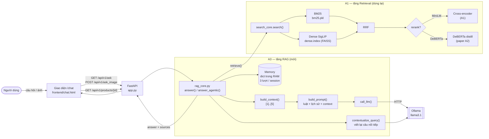
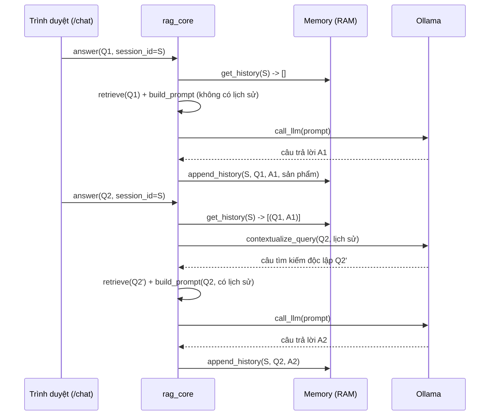
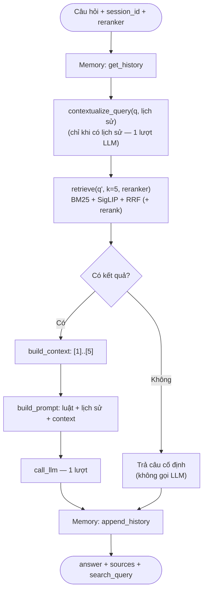
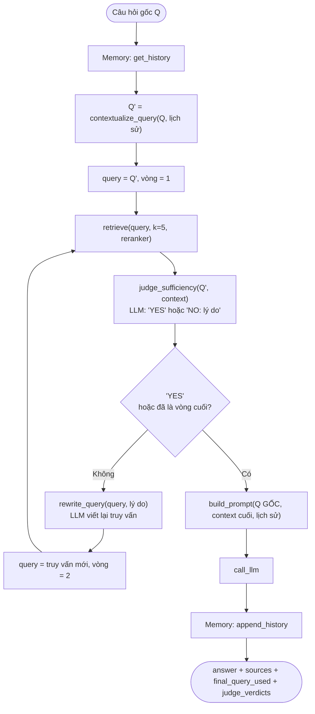
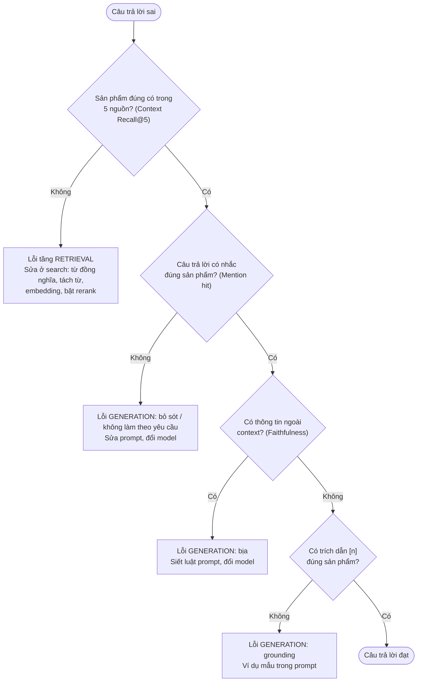

<div align="center">

**ĐẠI HỌC QUỐC GIA THÀNH PHỐ HỒ CHÍ MINH**<br>
**TRƯỜNG ĐẠI HỌC CÔNG NGHỆ THÔNG TIN**

**CỘNG HÒA XÃ HỘI CHỦ NGHĨA VIỆT NAM**<br>
**Độc lập – Tự do – Hạnh phúc**

# BÁO CÁO ĐỒ ÁN CUỐI KỲ — ASSIGNMENT A3
## Chatbot Tư vấn Sản phẩm ứng dụng RAG
### Mở rộng từ Hệ thống Tìm kiếm Đa phương thức A1 — Naive RAG, Agentic RAG và Hỏi đáp bằng Ảnh

*Môn: Thiết kế Hệ thống Thông tin Thông minh Dựa trên Truy hồi — IS6303*<br>
*Giảng viên phụ trách: Phạm Đỗ Kim Chi*

**Nhóm 12**

| MSSV | Họ và tên |
|---|---|
| 26848240 | Trần Thành Trung |
| 250101013 | Nguyễn Đức Thành Duy |
| 250104050 | Dương Thị Mỹ Phương |
| 250104039 | Nguyễn Tiến Khoa |
| 250104040 | Đặng Yến Linh |

</div>

---

## MỤC LỤC

**CHƯƠNG 1. GIỚI THIỆU**
- 1.1. Bối cảnh
- 1.2. Phát biểu bài toán và Yêu cầu hệ thống
- 1.3. Mục tiêu và Câu hỏi nghiên cứu
- 1.4. Đối tượng và Phạm vi nghiên cứu
- 1.5. Đóng góp của đồ án
- 1.6. Cấu trúc bài báo cáo

**CHƯƠNG 2. CƠ SỞ LÝ THUYẾT VÀ CÁC CÔNG TRÌNH LIÊN QUAN**
- 2.1. Truy hồi hai tầng (Two-Stage Retrieval)
- 2.2. Sinh văn bản tăng cường truy hồi (Retrieval-Augmented Generation - RAG)
- 2.3. Mức độ tự điều chỉnh trong RAG (Agentic / Self-RAG)
- 2.4. Phương pháp Đánh giá hệ RAG và Xây dựng Qrels

**CHƯƠNG 3. PHÂN TÍCH, THIẾT KẾ VÀ CÀI ĐẶT HỆ THỐNG**
- 3.1. Phân tích Yêu cầu Chức năng và Phi chức năng
- 3.2. Thiết kế Dữ liệu và Chuẩn hóa Ground Truth
- 3.3. Kiến trúc Tổng thể và Công nghệ Cài đặt
- 3.4. Thiết kế các Thành phần Cốt lõi
- 3.5. Hai luồng Xử lý RAG: Naive RAG và Agentic RAG
- 3.6. Thiết kế API và Giao diện Người dùng

**CHƯƠNG 4. THỰC NGHIỆM VÀ ĐÁNH GIÁ**
- 4.1. Thiết lập Thực nghiệm và Các Chỉ số Đánh giá
- 4.2. Chất lượng Tầng Truy hồi (Trả lời RQ1)
- 4.3. So sánh Luồng Naive RAG và Agentic RAG (Trả lời RQ2)
- 4.4. Phân tích Lỗi và Cây Chẩn đoán Tầng Lỗi (Trả lời RQ3)
- 4.5. Đánh giá Khả năng Hỏi đáp Đa phương thức bằng Ảnh (Trả lời RQ4)
- 4.6. Thảo luận, Rủi ro Đạo đức AI và Yếu tố Ảnh hưởng Tính Hợp lệ

**CHƯƠNG 5. KẾT LUẬN VÀ HƯỚNG PHÁT TRIỂN**
- 5.1. Kết quả đạt được
- 5.2. Hạn chế
- 5.3. Hướng phát triển

**TÀI LIỆU THAM KHẢO**

**PHỤ LỤC**
- Phụ lục A. Nguyên văn các Mẫu Prompt
- Phụ lục B. Cấu trúc Mã nguồn và Hướng dẫn Cài đặt & Triển khai

> **Về số liệu:** mọi kết quả ở Chương 4 lấy từ lần chạy thực nghiệm cuối cùng (ngày 12/10/2026) với mã nguồn hiện tại, trên 250 câu hỏi của bộ đánh giá. LLM `llama3.1` (8B), chạy trên Kaggle với 2 GPU T4, 0 lỗi.

---

## CHƯƠNG 1. GIỚI THIỆU

### 1.1. Bối cảnh

Ở Assignment A1, nhóm đã xây một **hệ tìm kiếm sản phẩm đa phương thức**: người dùng nhập câu chữ hoặc gửi ảnh, hệ thống trả về danh sách sản phẩm phù hợp từ catalog 2.000 sản phẩm. Hệ thống kết hợp BM25 (khớp từ khoá), Dense SigLIP (khớp ngữ nghĩa giữa chữ và ảnh) và Reciprocal Rank Fusion (RRF), tuỳ chọn rerank bằng cross-encoder. Ở Assignment A2, nhóm đọc paper RankGPT (Sun et al., 2023) và áp dụng model xếp hạng distill `deberta-10k-rank_net` của paper làm reranker thứ hai.

Hệ tìm kiếm chỉ trả về **danh sách**; người dùng vẫn phải tự đọc và chọn. Mô hình ngôn ngữ lớn (LLM) viết được câu trả lời tự nhiên, nhưng dùng một mình thì không biết dữ liệu riêng của cửa hàng và có thể "bịa" thông tin. **Retrieval-Augmented Generation (RAG)** kết hợp hai thế mạnh: tìm tài liệu liên quan trước, rồi buộc LLM trả lời dựa trên tài liệu đó.

A3 nâng cấp hệ tìm kiếm A1 thành **trợ lý hội thoại (chatbot) tư vấn sản phẩm** theo kỹ thuật RAG.

### 1.2. Phát biểu bài toán và Yêu cầu hệ thống

**Bài toán:** cho một câu hỏi của khách hàng (bằng chữ, bằng ảnh, hoặc cả hai), có thể nối tiếp các lượt hỏi trước, hệ thống phải:
1. Tìm các sản phẩm liên quan trong catalog.
2. Viết câu trả lời tự nhiên, **chỉ dựa trên các sản phẩm tìm được**, có **trích dẫn nguồn** `[n]` để người dùng kiểm chứng.
3. Hiểu câu hỏi nối tiếp trong cùng cuộc hội thoại (ví dụ "any other color?").

Ví dụ một lượt hỏi thật (cấu hình Naive, lần chạy cuối):

> **Người dùng:** *something to keep pets from running out of drinking water automatically*
> **Chatbot:** *I think the [1] 1.58 Gallon Automatic Dog Water Bowl Dispenser would be a good option to keep pets from running out of drinking water automatically.*
> **Nguồn [1]** là sản phẩm thật trong catalog, hiển thị kèm ảnh để người dùng đối chiếu.

**Yêu cầu của đề bài** (đồ án cuối kỳ chiếm 50% điểm môn):

| Tiêu chí | Điểm | Nội dung |
|---|---|---|
| Đề tài baseline | 5đ | Hệ RAG cơ bản |
| Hệ thống hoàn chỉnh | 2.5đ | Front-end, back-end, dữ liệu phù hợp |
| Nâng cấp engineering/research | 2.5đ | Cải tiến so với baseline, chứng minh bằng ablation |

Các yêu cầu khác: nâng cấp hệ search A1 bằng LLM dưới dạng chatbot; đánh giá bằng đủ metric RAG; ground truth tối thiểu 50 câu mỗi người, dùng chung với A1; chẩn đoán được lỗi nằm ở tầng Retrieval hay Generation; có đánh giá đạo đức AI.

### 1.3. Mục tiêu và Câu hỏi nghiên cứu

**Mục tiêu:**
- Xây chatbot RAG hoàn chỉnh (giao diện, API, lõi RAG) dùng lại tầng truy hồi của A1.
- Cài một baseline (Naive RAG) và các nâng cấp: rerank, Agentic RAG, Memory khi tìm kiếm, hỏi đáp bằng ảnh.
- Đo từng nâng cấp bằng ablation trên bộ đánh giá có nhãn, với metric riêng cho tầng Retrieval và tầng Generation.

**Câu hỏi nghiên cứu:**

| | Câu hỏi | Trả lời ở |
|---|---|---|
| **RQ1** | Tầng truy hồi hai tầng (BM25 + Dense + RRF, tuỳ chọn rerank) đưa được sản phẩm liên quan vào context của LLM tốt đến đâu? Rerank và việc dùng lịch sử hội thoại khi tìm kiếm cải thiện được gì? | Mục 4.2 |
| **RQ2** | Agentic RAG (LLM tự đánh giá kết quả tìm kiếm và tìm lại) có tốt hơn Naive RAG không, kể cả khi kết hợp với rerank? | Mục 4.3 |
| **RQ3** | Khi câu trả lời sai, lỗi nằm ở tầng Retrieval hay Generation, và nguyên nhân cụ thể là gì? | Mục 4.4 |
| **RQ4** | Cho phép hỏi bằng ảnh (chỉ ảnh, hoặc ảnh + chữ) có cải thiện cả hai tầng so với chỉ hỏi bằng chữ không? | Mục 4.5 |

### 1.4. Đối tượng và Phạm vi nghiên cứu

**Đối tượng:**
- Catalog 2.000 sản phẩm thương mại điện tử (`Shopify/product-catalogue`), mỗi sản phẩm có tên, mô tả, brand, category và ảnh.
- Câu hỏi tư vấn sản phẩm bằng tiếng Anh, có thể kèm ảnh.

**Phạm vi:**
- **Dùng lại** toàn bộ tầng truy hồi của A1, không huấn luyện lại hay fine-tune model nào.
- LLM mã nguồn mở chạy local qua Ollama (`llama3.1`, 8B), không gửi dữ liệu ra dịch vụ ngoài.
- LLM chỉ đọc chữ. Ảnh chỉ dùng ở tầng truy hồi.
- Context đưa cho LLM chỉ gồm tên sản phẩm. Catalog không có trường giá.
- Không cài LLM xếp hạng trực tiếp (RankGPT). LLM chỉ dùng để sinh câu trả lời, tự đánh giá và viết lại truy vấn.

### 1.5. Đóng góp của đồ án

1. **Chatbot RAG hoàn chỉnh:** giao diện `/chat`, API FastAPI, lõi `rag_core.py`; trả lời có trích dẫn `[n]`, người dùng bấm vào trích dẫn để xem chi tiết sản phẩm.
2. **Hai luồng RAG** dùng chung tầng Retrieval và Memory: **Naive RAG** (baseline, tìm một lần, trả lời một lần) và **Agentic RAG** (LLM tự đánh giá kết quả, có thể viết lại truy vấn và tìm lại).
3. **Ba lựa chọn rerank** trước khi đưa sản phẩm cho LLM: không rerank, cross-encoder MiniLM (A1), DeBERTa distill (từ paper A2).
4. **Memory theo phiên hội thoại** dùng ở cả hai tầng: viết lại câu hỏi nối tiếp thành câu tìm kiếm độc lập (tầng Retrieval), và chèn lịch sử vào prompt (tầng Generation).
5. **Hỏi đáp bằng ảnh:** chatbot nhận ảnh sản phẩm, có thể kèm câu chữ; ảnh được tìm bằng nhánh SigLIP của A1 rồi gộp với kết quả tìm theo chữ.
6. **Ground truth qrels đa mức:** nâng từ "1 sản phẩm đúng / câu, nhãn nhị phân" (A1) lên nhãn 0–3 cho 5.064 cặp câu hỏi–sản phẩm, theo quy trình pooling của TREC.
7. **Bộ đánh giá RAG tự viết, 8 metric** đo riêng tầng Retrieval và Generation, cùng 3 bộ ablation: 250 câu × 6 cấu hình, 100 ảnh × 3 cấu hình, 500 hội thoại × 4 cách tìm.

### 1.6. Cấu trúc bài báo cáo

- **Chương 2** trình bày cơ sở lý thuyết: truy hồi hai tầng, RAG, Agentic RAG, và phương pháp đánh giá.
- **Chương 3** trình bày phân tích yêu cầu, dữ liệu, kiến trúc và thiết kế từng thành phần của hệ thống.
- **Chương 4** trình bày thực nghiệm và trả lời bốn câu hỏi nghiên cứu, kèm phân tích lỗi, đạo đức AI và các yếu tố ảnh hưởng tính hợp lệ.
- **Chương 5** tổng kết kết quả, hạn chế và hướng phát triển.
- **Phụ lục** chép nguyên văn các prompt và hướng dẫn cài đặt.

---

## CHƯƠNG 2. CƠ SỞ LÝ THUYẾT VÀ CÁC CÔNG TRÌNH LIÊN QUAN

### 2.1. Truy hồi hai tầng (Two-Stage Retrieval)

Tìm kiếm trên catalog lớn thường chia hai tầng, để cân bằng giữa tốc độ và độ chính xác:

| | Tầng 1: lọc ứng viên (first-stage) | Tầng 2: xếp hạng lại (rerank) |
|---|---|---|
| Mục tiêu | Lấy nhanh vài chục ứng viên từ toàn bộ catalog, ưu tiên **độ phủ** (recall) | Xếp lại kỹ các ứng viên đó, ưu tiên **thứ hạng đầu** (precision) |
| Cách làm | Mỗi sản phẩm được biểu diễn sẵn (index), câu hỏi chỉ cần so khớp | Model đọc **đồng thời** câu hỏi và từng ứng viên |
| Chi phí | Rẻ, chạy trên toàn catalog | Đắt, chỉ chạy trên vài chục ứng viên |
| Trong đồ án | BM25 + Dense SigLIP + RRF | Cross-encoder MiniLM, DeBERTa distill |

**Tầng 1 gồm ba thành phần:**
- **BM25** (sparse): chấm điểm theo tần suất từ khoá trùng giữa câu hỏi và văn bản sản phẩm. Mạnh khi câu hỏi chứa đúng tên, mã hay brand sản phẩm; yếu khi câu hỏi diễn đạt bằng từ khác.
- **Dense retrieval:** model **SigLIP** (Zhai et al., 2023) đưa câu chữ và ảnh vào cùng một không gian vector 768 chiều. Câu hỏi được so với embedding ảnh sản phẩm bằng cosine, qua chỉ mục FAISS. Mạnh ở ngữ nghĩa và cho phép tìm bằng ảnh.
- **Reciprocal Rank Fusion** (Cormack et al., 2009): gộp các danh sách theo **thứ hạng** thay vì điểm (vì điểm BM25 và cosine khác thang đo): score(d) = Σ 1 / (60 + hạng của d). Sản phẩm đứng hạng 1 ở cả hai danh sách được 1/61 + 1/61 = 0,0328.

**Tầng 2, cross-encoder:** model nhận cặp (câu hỏi, tên sản phẩm) và cho ra một điểm liên quan, nên chính xác hơn cách so vector tính sẵn (Nogueira & Cho, 2019). Đồ án dùng hai reranker:
- `cross-encoder/ms-marco-MiniLM-L-6-v2`: học từ nhãn liên quan do người gán trên MS MARCO.
- `deberta-10k-rank_net` (DeBERTa-v3-base, khoảng 184M tham số): **permutation distillation** của paper RankGPT (Sun et al., 2023, mục 4), tức huấn luyện model nhỏ bắt chước thứ tự xếp hạng do ChatGPT tạo ra cho 10K câu hỏi MS MARCO.

### 2.2. Sinh văn bản tăng cường truy hồi (Retrieval-Augmented Generation - RAG)

RAG (Lewis et al., 2020) giải quyết hai điểm yếu của LLM khi dùng một mình: không biết dữ liệu riêng (ở đây là catalog), và có thể bịa thông tin nghe hợp lý (hallucination). Một hệ RAG có ba tầng:

| Tầng | Câu hỏi nó trả lời | Trong đồ án |
|---|---|---|
| **Retrieval** (truy hồi) | Tài liệu nào liên quan tới câu hỏi? | `retrieve()` gọi `search()` của A1, lấy 5 sản phẩm, tuỳ chọn rerank |
| **Augmentation** (bổ sung ngữ cảnh) | Đưa tài liệu cho LLM theo cách nào? | `build_context()` đánh số `[1]..[5]`; `build_prompt()` thêm luật grounding và lịch sử hội thoại |
| **Generation** (sinh) | LLM trả lời gì? | `call_llm()` gọi `llama3.1` qua Ollama |

**Grounding** là ràng buộc LLM chỉ dùng thông tin trong context và trích dẫn nguồn. Đồ án thực hiện grounding bằng context đánh số, luật trong prompt ("Use ONLY the information in the product list..."), và trả kèm nguồn thật để người dùng tự kiểm.

**Hệ quả quan trọng khi đánh giá:** Retrieval và Generation có thể sai độc lập. Tìm đúng sản phẩm nhưng LLM vẫn trả lời sai hoặc bịa; tìm sai thì LLM trả lời tốt đến đâu cũng không đúng. Vì vậy cần **metric riêng cho từng tầng** và **khung chẩn đoán theo tầng** (mục 4.4).

### 2.3. Mức độ tự điều chỉnh trong RAG (Agentic / Self-RAG)

Naive RAG đi thẳng một chiều Retrieval → Augmentation → Generation, đúng một lần, kể cả khi kết quả tìm kiếm kém. Một hướng cải tiến là cho LLM **tham gia ra quyết định** trong vòng truy hồi:
- **Self-RAG** (Asai et al., 2024) huấn luyện LLM sinh các token phản tư để quyết định có cần truy hồi không và đánh giá đoạn văn tìm được.
- **Corrective RAG** (Yan et al., 2024) thêm bộ đánh giá chất lượng kết quả truy hồi; khi kết quả kém thì viết lại truy vấn hoặc tìm nguồn khác.

Đồ án cài **phiên bản tối giản** của ý tưởng này, không huấn luyện thêm (mục 3.5): LLM đánh giá context có đủ để trả lời không (`judge_sufficiency`); nếu chưa đủ thì viết lại truy vấn (`rewrite_query`) và tìm lại, tối đa 2 vòng.

Một dạng tự điều chỉnh khác là **viết lại câu hỏi theo ngữ cảnh hội thoại** (query contextualization): câu nối tiếp như "any alternatives to that?" không chứa thông tin sản phẩm, nên được LLM viết lại thành câu tìm kiếm độc lập trước khi truy hồi (mục 3.4.6).

### 2.4. Phương pháp Đánh giá hệ RAG và Xây dựng Qrels

**Metric theo tầng.** RAGAS (Es et al., 2024) đề xuất đánh giá RAG bằng các metric riêng cho context (Context Precision, Context Recall) và cho câu trả lời (Faithfulness, Answer Relevancy). Đồ án cài **bản đơn giản hoá, tự viết** của các metric này, cộng thêm metric riêng cho bài toán sản phẩm (Mention hit, Citation rate). Chi tiết ở mục 4.1.

**Ground truth kiểu qrels.** Đánh giá truy hồi theo chuẩn TREC dùng **qrels**: nhãn mức độ liên quan cho từng cặp (câu hỏi, tài liệu). Vì không thể gán nhãn cho mọi tài liệu, TREC dùng **pooling**: gộp top-k của nhiều hệ thống làm pool ứng viên, chỉ gán nhãn trong pool; tài liệu ngoài pool coi là không liên quan.

**nDCG đa mức.** Với nhãn 0–3, nDCG@k = DCG/IDCG, trong đó DCG = Σᵢ rel(sᵢ) / log₂(i+1). Khác Recall chỉ phân biệt "đúng" và "sai", nDCG đa mức thưởng cả việc xếp sản phẩm liên quan một phần lên cao, và phạt việc xếp sản phẩm đúng ở hạng thấp.

---

## CHƯƠNG 3. PHÂN TÍCH, THIẾT KẾ VÀ CÀI ĐẶT HỆ THỐNG

### 3.1. Phân tích Yêu cầu Chức năng và Phi chức năng

**Yêu cầu chức năng:**

| Mã | Yêu cầu | Cách đáp ứng |
|---|---|---|
| F1 | Hỏi đáp bằng chữ, trả lời có trích dẫn nguồn | `GET /api/v1/ask`, context đánh số `[n]` |
| F2 | Hỏi bằng ảnh, có thể kèm chữ | `POST /api/v1/ask_image`, tìm bằng nhánh SigLIP |
| F3 | Hiểu câu hỏi nối tiếp trong cùng phiên | Memory theo `session_id`, viết lại câu hỏi nối tiếp |
| F4 | Chọn chế độ Naive hoặc Agentic | Tham số `agentic`, công tắc trên giao diện |
| F5 | Chọn reranker (không / MiniLM / DeBERTa) | Tham số `reranker` |
| F6 | Xem chi tiết sản phẩm được trích dẫn | `GET /api/v1/products/{id}`, khung chi tiết |
| F7 | Bắt đầu hội thoại mới | `POST /api/v1/reset_session` |

**Yêu cầu phi chức năng:**

| Mã | Yêu cầu | Cách đáp ứng |
|---|---|---|
| N1 | Không bịa thông tin | Luật grounding trong prompt; không gọi LLM khi kết quả tìm kiếm rỗng |
| N2 | Riêng tư dữ liệu | LLM chạy local qua Ollama; lịch sử chỉ lưu trong RAM |
| N3 | Đánh giá được, tái lập được | Ablation script dùng chung code với API; lưu chi tiết từng câu |
| N4 | Chịu lỗi khi gọi LLM | Thử lại tối đa 3 lần khi mất kết nối, timeout, lỗi 5xx; trả HTTP 503 kèm lý do |
| N5 | Dễ thay đổi cấu hình | Model và địa chỉ Ollama trong `.env` |

### 3.2. Thiết kế Dữ liệu và Chuẩn hóa Ground Truth

#### 3.2.1. Catalog sản phẩm (dùng lại của A1)

- **Nguồn:** `Shopify/product-catalogue` (Hugging Face, apache-2.0). A1 lấy 2.000 sản phẩm từ split train, xáo trộn với seed 42.
- **Mỗi sản phẩm có:** `id`, ảnh, `caption` (tên sản phẩm), `search_text` (tên + mô tả), `category`, `brand`. Tên sản phẩm có nhiều ngôn ngữ (tiếng Anh là chính, ngoài ra có tiếng Hà Lan, Na Uy, Romania, Việt...).
- **Chỉ mục:** BM25 trên `search_text` (`bm25.pkl`); FAISS `IndexFlatIP` trên embedding ảnh SigLIP 768 chiều (`dense.index`).

#### 3.2.2. Bộ câu hỏi đánh giá

`data/eval_set.jsonl`, 250 câu, dùng chung với A1:

| Nhóm | Số câu | Cách tạo |
|---|---|---|
| A1 viết tay | 30 | Trộn câu có từ khoá chính xác, câu diễn đạt lại, câu mơ hồ |
| A3 viết tay | 20 | Viết theo nhu cầu tư vấn, bằng tiếng Anh cho khớp catalog |
| Sinh từ mẫu | 200 | 10 mẫu câu, điền 8 từ đầu của tên sản phẩm và brand của sản phẩm chọn ngẫu nhiên |

Mỗi dòng có:
- `qrels`: nhãn liên quan 0–3 cho từng sản phẩm trong pool ứng viên của câu đó.
- `relevant_ids`: các sản phẩm có nhãn ≥ 2, gọi là tập *G*.
- `target_ids`: sản phẩm đúng gốc của A1, luôn mang nhãn 3.
- `answer_should_mention`: brand và 3 từ đầu của tên sản phẩm, dùng để kiểm tra câu trả lời có nhắc đúng sản phẩm không.

```json
{"query": "tool lanyard with a carabiner for working at height",
 "target_ids": [827], "relevant_ids": [379, 827],
 "qrels": {"379": 3, "827": 3, "271": 1, "757": 1, "851": 1, "1183": 1, "...": 0},
 "answer_should_mention": ["Ergodyne", "Lanyard"]}
```

Bộ truy vấn ảnh `data/eval_set_image.jsonl` gồm 100 ảnh, mỗi ảnh là ảnh của một sản phẩm đúng trong `eval_set.jsonl` đã bị biến đổi (cắt, xoay hoặc đổi độ sáng), nên ghép được với câu chữ và nhãn của câu đó.

#### 3.2.3. Chuẩn hóa ground truth thành qrels đa mức

**Vấn đề của ground truth A1:** mỗi câu chỉ có đúng 1 sản phẩm đúng, nhãn nhị phân. Nếu catalog có một sản phẩm khác cũng thoả câu hỏi, hệ thống trả về sản phẩm đó vẫn bị tính là sai; và nDCG "đa mức" của A1 phải đoán mức 1 theo category.

**Quy trình** (`step16_build_qrels.py`), theo cách xây qrels của TREC:
1. **Pooling:** với mỗi câu, gộp top-10 của BM25, Dense và Hybrid, cộng sản phẩm đúng gốc. Trung bình 20,3 ứng viên/câu, tổng **5.064 cặp** câu hỏi–sản phẩm.
2. **Gán nhãn 0–3**, chỉ dựa trên tên, brand, category và mô tả trong catalog:

| Nhãn | Ý nghĩa | Quy tắc |
|---|---|---|
| 3 | Đúng hoàn toàn | Đúng loại sản phẩm và thoả mọi ràng buộc trong câu (brand, model, kích thước, tính năng, tương thích) |
| 2 | Liên quan tốt | Đúng loại sản phẩm, lệch nhẹ hoặc không kiểm chứng được một ràng buộc phụ |
| 1 | Một phần | Phụ kiện, linh kiện, cùng nhóm sản phẩm, hoặc chỉ khớp một khía cạnh |
| 0 | Không liên quan | — |

   Hai quy tắc chặn trần: khác loại sản phẩm thì tối đa 1; vi phạm ràng buộc cứng (sai model, sai brand khi câu có nêu brand) thì tối đa 1. Nhãn được LLM chấm theo lô 25 câu, sau đó **rà soát thủ công** mọi nhãn 2–3 không phải sản phẩm đúng gốc; 6 nhãn 2 vi phạm quy tắc chặn trần bị hạ xuống 1.
3. **Đối chiếu sản phẩm đúng gốc với toàn văn catalog:** 3 câu có truy vấn mâu thuẫn với chính sản phẩm đúng được **sửa truy vấn cho khớp dữ liệu**, rồi chấm lại:

| Truy vấn cũ | Dữ liệu thật của sản phẩm đúng | Truy vấn mới |
|---|---|---|
| cornhole board set with eagle flag design | id 192 là bộ decal dán bảng (*Boards Wraps*) | cornhole board wraps with eagle flag design |
| fast fold portable projection screen | id 1758 là tấm màn thay thế (*Replacement Surface*) | replacement screen surface for a fast fold projection screen |
| slide stopper accessory for a trombone | mô tả id 1397: "*trumpet* slide stopper" | slide stopper accessory for a trumpet |

4. Sản phẩm ngoài pool coi là nhãn 0; sản phẩm đúng gốc luôn giữ nhãn 3.

**Kết quả trên 250 câu:**

| Số cặp đã chấm | Nhãn 3 | Nhãn 2 | Nhãn 1 | Nhãn 0 | Câu có > 1 sản phẩm liên quan (≥ 2) | Câu có sản phẩm nhãn 1 |
|---|---|---|---|---|---|---|
| 5.064 | 252 | 10 | 397 | 4.405 | 10 | 179 |

- **Phần lớn câu chỉ có 1 sản phẩm thực sự đúng** (|G| = 1 ở 240/250 câu), vì catalog 2.000 sản phẩm trải trên rất nhiều ngành hàng.
- **Nhãn 1 xuất hiện ở 179/250 câu,** nhờ vậy nDCG đa mức phân biệt được giữa đưa vào context một phụ kiện liên quan và một sản phẩm lạc đề.

#### 3.2.4. Giới hạn thông tin trong context

Mỗi sản phẩm đưa vào prompt **chỉ có tên sản phẩm và điểm RRF**: không có mô tả, brand riêng, và catalog **không có trường giá**. Hệ quả:
- Câu hỏi về giá (31/250 câu, ví dụ "price of...", "is there a cheaper...") không thể trả lời đầy đủ; LLM phải nói là không có thông tin.
- **Mention hit có mức trần dưới 1**, vì brand thường không nằm trong tên sản phẩm. Mức trần tính từ dữ liệu (tỷ lệ từ khoá `answer_should_mention` có trong tên sản phẩm đúng) là **0.708** trên 250 câu.

### 3.3. Kiến trúc Tổng thể và Công nghệ Cài đặt



**Nguyên tắc thiết kế:**
- **A3 không viết lại phần tìm kiếm:** toàn bộ truy hồi là `search_core.search()` của A1, gọi qua `rag_core.retrieve()`. A3 chỉ thêm các tầng phía trên.
- **Tách client và server:** trình duyệt chỉ gửi HTTP và nhận JSON; model, chỉ mục và LLM nằm ở server.
- **API và ablation dùng chung code:** các script thực nghiệm gọi đúng `answer()`, `answer_agentic()`, `retrieve()` mà API dùng, nên số liệu phản ánh đúng hệ thống chạy thật.

**Công nghệ:**

| Thành phần | Công nghệ |
|---|---|
| Back-end, API | Python 3, FastAPI, Uvicorn |
| Sparse retrieval | `rank_bm25` (BM25Okapi) |
| Dense retrieval | `transformers` (SigLIP `google/siglip-base-patch16-224`), `faiss-cpu` |
| Rerank | `sentence-transformers` (CrossEncoder MiniLM), `transformers` (DeBERTa) |
| LLM | Ollama, `llama3.1` 8B (lượng tử hoá Q4_K_M) |
| Metric | `sentence-transformers/all-MiniLM-L6-v2` cho Answer Relevancy; còn lại tự viết |
| Front-end | HTML, CSS, JavaScript thuần |
| Thực nghiệm | Kaggle Notebook, 2 GPU T4, mỗi GPU một `ollama serve` |

### 3.4. Thiết kế các Thành phần Cốt lõi

#### 3.4.1. Retrieval: `retrieve(query, k=5, reranker)`

1. **BM25:** tách câu hỏi thành từ (`lower().split()`), chấm điểm trên toàn bộ 2.000 sản phẩm, lấy `top_n` sản phẩm điểm cao nhất.
2. **Dense:** SigLIP mã hoá câu hỏi thành vector 768 chiều (đã chuẩn hoá); FAISS tìm `top_n` ảnh sản phẩm có cosine lớn nhất.
3. **RRF** gộp hai danh sách với k_RRF = 60.
4. **Cắt kết quả:** không rerank thì lấy 5 sản phẩm đầu (`top_n = 50` mỗi nhánh); có rerank thì lấy **30 ứng viên** đầu sau RRF (`top_n = 30` mỗi nhánh) rồi chuyển sang 3.4.3.

Kết quả là 5 sản phẩm `{id, image_path, caption, score}`, gọi là **sources**.

#### 3.4.2. Hỏi bằng ảnh: `retrieve(query, k, image=...)`

| Đầu vào | Cách tìm | Rerank |
|---|---|---|
| Chỉ chữ | Như 3.4.1 | Theo lựa chọn |
| Chỉ ảnh | `search(image, query_type="image")`: SigLIP mã hoá ảnh, FAISS tìm ảnh sản phẩm gần nhất (BM25 tự bỏ qua) | Không |
| Ảnh + chữ | Lấy 50 ứng viên từ tìm theo ảnh và 50 ứng viên từ tìm theo chữ (BM25 + Dense), gộp bằng RRF | Không |

- **LLM vẫn chỉ đọc chữ.** Prompt thêm một dòng báo người dùng có gửi ảnh và danh sách được tìm theo độ giống với ảnh. Nếu người dùng không gõ chữ, câu hỏi đưa vào prompt là "Find products similar to the photo I sent".
- **Không rerank khi có ảnh:** reranker chỉ đọc cặp (chữ, tên sản phẩm) nên bỏ mất tín hiệu ảnh. Thử 3 ảnh kèm câu ngắn, bật cross-encoder đều đẩy sản phẩm đúng xuống (vd ảnh vỏ máy tính bảng kèm "red case": hạng 1 tụt xuống hạng 3).

#### 3.4.3. Rerank (tuỳ chọn, mặc định tắt)

| | Cross-encoder MiniLM (A1) | DeBERTa distill (A2) |
|---|---|---|
| Model | `cross-encoder/ms-marco-MiniLM-L-6-v2` | `deberta-10k-rank_net`, DeBERTa-v3-base |
| Học từ | Nhãn liên quan do người gán trên MS MARCO | Thứ tự do ChatGPT xếp cho 10K câu hỏi MS MARCO, loss RankNet |
| Nguồn | Hugging Face | Repo github.com/sunnweiwei/RankGPT |

30 ứng viên được sắp lại theo điểm của reranker, giữ 5 sản phẩm đầu. Reranker không gọi LLM và áp dụng như nhau cho Naive lẫn Agentic.

#### 3.4.4. Augmentation: context và prompt

**`build_context(sources)`** viết mỗi sản phẩm một dòng, đánh số để LLM trích dẫn:
```
[1] 1.58 Gallon Automatic Dog Water Bowl Dispenser, Large Capacity Water Feeder ... (score=0.0325)
[2] ...
[5] ...
```

**`build_prompt(query, context, history, has_image)`** ghép các phần:

| Phần | Nội dung | Mục đích |
|---|---|---|
| Luật grounding | "Use ONLY the information in the product list below. Do NOT invent details (price, features, colors...)... If no product in the list fits the request, say clearly that you could not find one instead of guessing." | Giảm bịa thông tin |
| Lịch sử hội thoại | Tối đa 3 lượt gần nhất (3.4.6); trống nếu không có | Hiểu câu hỏi nối tiếp |
| Dòng báo có ảnh | Chỉ khi người dùng gửi ảnh | LLM biết danh sách được tìm theo ảnh |
| Context | Danh sách `[1]..[5]` | Nguồn thông tin duy nhất được phép dùng |
| Yêu cầu trả lời | "Reply briefly in English. CITE the list number in square brackets (e.g. [1])... never repeat their message back or ask them a question." | Định dạng, buộc trích dẫn, không hỏi ngược khách |

Mọi prompt viết bằng tiếng Anh, cùng ngôn ngữ với câu hỏi và phần lớn catalog. Bản thử nghiệm đầu dùng prompt tiếng Việt và gặp hai lỗi khi thử giao diện: LLM dịch câu tìm kiếm sang tiếng Việt nên BM25 không khớp catalog, và LLM chép lại câu ví dụ trong prompt thành câu trả lời (hỏi ngược lại người dùng). Nguyên văn prompt ở Phụ lục A.

#### 3.4.5. Generation: gọi LLM

`call_llm(prompt)` gửi `POST` tới Ollama (`/api/generate`, `stream=false`).

| Thiết lập | Giá trị |
|---|---|
| Model | `OLLAMA_MODEL` trong `.env`, mặc định `llama3.1` (8B) |
| Địa chỉ | `OLLAMA_URL`; có thể ghi nhiều địa chỉ cách nhau bằng dấu phẩy, các lượt gọi chia vòng tròn (dùng khi mỗi GPU chạy một server) |
| Timeout | 600 s |
| Thử lại | Tối đa 3 lần (chờ 5 s, 10 s) khi mất kết nối, timeout, lỗi 5xx; lỗi 4xx báo ngay |
| Lỗi trả cho giao diện | HTTP 503, kèm lý do Ollama trả về |

**Chọn model:** chạy thử 3 câu trước khi chạy đủ. Với cùng prompt, `qwen2.5:3b` chỉ trả về chuỗi `"[1]"`, còn `llama3.1` trả lời thành câu đầy đủ có trích dẫn. Hệ thống vì vậy dùng `llama3.1`.

#### 3.4.6. Memory theo phiên hội thoại

**Cấu trúc dữ liệu** (`rag_core._SESSION_STORE`): dict trong RAM, khoá là `session_id`, mỗi phiên giữ tối đa 3 lượt gần nhất.
```python
{"session-p57iqj4jb4s": [
    {"query": "black leather jacket",
     "answer": "We have a few options available: [1] Michael Kors ...",
     "products": ["Michael Kors Men's Perforated Faux-Leather Moto Jacket XL Black", "...", "..."]}
]}
```

**Vòng đời một phiên:**
1. Mở trang `/chat`: trình duyệt sinh `session_id` ngẫu nhiên và gửi kèm mọi câu hỏi.
2. **Đọc** (`get_history`) lịch sử của phiên.
3. **Viết lại câu hỏi theo ngữ cảnh** (`contextualize_query`): nếu phiên đã có lịch sử, LLM viết câu hỏi mới thành **một câu tìm kiếm độc lập, dạng từ khoá tiếng Anh**. Prompt có 3 ví dụ mẫu và các luật: lấy loại sản phẩm từ "Suggested products" của lượt gần nhất; hỏi màu/cỡ/hãng khác thì bỏ giá trị cũ, giữ loại sản phẩm; chủ đề khác hẳn thì bỏ qua lịch sử. Chốt chặn: nếu câu viết lại có chữ tiếng Việt trong khi câu hỏi và lịch sử không có, dùng lại câu gốc. Lượt đầu bỏ qua bước này.
   - *Ví dụ thật:* "black leather jacket" rồi "is any other color?" → tìm bằng *"leather jacket"*; chatbot trả lời *"Unfortunately, I could not find any other color options for the black leather jacket."*
4. **Chèn vào prompt trả lời** (`_format_history`): mỗi lượt một dòng, câu trả lời cũ cắt còn 150 ký tự, kèm tên 3 sản phẩm đầu đã gợi ý. Câu hỏi trong prompt trả lời vẫn là câu gốc; câu viết lại chỉ dùng để tìm kiếm.
5. **Ghi** (`append_history`) lượt mới; quá 3 lượt thì xoá lượt cũ nhất.
6. **Xoá:** nút "Mới" gọi `POST /api/v1/reset_session`.



### 3.5. Hai luồng Xử lý RAG: Naive RAG và Agentic RAG

#### 3.5.1. Naive RAG (baseline): `answer()`



Tuyến tính: tìm kiếm đúng một lần, gọi LLM tối đa một lần để trả lời (cộng 1 lượt viết lại nếu là câu nối tiếp). Không gọi LLM khi kết quả tìm kiếm rỗng, để tránh bịa.

#### 3.5.2. Agentic RAG (nâng cấp): `answer_agentic(max_iters=2)`



Quy tắc:
- **Đánh giá luôn so với câu hỏi gốc** (đã gộp ngữ cảnh hội thoại), không so với truy vấn đã viết lại, để không trôi khỏi ý người dùng.
- **Câu trả lời cuối dùng câu hỏi gốc** và context của lần tìm kiếm cuối.
- **`max_iters = 2`** là giới hạn cứng để không lặp vô hạn.
- **Truy vấn viết lại được làm sạch:** bỏ ngoặc kép ở hai đầu, vì BM25 tách từ theo khoảng trắng nên `"wheelbarrow` không khớp `wheelbarrow`.
- Trả thêm `final_query_used` và `judge_verdicts` để phân tích lỗi.

#### 3.5.3. So sánh hai luồng

| Khía cạnh | Naive RAG | Agentic RAG |
|---|---|---|
| Số lần tìm kiếm | 1 | 1–2 |
| Tự đánh giá kết quả | Không | Có (`judge_sufficiency`) |
| Tự viết lại truy vấn | Không | Có (`rewrite_query`), khi chưa đủ |
| Lượt gọi LLM mỗi câu | 1 (+1 nếu câu nối tiếp) | 2 nếu đủ ngay, 4 nếu phải tìm lại (+1 nếu câu nối tiếp) |
| Memory, Grounding, Reranker | Dùng chung | Dùng chung |

### 3.6. Thiết kế API và Giao diện Người dùng

**API** (`app.py`):

| Endpoint | Tham số | Trả về |
|---|---|---|
| `GET /api/v1/ask` | `q`, `k=5`, `agentic=false`, `reranker=none\|cross_encoder\|deberta`, `session_id` | `{answer, sources, reranker, search_query}`; Agentic thêm `final_query_used`, `judge_verdicts`. 400 nếu reranker không hợp lệ; 503 nếu không gọi được Ollama |
| `POST /api/v1/ask_image` | multipart: `file` (ảnh), `q` (có thể rỗng), `k=5`, `agentic`, `reranker`, `session_id` | Như `/ask`, thêm `query_mode` = `image` hoặc `image+text`; `reranker` luôn là `null`. 400 nếu file không phải ảnh |
| `GET /api/v1/rerankers` | — | Reranker dùng được (`deberta` chỉ có khi đã tải checkpoint) |
| `GET /api/v1/products/{id}` | — | Tên, brand, category, mô tả (tối đa 2.000 ký tự) của một sản phẩm |
| `POST /api/v1/reset_session` | `session_id` | Xoá Memory của phiên |
| `GET /chat` | — | Trang chatbot (A1 có trang riêng `/search`) |

**Giao diện `/chat`:**
- Công tắc "Rerank trước khi đưa vào context" (chọn MiniLM hoặc DeBERTa) và công tắc "Agentic".
- Nút "Ảnh" đính kèm một ảnh sản phẩm, có ô xem trước và nút bỏ ảnh; badge "Truy vấn: ảnh / ảnh + chữ" ở cột nguồn.
- Khung chat nhiều lượt; dưới mỗi câu trả lời có **thẻ sản phẩm** cho từng nguồn được trích dẫn `[n]`.
- Cột phải: 5 nguồn đã đưa vào context (ảnh, `[n]`, điểm RRF và điểm rerank) và **khung chi tiết sản phẩm** khi bấm vào một thẻ hoặc một nguồn.

```mermaid
sequenceDiagram
    participant U as Người dùng
    participant B as chat.html
    participant A as app.py
    participant R as rag_core / search_core
    participant L as Ollama

    U->>B: Nhập câu hỏi (kèm ảnh), chọn rerank / Agentic
    B->>A: GET /api/v1/ask hoặc POST /api/v1/ask_image
    A->>R: answer() hoặc answer_agentic()
    R->>R: retrieve() — A1 search (+ rerank)
    R->>L: call_llm()
    L-->>R: câu trả lời có [n]
    R-->>A: answer + sources
    A-->>B: JSON
    B->>B: Hiện câu trả lời; tách [n] → thẻ sản phẩm; hiện 5 nguồn
    U->>B: Bấm thẻ [1]
    B->>A: GET /api/v1/products/{id}
    A-->>B: tên, brand, category, mô tả
```

---

## CHƯƠNG 4. THỰC NGHIỆM VÀ ĐÁNH GIÁ

### 4.1. Thiết lập Thực nghiệm và Các Chỉ số Đánh giá

#### 4.1.1. Môi trường và quy trình

- **LLM:** `llama3.1` (8B) qua Ollama, prompt tiếng Anh (Phụ lục A), `k = 5`.
- **Phần cứng:** Kaggle, 2 GPU T4; mỗi GPU một `ollama serve`, mỗi server xử lý 2 yêu cầu cùng lúc, chạy 4 câu song song.
- **Ngày chạy:** 12/10/2026. 3 cấu hình Naive và 3 cấu hình Agentic chạy ở 2 session Kaggle song song với cùng code và dữ liệu; hai file kết quả được ghép lại rồi tính bảng tổng hợp.
- **Quy trình** (`step_ablation_rag.py`): với mỗi câu, gọi `answer()` hoặc `answer_agentic()`, tính 8 metric, ghi ngay chi tiết câu đó (câu trả lời, id nguồn, từng metric, truy vấn đã viết lại, phán đoán của LLM) vào `data/rag_ablation_details.jsonl`. Câu lỗi sau 3 lần thử được ghi kèm lỗi, không bị loại âm thầm. Lần chạy cuối: 0 lỗi.

#### 4.1.2. Các chỉ số đánh giá

Ký hiệu: với mỗi câu hỏi, *G* là tập sản phẩm có nhãn ≥ 2, *rel(d)* là nhãn 0–3 của sản phẩm *d*, *S = (s₁, ..., s₅)* là 5 nguồn đưa vào context, *A* là câu trả lời. Mỗi metric tính cho từng câu rồi lấy trung bình (bỏ qua giá trị `None`).

| Tầng | Metric | Công thức | Ý nghĩa |
|---|---|---|---|
| Retrieval | Context Recall@5 | \|S ∩ G\| / \|G\| | Sản phẩm đúng có được đưa cho LLM không |
| Retrieval | Context Precision@5 | (1/min(\|G\|, 5)) · Σ_{i: sᵢ∈G} (số id đúng trong i nguồn đầu) / i | Sản phẩm đúng có đứng cao không; với \|G\| = 1 bằng 1/hạng |
| Retrieval | Context nDCG@5 đa mức | DCG/IDCG theo nhãn 0–3 | Context có xếp đúng thứ tự mức độ liên quan không |
| Generation | Faithfulness | (số claim SUPPORTED) / (tổng số claim) | Câu trả lời có bịa ngoài context không |
| Generation | Answer Relevancy | cos(e(câu hỏi), e(A)) | Câu trả lời có đúng chủ đề câu hỏi không |
| Generation | Mention hit | (số từ khoá `answer_should_mention` có trong A) / (số từ khoá) | Câu trả lời có nhắc đúng sản phẩm không |
| Generation | Citation rate | 1 nếu A có ít nhất một `[n]` | Có tuân thủ yêu cầu trích dẫn không |
| Agentic | Rewrite rate | Tỷ lệ câu phải viết lại truy vấn | Agentic phải tìm lại bao nhiêu lần |

- **Faithfulness** (theo ý tưởng RAGAS, tự viết): LLM giám khảo (cùng `llama3.1`) tách câu trả lời thành các claim và đánh `SUPPORTED` / `NOT_SUPPORTED` dựa trên context. Trả `None` nếu không đọc được claim nào.
- **Answer Relevancy** (đơn giản hoá so với RAGAS): so thẳng embedding câu hỏi và câu trả lời bằng `all-MiniLM-L6-v2`. Chỉ đo cùng chủ đề, không đo đúng sản phẩm.
- **Mention hit** so khớp chuỗi, phải đọc so với mức trần **0.708** (mục 3.2.4), không so với 1.
- **Citation rate** chỉ kiểm tra định dạng; câu trả lời rỗng nội dung `"[1]"` vẫn đạt 1, nên phải đọc cùng Mention hit.
- **Latency không được báo cáo:** 4 câu chạy song song trên 2 GPU nên mỗi lượt gọi LLM phải chờ lượt khác, và trung bình đo được không hợp lý (vd Naive + DeBERTa nhanh hơn Naive). Tham khảo: trên CPU máy local, một câu trả lời `llama3.1` mất khoảng 14–16 s.

#### 4.1.3. Các cấu hình ablation

| Bộ thí nghiệm | Script | Cấu hình | Quy mô |
|---|---|---|---|
| Naive / Agentic × rerank | `step_ablation_rag.py` | {Naive, Agentic} × {không rerank, MiniLM, DeBERTa} | 250 câu × 6 cấu hình |
| Hỏi bằng ảnh, tầng Retrieval | `step17_eval_image_rag_retrieval.py` | Chỉ ảnh, theo loại biến đổi | 100 ảnh |
| Hỏi bằng ảnh, cả hai tầng | `step18_ablation_image_rag.py` | Chỉ chữ / chỉ ảnh / ảnh + chữ | 100 bộ × 3 cấu hình |
| Memory khi tìm kiếm | `step19_ablation_multiturn.py` | raw / concat / rewrite / oracle | 500 hội thoại × 4 cách tìm |

Mỗi cấu hình trong một bộ chỉ khác mốc so sánh ở **đúng một thành phần**, cùng model LLM, cùng prompt, cùng bộ câu hỏi.

### 4.2. Chất lượng Tầng Truy hồi (Trả lời RQ1)

#### 4.2.1. Truy hồi câu hỏi đơn, có và không rerank

Số liệu lấy từ các nguồn mà chatbot thực sự đưa cho LLM. "Đúng ở [1]" nghĩa là nguồn `[1]` thuộc *G*. Cột thời gian là của riêng bước `retrieve()`, đo trên CPU.

| Reranker | Ctx Recall@5 | Ctx Precision@5 | Ctx nDCG@5 | Đúng ở [1] | Không có trong 5 nguồn | Thời gian / câu |
|---|---|---|---|---|---|---|
| Không rerank | **0.983** | 0.942 | 0.878 | 229/250 (91.6%) | **3** | 0.08 s |
| Cross-encoder MiniLM (A1) | 0.979 | 0.974 | 0.895 | **245/250 (98.0%)** | **3** | 0.29 s |
| DeBERTa distill (A2) | 0.981 | **0.975** | **0.902** | 244/250 (97.6%) | **3** | 3.16 s |

- **Tầng truy hồi đưa được sản phẩm liên quan vào context ở 247/250 câu**, cả khi không rerank. 3 câu trượt: *"round basket for serving bread"*, *"long track speed skates"* và *"price of sp1 reed valve rebuild kit"*.
- **Rerank cải thiện thứ hạng, không cải thiện độ phủ.** Tỷ lệ đúng ở `[1]` tăng từ 91.6% lên 97.6–98.0%, Precision@5 từ 0.942 lên 0.974–0.975, nDCG@5 từ 0.878 lên 0.895–0.902. Số câu trượt vẫn là 3: rerank cứu được câu *"sp1 reed valve"* nhưng làm mất câu *"inflatable towable tube for boating"*, có thể do pool rerank nhỏ hơn (top-30 so với top-50) hoặc reranker đẩy sản phẩm đúng ra khỏi top-5.
- **MiniLM và DeBERTa gần như bằng nhau:** chênh 1 câu ở tỷ lệ đúng ở `[1]`; DeBERTa nhỉnh hơn ở nDCG (0.902 so với 0.895) nhưng chậm hơn khoảng 11 lần trên CPU.

#### 4.2.2. Truy hồi trong hội thoại nhiều lượt: Memory khi tìm kiếm

**Câu hỏi:** khi người dùng hỏi tiếp một câu mơ hồ, tìm kiếm có cần dùng lịch sử không, và dùng cách nào?

**Thiết kế** (`step19_ablation_multiturn.py`): hội thoại hai lượt tạo tự động từ 250 câu của eval set, dùng lại qrels của câu *i* làm ground truth của lượt 2, không cần gán nhãn thêm.
- **Hỏi nối tiếp (250 hội thoại):** lượt 1 là câu *i*; lượt 2 là một trong 4 câu mơ hồ: *"show me more options like that"*, *"do you have any others similar to that?"*, *"what else do you have like this one?"*, *"any alternatives to that?"*. Các câu này giữ nguyên nhu cầu của lượt 1, nên qrels của câu *i* vẫn đúng.
- **Đổi chủ đề (250 hội thoại):** lượt 1 là câu *j* (cách *i* nửa eval set, chủ đề khác); lượt 2 là câu *i* đầy đủ. Lịch sử không được kéo vào tìm kiếm.
- Lượt 1 chạy thật bằng `answer()` có Memory để lịch sử giống hệt chatbot. Lượt 2 tìm bằng 4 cách, cùng `retrieve(k=5)`, không rerank:

| Cách tìm | Mô tả |
|---|---|
| raw | Câu lượt 2 nguyên văn: Memory chỉ dùng khi trả lời, không dùng khi tìm |
| concat | Câu lượt 1 + câu lượt 2: dùng Memory khi tìm, không cần LLM |
| **rewrite** | `contextualize_query(câu lượt 2, lịch sử)`: cách chatbot đang dùng, +1 lượt LLM |
| oracle | Câu *i* viết đầy đủ: mức trần |

| Cách tìm | Hỏi nối tiếp: Recall@5 | Precision@5 | nDCG@5 | Đúng ở [1] | Đổi chủ đề: Recall@5 | Precision@5 | nDCG@5 | Đúng ở [1] |
|---|---|---|---|---|---|---|---|---|
| raw | 0.004 | 0.002 | 0.003 | 0.0% | **0.983** | **0.942** | **0.878** | **91.6%** |
| concat | **0.986** | **0.934** | **0.863** | **90.4%** | 0.856 | 0.577 | 0.566 | 39.6% |
| **rewrite** | 0.868 | 0.779 | 0.745 | 72.4% | 0.938 | 0.899 | 0.839 | 87.2% |
| oracle (mức trần) | 0.983 | 0.942 | 0.878 | 91.6% | 0.983 | 0.942 | 0.878 | 91.6% |

Trung bình cả 500 hội thoại:

| Cách tìm | Recall@5 | Precision@5 | nDCG@5 | Đúng ở [1] |
|---|---|---|---|---|
| raw | 0.494 | 0.472 | 0.441 | 45.8% |
| concat | **0.921** | 0.756 | 0.715 | 65.0% |
| **rewrite** | 0.903 | **0.839** | **0.792** | **79.8%** |

- **Không dùng lịch sử khi tìm thì câu hỏi nối tiếp hỏng hoàn toàn** (Recall 0.004): câu *"any alternatives to that?"* không chứa thông tin sản phẩm nào. Memory phải được đưa vào tầng Retrieval, không chỉ vào prompt trả lời.
- **Ghép câu (concat) tốt khi hỏi nối tiếp nhưng hỏng khi đổi chủ đề:** câu lượt 1 lấn câu lượt 2, Precision@5 còn 0.577 và đúng ở `[1]` chỉ còn 39.6%.
- **Viết lại (rewrite) là cách duy nhất ổn ở cả hai loại.** Tính trên 500 hội thoại, rewrite thắng concat ở Precision (0.839 so với 0.756), nDCG (0.792 so với 0.715) và đúng ở `[1]` (79.8% so với 65.0%), chỉ thua nhẹ ở Recall (0.903 so với 0.921). Chi phí 1 lượt LLM, khoảng 1 s mỗi câu trên GPU T4.
- **Điểm yếu của rewrite: làm mất tên sản phẩm không phải tiếng Anh.** Ở 31 hội thoại hỏi nối tiếp, oracle tìm được sản phẩm đúng còn rewrite thì không. Đọc 8 ca đầu tiên thì 6 ca là caption không phải tiếng Anh hoặc có mã sản phẩm bị LLM thay bằng tên loại tiếng Anh, vd *"plasă de ricoșeu fotbal dublă, reglabilă"* (tiếng Romania) → *"soccer goal net"*. Khi đổi chủ đề, rewrite kém raw ở 12/250 hội thoại, chủ yếu cũng do dịch hoặc rút gọn câu mới.

**Trả lời RQ1:** tầng truy hồi đã rất mạnh với câu hỏi đơn (247/250 câu có sản phẩm liên quan trong context). Rerank cải thiện thứ hạng đầu (đúng ở `[1]` +6 điểm phần trăm) nhưng không tăng độ phủ. Với hội thoại nhiều lượt, dùng lịch sử khi tìm là bắt buộc, và viết lại câu hỏi bằng LLM là cách cân bằng nhất giữa hỏi nối tiếp và đổi chủ đề.

### 4.3. So sánh Luồng Naive RAG và Agentic RAG (Trả lời RQ2)

#### 4.3.1. Kết quả 6 cấu hình trên 250 câu

| Cấu hình | Ctx Recall@5 | Ctx Precision@5 | Ctx nDCG@5 | Faithfulness | Answer Relevancy | Mention hit | Citation | Rewrite |
|---|---|---|---|---|---|---|---|---|
| Naive RAG (baseline) | **0.983** | 0.942 | 0.878 | 0.799 | 0.796 | 0.660 | 0.836 | — |
| Naive + MiniLM | 0.979 | 0.974 | 0.895 | 0.791 | **0.804** | **0.668** | 0.872 | — |
| Naive + DeBERTa | 0.981 | **0.975** | **0.902** | 0.791 | 0.799 | 0.652 | 0.844 | — |
| Agentic RAG | 0.968 | 0.926 | 0.865 | 0.818 | 0.792 | 0.648 | 0.828 | 0.220 |
| Agentic + MiniLM | 0.978 | 0.973 | 0.892 | **0.824** | 0.798 | **0.668** | **0.880** | 0.144 |
| Agentic + DeBERTa | 0.977 | 0.965 | 0.894 | 0.772 | 0.803 | 0.664 | 0.864 | 0.216 |

- Mức trần Mention hit: 0.708.
- Số câu Faithfulness = None (giám khảo không in đúng định dạng claim): Naive 35, Naive + MiniLM 37, Naive + DeBERTa 42, Agentic 47, Agentic + MiniLM 32, Agentic + DeBERTa 47.
- **Cách đọc:** mỗi cấu hình chạy 1 lần và LLM sinh câu trả lời ngẫu nhiên, nên chênh lệch dưới khoảng 3 điểm ở các metric Generation chưa đủ để coi là khác biệt thật.

**Nhận xét:**
1. **Rerank cải thiện tầng Retrieval rõ, nhưng không đo được cải thiện ở tầng Generation.** Mention hit: 0.660 (Naive), 0.668 (MiniLM), 0.652 (DeBERTa). Faithfulness thấp hơn Naive 0,8 điểm. Chỉ Citation của MiniLM cao hơn Naive 3,6 điểm, vừa chạm ngưỡng. Lý do: Naive đã có sản phẩm đúng ở `[1]` trong 91.6% câu, nên đẩy thêm 6 điểm phần trăm lên `[1]` không đổi được nhiều câu trả lời.
2. **Agentic RAG không cải thiện so với Naive.** Retrieval thấp hơn nhẹ (Recall 0.968 so với 0.983, nDCG 0.865 so với 0.878); các metric Generation chênh dưới ngưỡng (Faithfulness 0.818 so với 0.799, Mention hit 0.648 so với 0.660, Citation 0.828 so với 0.836). Agentic tốn thêm 1–3 lượt gọi LLM mỗi câu và chậm hơn Naive khoảng 2–3 lần.
3. **Answer Relevancy gần như bằng nhau ở mọi cấu hình (0.792–0.804),** nên metric này không phân biệt được các cấu hình trên bộ câu hỏi này.

#### 4.3.2. Bảng 2 × 3: Agentic kết hợp rerank

Context Recall@5:

| | Không rerank | MiniLM | DeBERTa |
|---|---|---|---|
| Naive | **0.983** | 0.979 | 0.981 |
| Agentic | 0.968 | 0.978 | 0.977 |
| Chênh lệch Agentic − Naive | −0.015 | −0.001 | −0.004 |

- **Rerank xoá gần hết thiệt hại Retrieval của Agentic:** với rerank, Agentic gần như bằng Naive cùng reranker.
- Agentic + MiniLM có Faithfulness (0.824), Mention hit (0.668) và Citation (0.880) cao nhất bảng, nhưng so với Naive + MiniLM chỉ chênh 3,3 / 0 / 0,8 điểm, chưa đủ để kết luận đây là cấu hình tốt nhất.

#### 4.3.3. Vì sao Agentic không giúp được

| Hiện tượng (Agentic, không rerank) | Số đo |
|---|---|
| `judge_sufficiency` vòng 1 trả "NO" (= Rewrite rate) | 55/250 câu (22%) |
| Trong đó, sản phẩm đúng **đã có** trong 5 nguồn | 52 câu |
| Trong đó, sản phẩm đúng **đã ở `[1]`** | 47 câu (trên 229 câu có đúng ở `[1]`) |
| Truy vấn viết lại có ngoặc kép / có chữ tiếng Việt | 0 / 0 |
| Ctx Recall@5 trên 55 câu bị viết lại: trước (Naive) → sau (Agentic) | 0.932 → 0.864 |
| Ctx Recall@5 trên 195 câu không bị viết lại | 0.997 |
| Câu Naive có sản phẩm đúng nhưng Agentic làm mất | 4 |
| Câu Naive không có nhưng Agentic tìm được | 0 |

1. **Giám khảo đánh giá quá chặt:** 52/55 câu bị đánh "NO" đã có sản phẩm đúng trong context, 47 câu đã có ở `[1]`. Lý do LLM đưa ra thường là tên sản phẩm "không khớp chính xác", vd *"NO: The product description does not exactly match the description in the question."* Context chỉ có tên sản phẩm, nên câu hỏi mô tả nhu cầu hiếm khi khớp từng chữ.
2. **Viết lại làm mất tên riêng.** Bốn câu bị mất sản phẩm đúng:
   - *"Valkenpower verrijdbare werkbank 2x 7 laden kast..."* (tiếng Hà Lan) → *"Portable workshop with 2x 7-bay cabinet and tool wall"*: dịch sang tiếng Anh, BM25 không còn khớp caption.
   - *"igus - 1 ft. long, igumid g, snap"* → *"igus igumid g 1 foot long plastic rod"*: thêm từ đoán, đổi "ft." thành "foot".
   - *"Pets Qatar chihiros stand for nova"* → *"Pets Nova Chiro"*: cắt mất tên hãng.
   - *"price of labor saving devices 81-130 creep-zit fiberfuse..."* → *"labour-saving wire reels"*: thay mã sản phẩm bằng tên loại chung chung.
3. **Không quay về kết quả lượt đầu:** Agentic luôn dùng kết quả của lượt tìm cuối, nên mỗi lần viết lại sai làm mất hẳn sản phẩm đúng.

**Khi có rerank:**

| | Agentic | Agentic + MiniLM | Agentic + DeBERTa |
|---|---|---|---|
| Giám khảo vòng 1 trả "NO" | 55 | **36** | 54 |
| Trong đó sản phẩm đúng **đã có** trong 5 nguồn | 52 | 33 | 53 |
| Trong đó sản phẩm đúng **đã ở `[1]`** | 47 / 229 | 32 / 245 | 52 / 244 |
| Câu mất sản phẩm đúng so với Naive cùng reranker | 4 | **1** | 2 |
| Câu được cứu | 0 | 0 | 1 |

- Giám khảo vẫn đánh giá sai khi sản phẩm đúng ở `[1]` (32–52 câu): lỗi nằm ở **phần ra quyết định**, không nằm ở thứ tự context.
- Rerank giảm hậu quả của lần viết lại sai: ở lượt tìm thứ hai, reranker đọc lại cặp (truy vấn viết lại, tên sản phẩm) bằng mô hình ngôn ngữ nên ít bị từ đoán thêm làm sai hơn BM25; số câu mất giảm từ 4 xuống 1–2.

**Trả lời RQ2:** với bộ câu hỏi này, Agentic RAG **không tốt hơn** Naive RAG: Retrieval thấp hơn nhẹ, Generation không khác biệt, tốn thêm 1–3 lượt LLM. Khi kết hợp rerank, Agentic chỉ ngang bằng Naive cùng reranker. Nguyên nhân chính là bước tự đánh giá quá chặt khi context chỉ có tên sản phẩm, và bước viết lại truy vấn làm mất tên riêng.

### 4.4. Phân tích Lỗi và Cây Chẩn đoán Tầng Lỗi (Trả lời RQ3)

#### 4.4.1. Cây chẩn đoán



| Dấu hiệu | Tầng lỗi | Cách xác nhận |
|---|---|---|
| Sản phẩm đúng không có trong `sources` | Retrieval | Context Recall@5 = 0 |
| Sản phẩm đúng có trong `sources` nhưng câu trả lời không nhắc, hoặc trích dẫn sai `[n]` | Generation | Mention hit thấp; đối chiếu `[n]` với nguồn |
| Câu trả lời có thông tin không có trong context | Generation (bịa) | Faithfulness thấp |
| Câu trả lời không có `[n]` | Generation (grounding) | Citation = 0 |

#### 4.4.2. Phân bố lỗi

**Câu trả lời "không tìm thấy" dù context đúng, và thiếu trích dẫn:**

| | Naive | Naive + MiniLM | Naive + DeBERTa | Agentic | Agentic + MiniLM | Agentic + DeBERTa |
|---|---|---|---|---|---|---|
| Câu trả lời nói "could not find" / "couldn't find"... | 30 | 21 | 31 | 31 | 27 | 25 |
| Trong đó sản phẩm đúng có trong 5 nguồn | 27 | 21 | 30 | 25 | 25 | 22 |
| ...trong đó là câu hỏi về giá / "cheaper" | 23 | 17 | 24 | 20 | 22 | 19 |
| ...còn lại: từ chối thật dù context đúng | 4 | 4 | 6 | 5 | 3 | 3 |
| Câu trả lời không có trích dẫn `[n]` | 41 | 32 | 39 | 43 | 30 | 34 |

- **Phần lớn câu "không tìm thấy" là câu hỏi về giá.** Catalog không có giá, nên trả lời "không có thông tin giá" là đúng luật grounding. Vấn đề là nhiều câu trả lời dừng ở đó mà không nêu sản phẩm `[1]`: Mention hit trên 31 câu hỏi về giá chỉ 0.532 (Naive), so với 0.678 trên 219 câu còn lại.
- **Một luật trong prompt gây câu trả lời cụt.** Luật *"if the list has no product of that type, say you could not find other options"* viết cho câu hỏi nối tiếp, nhưng LLM áp cả vào câu đơn kiểu *"is there a cheaper..."* và trả lời *"I could not find other options."* mà không nêu sản phẩm. Có 50/1.500 câu trả lời dạng này, 48 câu đã có sản phẩm đúng trong context.
- **Từ chối thật dù context đúng chỉ còn 3–6 câu mỗi cấu hình.**
- **Thiếu trích dẫn:** 30–43 câu, phần lớn là các câu "không tìm thấy" ở trên.

**Phân bố lỗi của Naive RAG:**
- **Retrieval:** 3/250 câu không có sản phẩm liên quan trong 5 nguồn.
- **Generation:** trong 247 câu có context đúng, 27 câu LLM nói "không tìm thấy" (23 câu hỏi về giá, 4 câu từ chối sai); 41 câu không có trích dẫn.
- **Điểm nghẽn nằm ở Generation:** Context Recall@5 là 0.983 nhưng Mention hit chỉ 0.660 (mức trần 0.708), và phần lớn khoảng cách bắt nguồn từ việc context chỉ có tên sản phẩm.

#### 4.4.3. Ví dụ có số đo thật

1. **Retrieval, thiếu sản phẩm tốt nhất** (Naive, câu #27): *"device that helps someone relearn to walk after an injury"*.
   - Qrels có 4 sản phẩm liên quan: "Drive Medical tk 1000 Trekker Gait Trainer" (nhãn 3), xe tập đi rollator, nạng và gậy chống (nhãn 2).
   - 5 nguồn chỉ có gậy chống "foldable walking stick", Context Recall@5 = 0.25. Câu trả lời: *"I found a product that might help someone relearn to walk after an injury: [5] Aluminum alloy with LED light non-slip foldable walking stick."*. Câu trả lời đúng với context, nhưng thiếu sản phẩm phù hợp nhất.
   - Câu hỏi dùng ngôn ngữ đời thường, tên sản phẩm dùng thuật ngữ chuyên ngành ("gait trainer"), không có từ nào trùng nên BM25 không tìm thấy. Cần sửa ở search, không phải sửa prompt.
   - Agentic xử lý được một phần: giám khảo đánh "NO", truy vấn viết lại *"orthotic walker devices for gait rehabilitation"* đưa thêm một sản phẩm liên quan vào context, Recall tăng lên 0.5.
2. **Generation, từ chối dù context đúng** (Naive, câu #46): *"slide stopper accessory for a trumpet"*. Sản phẩm đúng "Yamaha Slide Stopper" ở **`[1]`**, nhưng câu trả lời là *"I couldn't find a slide stopper accessory for a trumpet."*. Tên sản phẩm không có chữ "trumpet", và model áp luật "nói không tìm thấy thay vì đoán" quá chặt.
3. **Generation, câu hỏi về giá** (Naive, câu #87): *"is there a cheaper [fresh] organic french bean 200g malaysia"*. `[1]` đúng là sản phẩm được hỏi; câu trả lời *"I could not find other options for a cheaper [FRESH] organic French bean 200g Malaysia."*. Không bịa giá là đúng, nhưng câu trả lời nên nêu `[1]` và nói rõ catalog không có giá.
4. **Generation lan sang Retrieval** (Agentic): *"igus - 1 ft. long, igumid g, snap"*. Lượt tìm đầu có sản phẩm đúng, nhưng giám khảo trả *"NO: The product description does not exactly match..."*; truy vấn viết lại *"igus igumid g 1 foot long plastic rod"* làm lượt tìm thứ hai **mất** sản phẩm đúng. Lỗi bắt nguồn từ phần ra quyết định của tầng Generation.
5. **Memory, viết lại làm mất tên sản phẩm** (mục 4.2.2): lượt 1 *"need to buy plasă de ricoșeu fotbal dublă, reglabilă, galben"*, lượt 2 *"any alternatives to that?"* được viết lại thành *"soccer goal net"*. Catalog ghi tên bằng tiếng Romania nên lượt tìm trượt, trong khi ghép câu vẫn tìm được.

**Trả lời RQ3:** lỗi của hệ thống **chủ yếu nằm ở tầng Generation**. Tầng Retrieval chỉ trượt 3/250 câu. Ở tầng Generation có ba nguồn lỗi chính: (1) câu hỏi về giá mà context không có giá, LLM từ chối mà không nêu sản phẩm; (2) một luật trong prompt viết cho câu nối tiếp lại áp vào câu đơn; (3) ở Agentic, bước tự đánh giá quá chặt và bước viết lại truy vấn làm mất tên riêng, gây lỗi lan ngược sang Retrieval.

### 4.5. Đánh giá Khả năng Hỏi đáp Đa phương thức bằng Ảnh (Trả lời RQ4)

#### 4.5.1. Tầng Retrieval, chỉ ảnh

`step17_eval_image_rag_retrieval.py` gọi đúng `rag_core.retrieve(query="", image=..., k=5)` mà `/api/v1/ask_image` dùng, trên 100 truy vấn ảnh. Không cần LLM.

| Biến đổi | Số câu | Context Recall@5 | Context Precision@5 | Sản phẩm đúng ở [1] | Thời gian / câu (CPU) |
|---|---|---|---|---|---|
| Đổi độ sáng | 33 | 1.000 | 1.000 | 33/33 | 0.48 s |
| Cắt | 34 | 1.000 | 1.000 | 34/34 | 0.55 s |
| Xoay | 33 | 1.000 | 1.000 | 33/33 | 0.53 s |
| **Tất cả** | **100** | **1.000** | **1.000** | **100/100** | **0.52 s** |

Với ảnh chụp lại chính sản phẩm trong catalog, nhánh SigLIP luôn đưa sản phẩm đúng lên `[1]`. Bộ truy vấn này dễ: kết quả 1.000 chỉ cho thấy hệ thống chịu được biến đổi nhẹ.

#### 4.5.2. Cả hai tầng: chỉ chữ / chỉ ảnh / ảnh + chữ

`step18_ablation_image_rag.py`: mỗi ảnh được ghép với câu chữ, qrels và `answer_should_mention` của câu gốc trong `eval_set.jsonl`, tạo 100 bộ (ảnh, câu chữ) có nhãn. Ba cấu hình cùng dùng Naive RAG, có chấm Faithfulness; 300 lượt, 0 lỗi. Answer Relevancy so câu trả lời với câu chữ đã ghép, kể cả ở cấu hình chỉ ảnh.

| Cấu hình | Ctx Recall@5 | Ctx Precision@5 | Ctx nDCG@5 | Đúng ở [1] | Faithfulness | Answer Relevancy | Mention hit | Citation | "Không tìm thấy" dù context đúng |
|---|---|---|---|---|---|---|---|---|---|
| Chỉ chữ (mốc) | 0.973 | 0.923 | 0.868 | 88/100 | 0.785 | **0.791** | 0.635 | 0.870 | 8 |
| Chỉ ảnh | 0.988 | **0.986** | 0.858 | **100/100** | 0.708 | 0.539 | 0.620 | 0.900 | 15 |
| **Ảnh + chữ** | **0.995** | 0.985 | **0.895** | 98/100 | **0.830** | 0.778 | **0.675** | **0.930** | **4** |

- **Ảnh + chữ tốt nhất ở cả hai tầng.**
  - Retrieval: Recall 0.995 và nDCG 0.895 cao nhất; đúng ở `[1]` trong 98/100 câu, so với 88/100 khi chỉ dùng chữ.
  - Ảnh **cứu được 2 câu** mà câu chữ tìm trượt: *"round basket for serving bread"* (caption tiếng Hà Lan) và *"long track speed skates"* (caption tiếng Na Uy), cũng chính là 2 câu trượt ở mục 4.2.1. Không có câu nào chữ tìm được mà ảnh + chữ lại làm mất.
  - Generation: Faithfulness 0.830, Mention hit 0.675 và Citation 0.930 cao nhất; số câu "không tìm thấy" dù context đúng thấp nhất (4).
- **Chỉ ảnh: Retrieval gần như hoàn hảo, nhưng câu trả lời kém dứt khoát hơn.** Câu trả lời dài nhất (trung bình 208 ký tự, so với 111 khi chỉ chữ và 124 khi ảnh + chữ) và hay liệt kê nhiều lựa chọn, vd *"Based on the product list, I found several options that may match the photo you sent. The top match is [1]..."*. 15 câu nói không tìm thấy dù `[1]` đúng, vì LLM không xem được ảnh nên không chắc `[1]` có khớp không. Answer Relevancy thấp (0.539) một phần do cách đo: câu trả lời được so với câu chữ mà người dùng không gõ.

**Trả lời RQ4:** cho phép hỏi bằng **ảnh + chữ** cải thiện **cả hai tầng** so với chỉ hỏi bằng chữ: đúng ở `[1]` từ 88 lên 98/100, cứu được 2 câu mà chữ tìm trượt, Faithfulness và Citation cao hơn. Ảnh bổ sung tín hiệu khi caption không phải tiếng Anh; câu chữ giúp LLM biết người dùng cần gì. Chế độ chỉ ảnh tìm rất tốt nhưng câu trả lời kém dứt khoát, do LLM chỉ đọc chữ.

### 4.6. Thảo luận, Rủi ro Đạo đức AI và Yếu tố Ảnh hưởng Tính Hợp lệ

#### 4.6.1. Thảo luận

- **Nâng cấp nào có lợi:** ba nâng cấp có bằng chứng cải thiện là **hỏi bằng ảnh + chữ** (cả hai tầng), **Memory khi tìm kiếm** (bắt buộc cho câu nối tiếp, viết lại câu hỏi cân bằng nhất) và **rerank** (thứ hạng ở tầng Retrieval). **Agentic RAG** là kết quả âm: không cải thiện mà tốn thêm lượt gọi LLM.
- **Tầng Retrieval đã gần trần với câu hỏi đơn,** nên các cải tiến Retrieval (rerank) khó chuyển thành cải tiến ở câu trả lời. Muốn câu trả lời tốt hơn phải sửa ở Generation và ở nội dung context (thêm mô tả, giá).
- **Bước viết lại bằng LLM là con dao hai lưỡi:** nó cứu câu hỏi nối tiếp, nhưng cả ở Agentic và Memory đều làm mất tên riêng không phải tiếng Anh. Catalog đa ngôn ngữ cần chiến lược viết lại giữ nguyên tên riêng.

#### 4.6.2. Rủi ro đạo đức AI

| Rủi ro | Ví dụ | Biện pháp trong hệ thống |
|---|---|---|
| Bịa thông tin | LLM tự thêm giá hoặc tính năng không có | Luật trong prompt; context không có giá, nên mọi con số giá đều là bịa và kiểm được ngay. Faithfulness đo 0.77–0.82 |
| Trích dẫn sai nguồn | Ghi `[2]` nhưng mô tả sản phẩm `[1]` | Hiện 5 nguồn kèm `[n]`; thẻ sản phẩm và khung chi tiết để người dùng tự kiểm |
| Trả lời khi không có dữ liệu | LLM cố trả lời dù không tìm thấy gì | Naive không gọi LLM khi kết quả tìm kiếm rỗng (Agentic chưa có kiểm tra này) |
| Vòng lặp Agentic không dừng | LLM liên tục đánh giá "chưa đủ" | `max_iters = 2` |
| Thiên lệch khi xếp hạng sản phẩm | Paper A2 (Ethics Statement) không khuyến nghị dùng LLM để xếp hạng sản phẩm | Không dùng LLM để xếp hạng; DeBERTa (học từ ChatGPT) là tuỳ chọn, mặc định tắt |
| Lộ dữ liệu hội thoại | Lịch sử chat lưu trên server | Chỉ trong RAM, 3 lượt, xoá được; LLM chạy local, không gửi dữ liệu ra dịch vụ ngoài |
| Giấy phép model | DeBERTa distill học từ output ChatGPT | Paper A2 ghi model distill chịu điều khoản của OpenAI; chỉ dùng cho mục đích học tập |

#### 4.6.3. Yếu tố ảnh hưởng tính hợp lệ

**Tính hợp lệ nội tại:**
- Mỗi cấu hình chạy **1 lần**; LLM sinh câu trả lời ngẫu nhiên nên chênh lệch nhỏ (dưới khoảng 3 điểm) ở metric Generation chưa đủ để kết luận.
- 3 cấu hình Naive và 3 cấu hình Agentic chạy ở 2 session Kaggle khác nhau (cùng code, dữ liệu, model).
- Faithfulness do chính model sinh câu trả lời chấm, có thể thiên vị; 32–47/250 câu mỗi cấu hình không chấm được.
- Latency bị nhiễu do chạy song song, nên không dùng để so sánh.

**Tính hợp lệ của phép đo:**
- Answer Relevancy chỉ đo cùng chủ đề và gần như không phân biệt các cấu hình.
- Mention hit so khớp chuỗi và có mức trần 0.708.
- Qrels do LLM chấm, người rà soát nhãn 2–3; nhãn 0–1 chưa được rà toàn bộ, chưa đo độ đồng thuận giữa người chấm. Pool chỉ lấy top-10 của 3 cách tìm hiện có, nên sản phẩm liên quan mà cả 3 cách đều bỏ sót bị coi là nhãn 0.

**Tính hợp lệ ngoại tại:**
- 200/250 câu sinh từ mẫu, chứa nguyên văn một phần tên sản phẩm, dễ hơn câu hỏi thực tế.
- Truy vấn ảnh là ảnh catalog bị biến đổi nhẹ, chưa có ảnh người dùng tự chụp.
- Hội thoại nhiều lượt dùng 4 câu nối tiếp cố định, chỉ gồm loại câu giữ nguyên nhu cầu; chưa đo câu đổi thuộc tính ("other color", "cheaper").

---

## CHƯƠNG 5. KẾT LUẬN VÀ HƯỚNG PHÁT TRIỂN

### 5.1. Kết quả đạt được

- **Hệ thống hoàn chỉnh:** chatbot `/chat` hỏi bằng chữ hoặc ảnh, nhiều lượt, trả lời có trích dẫn và xem được chi tiết sản phẩm; API FastAPI; dùng lại dữ liệu và tầng truy hồi của A1.
- **Baseline Naive RAG:** Context Recall@5 = 0.983 (247/250 câu có sản phẩm liên quan trong context), Faithfulness 0.799, Mention hit 0.660 (mức trần 0.708), Citation 0.836.
- **Các nâng cấp và bằng chứng ablation:**

| Nâng cấp | Kết quả | Mục |
|---|---|---|
| Hỏi bằng ảnh + chữ | **Cải thiện cả hai tầng:** đúng ở `[1]` 88 → 98/100, Recall 0.973 → 0.995, Faithfulness 0.785 → 0.830, Citation 0.870 → 0.930 | 4.5 |
| Memory khi tìm kiếm (viết lại câu hỏi) | **Cải thiện tầng Retrieval ở hội thoại nhiều lượt:** câu nối tiếp từ Recall 0.004 (không dùng lịch sử) lên 0.868; trên 500 hội thoại đúng ở `[1]` 79.8% so với 65.0% của cách ghép câu | 4.2.2 |
| Rerank MiniLM / DeBERTa | **Cải thiện thứ hạng ở tầng Retrieval** (đúng ở `[1]` 91.6% → 97.6–98.0%), không đo được cải thiện ở Generation | 4.2.1, 4.3 |
| Agentic RAG | **Không cải thiện:** Recall 0.968 so với 0.983, Generation không khác biệt, tốn thêm 1–3 lượt LLM | 4.3 |
| Qrels đa mức | Đo được Context nDCG@5 đa mức; phân biệt được các reranker | 3.2.3 |

- **Chẩn đoán lỗi:** lỗi chủ yếu nằm ở tầng Generation (câu hỏi về giá, luật prompt áp sai chỗ, bước tự đánh giá quá chặt); tầng Retrieval chỉ trượt 3/250 câu.

**Đối chiếu yêu cầu:**

| Yêu cầu | Mức đáp ứng | Ở đâu |
|---|---|---|
| Baseline RAG | Có | Naive RAG, mục 3.5.1 |
| Hệ thống hoàn chỉnh (front, back, dữ liệu) | Có | Mục 3.3, 3.6 |
| Nâng cấp engineering/research | Có | Hỏi bằng ảnh (3.4.2); Memory khi tìm kiếm (3.4.6); rerank (3.4.3); Agentic RAG (3.5.2); qrels đa mức (3.2.3) |
| Chứng minh nâng cấp bằng ablation | Có | 250 câu × 6 cấu hình; 100 ảnh × 3 cấu hình; 500 hội thoại × 4 cách tìm (Chương 4) |
| Chatbot nhiều lượt | Có | Memory (3.4.6), đo ở 4.2.2 |
| Đủ metric RAG | Có | 8 metric (4.1.2) |
| Ground truth ≥ 250 câu, dùng chung A1 | Có, nâng lên qrels 0–3 | Mục 3.2 |
| Chẩn đoán Retrieval/Generation | Có | Mục 4.4, có ví dụ thật |
| Đạo đức AI | Có | Mục 4.6.2 |

### 5.2. Hạn chế

**Về đánh giá:** xem mục 4.6.3 (chạy 1 lần, giám khảo cùng model, câu sinh từ mẫu dễ, ảnh truy vấn dễ, qrels chưa rà toàn bộ).

**Về hệ thống:**
- Context chỉ có tên sản phẩm: không có giá, mô tả hay brand riêng, nên câu hỏi về giá và thuộc tính không trả lời được đầy đủ.
- `judge_sufficiency` đánh "NO" ở 52 câu đã có sản phẩm đúng trong context; với `max_iters = 2`, kết quả đánh giá ở vòng cuối luôn bị bỏ qua (tốn 1 lượt LLM).
- `rewrite_query` và `contextualize_query` có thể dịch tên sản phẩm không phải tiếng Anh hoặc thay mã sản phẩm bằng tên loại chung chung.
- Agentic luôn dùng kết quả của lượt tìm cuối, không gộp với lượt đầu; Agentic vẫn gọi LLM khi kết quả tìm kiếm rỗng.
- Luật "could not find other options" trong prompt trả lời, viết cho câu nối tiếp, cũng áp vào câu đơn (50/1.500 câu trả lời cụt).
- LLM không xem được ảnh; ảnh và chữ gộp bằng RRF với trọng số bằng nhau, nên câu chữ mơ hồ có thể lấn tín hiệu ảnh.
- Memory lưu trong RAM: mất khi khởi động lại server, không dùng chung được nếu chạy nhiều server; cửa sổ chỉ 3 lượt.
- Chạy LLM 8B trên CPU chậm (khoảng 15 s mỗi câu trả lời).

### 5.3. Hướng phát triển

Theo thứ tự ưu tiên, dựa trên lỗi đo được ở Chương 4:
1. **Sửa prompt trả lời:** chỉ thêm luật "could not find other options" khi có lịch sử hội thoại; với câu hỏi về giá, nêu sản phẩm `[1]` và nói rõ catalog không có giá; cho phép nêu sản phẩm gần nhất kèm mức độ chắc chắn thay vì từ chối.
2. **Sửa bước viết lại truy vấn** (`rewrite_query`, `contextualize_query`): giữ nguyên tên và mã sản phẩm không phải tiếng Anh; hoặc gộp RRF kết quả của câu viết lại với kết quả của câu gốc.
3. **Sửa Agentic:** gộp kết quả lượt đầu và lượt sau thay vì bỏ hẳn lượt đầu; dặn giám khảo rằng context chỉ có tên sản phẩm nên không cần "khớp chính xác"; bỏ lượt đánh giá thừa ở vòng cuối.
4. **Làm giàu context:** đưa thêm brand và một đoạn mô tả, để LLM trả lời được nhiều thuộc tính hơn và Mention hit không bị giới hạn.
5. **Đánh giá chắc hơn:** dùng một model khác và mạnh hơn làm giám khảo Faithfulness; chạy nhiều lần hoặc đặt `temperature = 0` để ước lượng độ dao động; bổ sung câu nối tiếp đổi thuộc tính có nhãn.
6. **Hỏi bằng ảnh:** sửa prompt để LLM khẳng định `[1]` khi điểm giống cao; gán trọng số cho RRF ảnh/chữ; xây bộ ảnh người dùng tự chụp có qrels; thử LLM đa phương thức (vd LLaVA, Qwen2-VL qua Ollama).
7. **Hạ tầng:** lưu Memory bằng Redis hoặc cơ sở dữ liệu; thêm tầng Recommendation theo kiến trúc Search → RAG → Recommendation của môn học.

---

## TÀI LIỆU THAM KHẢO

1. Lewis, P., Perez, E., Piktus, A., et al. "Retrieval-Augmented Generation for Knowledge-Intensive NLP Tasks." *NeurIPS*, 2020.
2. Sun, W., Yan, L., Ma, X., Wang, S., Ren, P., Chen, Z., Yin, D., Ren, Z. "Is ChatGPT Good at Search? Investigating Large Language Models as Re-Ranking Agents." *Proceedings of EMNLP 2023*, pp. 14918–14937.
3. Nogueira, R., Cho, K. "Passage Re-ranking with BERT." arXiv:1901.04085, 2019.
4. Cormack, G. V., Clarke, C. L. A., Büttcher, S. "Reciprocal Rank Fusion Outperforms Condorcet and Individual Rank Learning Methods." *SIGIR*, 2009.
5. Es, S., James, J., Espinosa-Anke, L., Schockaert, S. "RAGAS: Automated Evaluation of Retrieval Augmented Generation." *EACL 2024 (System Demonstrations)*.
6. Zhai, X., Mustafa, B., Kolesnikov, A., Beyer, L. "Sigmoid Loss for Language Image Pre-Training." *ICCV*, 2023.
7. Reimers, N., Gurevych, I. "Sentence-BERT: Sentence Embeddings using Siamese BERT-Networks." *EMNLP*, 2019.
8. Asai, A., Wu, Z., Wang, Y., Sil, A., Hajishirzi, H. "Self-RAG: Learning to Retrieve, Generate, and Critique through Self-Reflection." *ICLR*, 2024.
9. Yan, S.-Q., Gu, J.-C., Zhu, Y., Ling, Z.-H. "Corrective Retrieval Augmented Generation." arXiv:2401.15884, 2024.
10. Grattafiori, A., et al. (Llama Team, Meta). "The Llama 3 Herd of Models." arXiv:2407.21783, 2024.
11. Shopify. "Shopify/product-catalogue." Hugging Face Datasets. huggingface.co/datasets/Shopify/product-catalogue.
12. Sun, W. et al. RankGPT repository. github.com/sunnweiwei/RankGPT (checkpoint `deberta-10k-rank_net`).

---

## PHỤ LỤC

### Phụ lục A. Nguyên văn các Mẫu Prompt

**A.1. Prompt sinh câu trả lời** (`build_prompt`):
```
You are a product assistant. Use ONLY the information in the product list below. Do NOT invent details (price, features, colors...) that are not in the list. If no product in the list fits the request, say clearly that you could not find one instead of guessing.
{lịch sử hội thoại, nếu có}
{dòng báo có ảnh, nếu có: The customer attached a product photo. You CANNOT see the photo; the product list below was retrieved by visual similarity to it (most similar first).}
Product list:
{context [1]..[5]}

Customer message: "{câu hỏi}"

Reply briefly in English. CITE the list number in square brackets (e.g. [1]) every time you mention a specific product. If the message refers to an earlier turn, use the conversation history above to work out which product it is about; if the list has no product of that type, say you could not find other options. Answer the customer directly: never repeat their message back or ask them a question.
```

**A.2. Lịch sử hội thoại** (`_format_history`), dùng chung cho A.1 và A.3:
```
Conversation so far (to understand the current message):
- Customer: "{câu hỏi cũ}" -> Assistant: "{câu trả lời cũ, 150 ký tự đầu}..."
  Suggested products: {tên 3 sản phẩm đầu}
```

**A.3. Prompt viết lại câu hỏi nối tiếp** (`contextualize_query`):
```
{lịch sử hội thoại}
New customer message: "{câu hỏi mới}"

Rewrite the new message as ONE standalone product-search query, written in English as short keywords.
Rules:
- If the message refers to an earlier product ("that one", "other colors", "cheaper"...), take the product type from "Suggested products" of the latest turn.
- If it asks for a different color, size or brand, DROP the old value and keep only the product type.
- If it is a completely new topic, keep its meaning and ignore the history.
- Keep brand and product names exactly as written.
Examples:
- Suggested: "Men's Black Leather Biker Jacket" | message: "any other color?" -> leather biker jacket
- Suggested: "Nike Air Zoom Pegasus 39 Running Shoes" | message: "something cheaper?" -> running shoes
- Suggested: "Stainless Steel Water Bottle 1L" | message: "do you sell camping tents?" -> camping tent
Return ONLY the query: no explanation, no quotes.
```

**A.4. Prompt tự đánh giá** (`judge_sufficiency`):
```
Question: "{câu hỏi gốc}"
Retrieved product list:
{context}

Does the list above contain enough information to answer the question?
Reply with EXACTLY one of these two forms:
YES
or
NO: <short reason>
```

**A.5. Prompt viết lại truy vấn** (`rewrite_query`):
```
The customer asked: "{truy vấn hiện tại}"
The current search results are NOT enough because: {lý do}
Rewrite it as ONE SHORT English search query with more specific keywords to get better results.
Return ONLY the new query: no explanation, no quotes.
```

**A.6. Prompt chấm Faithfulness** (`rag_metrics._build_faithfulness_prompt`): yêu cầu tách câu trả lời thành các claim và in mỗi claim một dòng `CLAIM: <nội dung> | SUPPORTED` hoặc `| NOT_SUPPORTED`, chỉ dựa vào context. Nguyên văn trong `rag_metrics.py`.

### Phụ lục B. Cấu trúc Mã nguồn và Hướng dẫn Cài đặt & Triển khai

#### B.1. Cấu trúc mã nguồn

```
a1_multimodal_search/
├── step1_build_catalog.py           A1  tải dataset → data/catalog.jsonl + data/images/
├── step2_build_embeddings.py        A1  embedding ảnh → data/image_embeddings.npy
├── step3_build_index.py             A1  FAISS + BM25 → data/dense.index, data/bm25.pkl
├── search_core.py                   A1  BM25, Dense SigLIP, RRF, search(), rerank() (MiniLM)
│                                    A2  distilled_rerank() (DeBERTa distill)
├── metrics.py                       A1  Recall@k, nDCG@k, nDCG đa mức theo qrels, MRR
├── rag_core.py                      A3  retrieve, build_context, build_prompt, call_llm,
│                                        answer (Naive), answer_agentic, Memory, contextualize_query
├── rag_metrics.py                   A3  Context Precision, Faithfulness, Answer Relevancy
├── app.py                           A1+A3  FastAPI: /api/v1/search, /ask, /ask_image, /rerankers,
│                                           /products/{id}, /reset_session
├── frontend/
│   ├── search.html                  A1  trang tìm kiếm (GET /search)
│   ├── chat.html                    A3  trang chatbot (GET /chat)
│   └── style.css
├── step15_expand_eval_set.py        A1+A3  mở rộng eval set lên 250 câu
├── step16_build_qrels.py            A1+A3  pooling + merge nhãn qrels 0–3
├── step_ablation_rag.py             A3  {Naive, Agentic} × {không rerank, MiniLM, DeBERTa}
├── step17_eval_image_rag_retrieval.py  A3  Retrieval khi hỏi bằng ảnh
├── step18_ablation_image_rag.py     A3  chỉ chữ / chỉ ảnh / ảnh + chữ
├── step19_ablation_multiturn.py     A3  Memory khi tìm kiếm: raw / concat / rewrite / oracle
├── kaggle/
│   ├── kaggle_build_A1_data_siglip.py   chạy step1–3 trên Kaggle bằng SigLIP
│   ├── make_kaggle_rag_bundle.py        đóng gói code + data → dist/kaggle_rag_bundle.zip
│   ├── kaggle_run_rag_ablation.py       chạy step_ablation_rag, step18, step19 trên Kaggle GPU
│   └── kaggle_run_retrieval_ablation.py chạy các ablation retrieval của A1
├── models/deberta-10k-rank_net/     A2  checkpoint tải từ repo RankGPT (không commit)
├── data/                            catalog, chỉ mục, eval set, kết quả thực nghiệm
│   ├── eval_set.jsonl, eval_set_image.jsonl, query_images/
│   ├── rag_ablation_results.json, rag_ablation_details.jsonl
│   ├── image_rag_retrieval_results.json, image_rag_ablation_*.json*
│   └── multiturn_ablation_results.json, multiturn_ablation_details.jsonl
├── requirements.txt
├── .env.example
└── docs/                            báo cáo và tài liệu
```

#### B.2. Cài đặt

```powershell
# 1. Thư viện Python
python -m venv venv
venv\Scripts\activate
pip install -r requirements.txt

# 2. Dữ liệu A1 (catalog, ảnh, chỉ mục SigLIP):
#    chạy kaggle/kaggle_build_A1_data_siglip.py trên Kaggle rồi giải nén zip ở thư mục gốc,
#    hoặc chạy local: python step1_build_catalog.py; python step2_build_embeddings.py; python step3_build_index.py

# 3. Ollama: cài từ https://ollama.com, rồi tải model
ollama pull llama3.1

# 4. Cấu hình: copy .env.example thành .env
#    OLLAMA_MODEL=llama3.1
#    OLLAMA_URL=http://localhost:11434/api/generate

# 5. (Tuỳ chọn) DeBERTa distill: tải thư mục models/deberta-10k-rank_net
#    từ mục "Download data and model" của github.com/sunnweiwei/RankGPT
```

#### B.3. Chạy hệ thống

```powershell
uvicorn app:app --port 8000
#    Chatbot:     http://localhost:8000/chat
#    Tìm kiếm A1: http://localhost:8000/search
```

#### B.4. Chạy thực nghiệm

```powershell
# Chạy thử ở máy local (cần Ollama)
python step_ablation_rag.py --sample 3
python step18_ablation_image_rag.py --sample 3
python step19_ablation_multiturn.py --sample 3
python step17_eval_image_rag_retrieval.py          # không cần Ollama

# Chạy đủ trên Kaggle GPU (cách đã dùng cho Chương 4)
python kaggle/make_kaggle_rag_bundle.py            # tạo dist/kaggle_rag_bundle.zip, upload làm Kaggle Dataset
#    Notebook Kaggle (GPU T4 x2, Internet On): dán kaggle/kaggle_run_rag_ablation.py vào 1 cell,
#    sửa NOTEBOOK_ARGS rồi chạy. Lần chạy cuối dùng 2 session song song:
#      session 1: NOTEBOOK_ARGS = ["--configs", "naive", "naive_minilm", "naive_deberta",
#                                  "--with-image", "--with-multiturn"]
#      session 2: NOTEBOOK_ARGS = ["--configs", "agentic", "agentic_minilm", "agentic_deberta"]
#    Tải rag_ablation_output.zip của mỗi session, giải nén các file json vào data/,
#    ghép 2 file rag_ablation_details.jsonl, rồi tính bảng tổng hợp (không gọi LLM):
python step_ablation_rag.py --resume

# Xây lại qrels (chỉ khi đổi catalog hoặc eval set)
python step16_build_qrels.py pool
#    chấm nhãn -> data/qrels_judgments/*.jsonl
python step16_build_qrels.py merge
```
