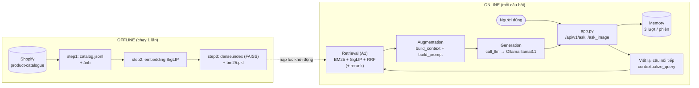
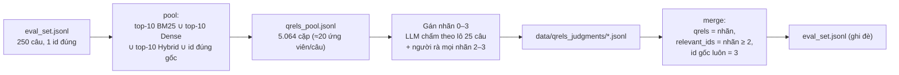
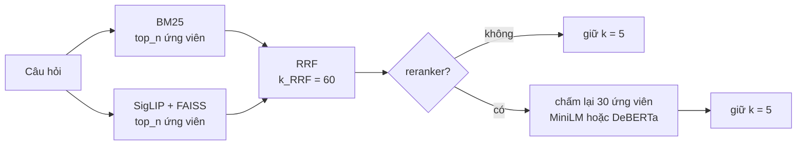
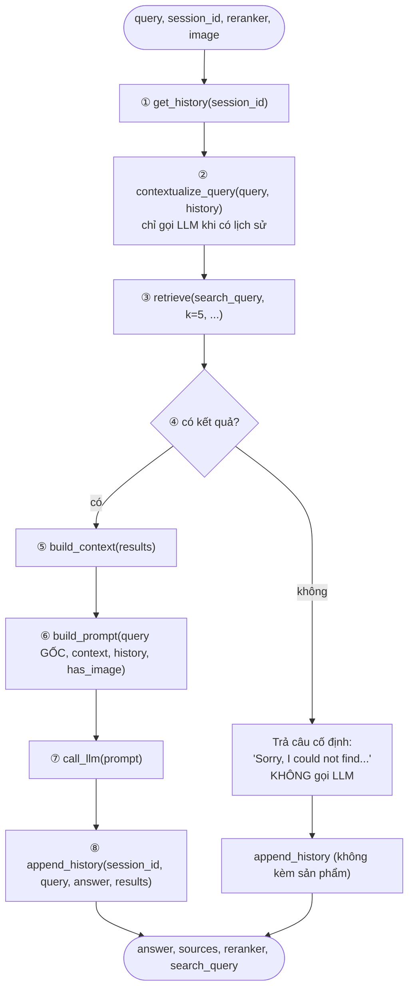
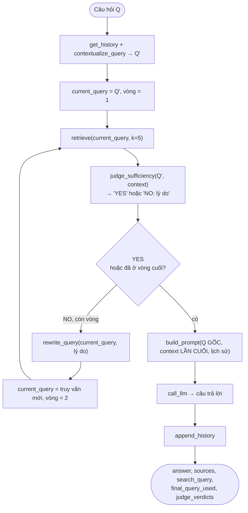
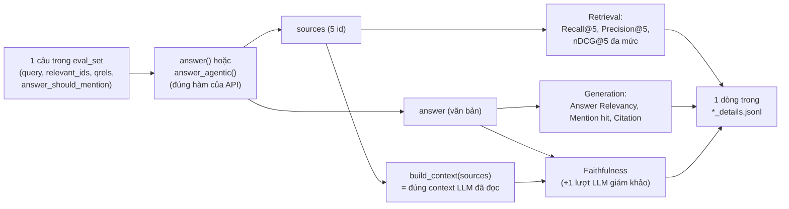
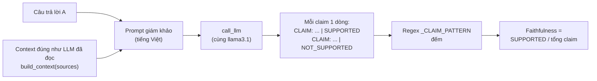
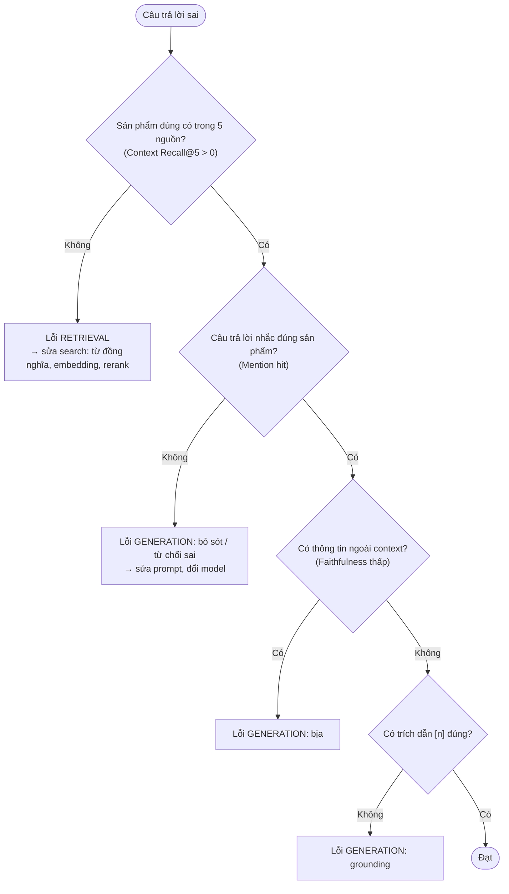

# Hiểu hệ thống RAG (A3) từ tổng quan đến từng bước

Tài liệu này giải thích **hệ thống chạy thế nào** và **các con số trong báo cáo được đo ra sao**. Mỗi bước đều ghi rõ: ý tưởng, hàm nào làm, đầu vào, đầu ra, kèm ví dụ lấy từ chính file kết quả của project (không phải ví dụ bịa).

Báo cáo nộp là [BAO_CAO_A3_NEWEST.md](BAO_CAO_A3_NEWEST.md). Tài liệu này là bản "đọc để hiểu" đi kèm báo cáo đó.

---

## Mục lục

- [Cách đọc và các tài liệu đã có](#cách-đọc-và-các-tài-liệu-đã-có)
- [Phần 0. Bức tranh tổng quan](#phần-0-bức-tranh-tổng-quan)
- [Phần 1. Dữ liệu và ground truth](#phần-1-dữ-liệu-và-ground-truth)
- [Phần 2. Offline: dựng chỉ mục](#phần-2-offline-dựng-chỉ-mục)
- [Phần 3. Tầng Retrieval (dùng lại A1)](#phần-3-tầng-retrieval-dùng-lại-a1)
- [Phần 4. Luồng Naive RAG, từng bước](#phần-4-luồng-naive-rag-từng-bước)
- [Phần 5. Memory hội thoại](#phần-5-memory-hội-thoại)
- [Phần 6. Luồng Agentic RAG](#phần-6-luồng-agentic-rag)
- [Phần 7. Hỏi bằng ảnh](#phần-7-hỏi-bằng-ảnh)
- [Phần 8. API và giao diện](#phần-8-api-và-giao-diện)
- [Phần 9. Đo lường: từng metric tính thế nào](#phần-9-đo-lường-từng-metric-tính-thế-nào)
- [Phần 10. Các thí nghiệm ablation](#phần-10-các-thí-nghiệm-ablation)
- [Phần 11. Chẩn đoán lỗi Retrieval / Generation](#phần-11-chẩn-đoán-lỗi-retrieval--generation)
- [Phần 12. Câu hỏi hay gặp khi bảo vệ](#phần-12-câu-hỏi-hay-gặp-khi-bảo-vệ)
- [Phụ lục. Bản đồ file](#phụ-lục-bản-đồ-file)

---

## Cách đọc và các tài liệu đã có

Project đã có nhiều tài liệu, mỗi cái trả lời một câu hỏi khác nhau:

| Tài liệu | Trả lời câu hỏi | Khi nào đọc |
|---|---|---|
| **File này** | Hệ thống chạy thế nào, các con số được đo ra sao | Đọc đầu tiên để hiểu toàn bộ |
| [BAO_CAO_A3_NEWEST.md](BAO_CAO_A3_NEWEST.md) | Báo cáo nộp: kết quả, bảng số, kết luận | Khi cần số liệu đầy đủ, nguyên văn prompt (Phụ lục A) |
| [CONG_THUC_DO_LUONG.md](CONG_THUC_DO_LUONG.md) | Công thức ngắn gọn của mọi con số | Tra nhanh một công thức |
| [CAU_TRUC_DU_AN.md](CAU_TRUC_DU_AN.md) | Từng file trong project làm gì | Khi cần tìm code |
| [HOC_LY_THUYET.md](HOC_LY_THUYET.md) | Lý thuyết môn học (BM25, embedding, RRF, nDCG, RAG...) theo slide | Khi cần ôn lý thuyết nền |
| [HUONG_DAN_STEP_BY_STEP.md](HUONG_DAN_STEP_BY_STEP.md) | Thứ tự chạy lệnh | Khi cần chạy lại |
| [BAO_CAO_TONG_HOP.md](BAO_CAO_TONG_HOP.md) | Báo cáo A1 (search) | Khi bị hỏi về tầng Retrieval |

**Cách đọc file này:** đọc Phần 0 để có bức tranh chung. Sau đó đọc Phần 3 → 7 để hiểu luồng chạy, và Phần 9 → 11 để hiểu cách chấm điểm. Phần 12 gom các câu hỏi hay bị hỏi.

---

## Phần 0. Bức tranh tổng quan

### 0.1. Hệ thống làm gì

Đây là **chatbot tư vấn sản phẩm**. Người dùng hỏi bằng chữ, bằng ảnh, hoặc cả hai, và có thể hỏi nhiều lượt. Chatbot tìm sản phẩm trong catalog 2.000 sản phẩm, rồi nhờ LLM viết câu trả lời **chỉ dựa trên sản phẩm tìm được**, có trích dẫn `[1]`, `[2]`...

RAG = **R**etrieval (tìm) + **A**ugmentation (đưa kết quả tìm vào prompt) + **G**eneration (LLM viết câu trả lời).

### 0.2. Các khối của hệ thống



| Khối | Làm gì | File, hàm |
|---|---|---|
| Retrieval | Tìm 5 sản phẩm liên quan nhất | `search_core.search()`, gọi qua `rag_core.retrieve()` |
| Augmentation | Viết 5 sản phẩm thành danh sách `[1]..[5]`, ghép vào prompt cùng luật và lịch sử | `rag_core.build_context()`, `build_prompt()` |
| Generation | Gửi prompt cho LLM, nhận câu trả lời | `rag_core.call_llm()` |
| Memory | Nhớ 3 lượt gần nhất của mỗi phiên chat | `get_history()`, `append_history()`, `contextualize_query()` |
| Naive RAG | Tìm 1 lần → trả lời 1 lần | `rag_core.answer()` |
| Agentic RAG | Tìm → LLM tự đánh giá → nếu thiếu thì viết lại truy vấn và tìm lại → trả lời | `rag_core.answer_agentic()` |
| Hỏi bằng ảnh | Ảnh dùng để tìm, LLM vẫn chỉ đọc chữ | `rag_core._retrieve_with_image()` |

**Nguyên tắc quan trọng nhất:** A3 **không viết lại phần tìm kiếm**. Mọi lần tìm đều gọi đúng `search()` của A1. Các script ablation cũng gọi đúng `answer()` / `answer_agentic()` / `retrieve()` mà API dùng, nên số đo phản ánh đúng hệ thống thật.

### 0.3. Theo chân một câu hỏi thật (hai lượt)

Ví dụ lấy từ `data/rag_ablation_details.jsonl` (câu #44, cấu hình Naive) và `data/multiturn_ablation_details.jsonl`.

**Lượt 1.** Người dùng hỏi: *"tool lanyard with a carabiner for working at height"*

| Bước | Chuyện gì xảy ra | Kết quả |
|---|---|---|
| 1. Memory | Phiên mới, chưa có lịch sử | `history = []` |
| 2. Viết lại câu hỏi | Không có lịch sử nên bỏ qua, không gọi LLM | Truy vấn tìm kiếm = câu gốc |
| 3. Retrieval | BM25 và SigLIP mỗi bên lấy 50 ứng viên, gộp RRF, giữ 5 | id `[827, 379, 1183, 271, 1368]` |
| 4. Context | Viết thành danh sách đánh số | `[1] Squids 3105 Tool Lanyard with Aluminum Carabiner + Cinch-Loop, 15 lb Max Working Capacity...`<br/>`[2] Tool Holding Accessories; Product Type: Tool Lanyard; ... Connection Type: Carabiner`<br/>`[3] 10.5mm Outdoor Climbing Double Lanyard ...`<br/>`[4] Squids 3134 Barcode Scanner Lanyard Sling ...`<br/>`[5] SG-MC33-LNYDB-01 - Zebra MC33 RETRACTABLE LANYARD ...` |
| 5. Prompt | Luật grounding + context + câu hỏi + yêu cầu trích dẫn | Một chuỗi văn bản (xem 4.3) |
| 6. LLM | llama3.1 viết câu trả lời | *"I can suggest [1] Squids 3105 Tool Lanyard with Aluminum Carabiner + Cinch-Loop, which has a 15 lb Max Working Capacity and a carabiner for working at height."* |
| 7. Memory | Lưu câu hỏi, câu trả lời và tên 3 sản phẩm đầu | Phiên có 1 lượt |

Điểm của câu này: Context Recall@5 = 1.0 (cả 2 sản phẩm đúng 827 và 379 đều có), Precision = 1.0, nDCG = 1.0, Faithfulness = 0.667, Mention hit = 0.5, Citation = 1. Cách tính từng con số ở [Phần 9](#phần-9-đo-lường-từng-metric-tính-thế-nào).

**Lượt 2.** Người dùng hỏi tiếp: *"show me more options like that"*

| Cách tìm | Câu dùng để tìm | 5 id tìm được | Nhận xét |
|---|---|---|---|
| Không dùng lịch sử (raw) | `show me more options like that` | `[1729, 133, 1522, 1485, 1907]` | Toàn sản phẩm lạc đề: câu không chứa thông tin sản phẩm nào |
| **Viết lại bằng LLM (cách chatbot dùng)** | `tool lanyard with carabiner` | `[379, 827, 271, 757, 851]` | Tìm lại đúng nhóm sản phẩm |

Đây là lý do Memory phải được dùng **ngay ở bước tìm kiếm**, không chỉ chèn vào prompt trả lời (đo ở [10.3](#103-thí-nghiệm-3--memory-khi-tìm-kiếm-hội-thoại-nhiều-lượt)).

### 0.4. Mỗi câu hỏi tốn bao nhiêu lượt gọi LLM

| Luồng | Câu đầu phiên | Câu nối tiếp (có lịch sử) |
|---|---|---|
| Naive | 1 (trả lời) | 2 (viết lại + trả lời) |
| Naive, tìm kiếm rỗng | 0 (trả câu cố định) | 1 |
| Agentic, giám khảo nói "đủ" ngay | 2 (đánh giá + trả lời) | 3 |
| Agentic, phải tìm lại | 4 (đánh giá + viết lại + đánh giá + trả lời) | 5 |
| Khi chạy ablation | cộng thêm 1 lượt chấm Faithfulness | |

---

## Phần 1. Dữ liệu và ground truth

### 1.1. Catalog sản phẩm: `data/catalog.jsonl`

2.000 sản phẩm từ `Shopify/product-catalogue` (Hugging Face), xáo trộn với seed 42. Mỗi dòng:

```json
{"id": 0, "image_path": "data/images/000000.jpg",
 "caption": "Plato Hydrometer, 0 to 32 degrees",
 "search_text": "Plato Hydrometer, 0 to 32 degrees Plato Hydrometer,0 to 32 degrees",
 "category": "Home & Garden > Kitchen & Dining > Kitchen Tools & Utensils > ...",
 "brand": "Vee Gee"}
```

| Trường | Dùng ở đâu |
|---|---|
| `caption` (tên sản phẩm) | Đưa vào context cho LLM; reranker chấm cặp (câu hỏi, caption) |
| `search_text` (tên + mô tả) | BM25 tìm trên trường này |
| ảnh | SigLIP mã hoá thành vector để tìm (cả câu hỏi chữ lẫn ảnh) |
| `brand`, `category` | Hiện ở khung chi tiết sản phẩm, dùng khi gán qrels; **không đưa vào context** |

Lưu ý: catalog **không có giá**, và tên sản phẩm có nhiều ngôn ngữ (Anh là chính, ngoài ra có Hà Lan, Na Uy, Romania...). Hai điểm này giải thích phần lớn lỗi ở Phần 11.

### 1.2. Bộ câu hỏi: `data/eval_set.jsonl` (250 câu)

Dùng chung cho A1 và A3, do `step15_expand_eval_set.py` gộp ra.

| Nhóm | Số câu | Vị trí trong file | Cách tạo |
|---|---|---|---|
| A1 viết tay | 30 | dòng 0–29 | Trộn câu có từ khoá chính xác, câu diễn đạt lại, câu mơ hồ |
| A3 viết tay | 20 | dòng 30–49 | Viết theo nhu cầu tư vấn |
| Sinh từ mẫu | 200 | dòng 50–249 | 10 mẫu câu (vd "need to buy ...", "price of ..."), điền 8 từ đầu tên sản phẩm |

Vì vậy các script tách kết quả thành **"50 câu viết tay"** (`index < 50`) và **"câu sinh từ mẫu"**.

Một dòng sau khi đã có qrels:

```json
{"query": "tool lanyard with a carabiner for working at height",
 "query_type": "text",
 "target_ids": [827],
 "relevant_ids": [379, 827],
 "qrels": {"379": 3, "827": 3, "271": 1, "757": 1, "851": 1, "1183": 1, "1368": 1, "...": 0},
 "answer_should_mention": ["Ergodyne", "Lanyard"]}
```

| Trường | Ý nghĩa | Dùng cho metric |
|---|---|---|
| `target_ids` | Sản phẩm đúng gốc của A1 (luôn nhãn 3) | Ghép ảnh với câu chữ (step18) |
| `qrels` | Nhãn 0–3 cho từng sản phẩm trong pool | Context nDCG@5 đa mức |
| `relevant_ids` | Các id có nhãn ≥ 2, gọi là tập **G** | Recall, Precision, đúng ở [1] |
| `answer_should_mention` | Brand + vài từ đầu tên sản phẩm đúng | Mention hit |

### 1.3. Qrels đa mức: vì sao cần và làm thế nào

**Vấn đề:** ground truth của A1 chỉ có **1 id đúng mỗi câu**. Nếu catalog có sản phẩm khác cũng thoả câu hỏi (vd hai loại dây đeo dụng cụ có carabiner), hệ thống trả về sản phẩm đó vẫn bị tính là sai.

**Cách làm** (`step16_build_qrels.py`), theo cách TREC xây qrels:



| Nhãn | Ý nghĩa | Ví dụ với câu "tool lanyard with a carabiner..." |
|---|---|---|
| 3 | Đúng hoàn toàn | 827 Squids Tool Lanyard with Aluminum Carabiner; 379 Knipex Tool Lanyard, Connection Type: Carabiner |
| 2 | Đúng loại, lệch nhẹ một thuộc tính phụ | (câu này không có) |
| 1 | Một phần: cùng nhóm, phụ kiện | 1183 dây leo núi; 271 dây đeo máy quét mã vạch |
| 0 | Không liên quan | Phần còn lại của pool, và mọi sản phẩm ngoài pool |

Hai quy tắc chặn: khác loại sản phẩm thì tối đa nhãn 1; sai ràng buộc cứng (sai model, sai brand khi câu có nêu brand) thì tối đa nhãn 1. Khi rà soát còn phát hiện 3 câu hỏi mâu thuẫn với chính sản phẩm đúng, nên sửa câu hỏi (`QUERY_FIXES` trong step16).

**Kết quả:** 5.064 cặp gồm 252 nhãn 3, 10 nhãn 2, 397 nhãn 1, 4.405 nhãn 0. |G| = 1 ở 240/250 câu. Nhãn 1 có mặt ở 179 câu, nhờ đó nDCG phân biệt được "đưa phụ kiện liên quan vào context" với "đưa sản phẩm lạc đề vào context".

### 1.4. Bộ truy vấn ảnh: `data/eval_set_image.jsonl` (100 ảnh)

`step13_build_image_eval_set.py` lấy ảnh của 100 sản phẩm đúng khác nhau trong eval set, mỗi ảnh áp một phép biến đổi xoay vòng: **cắt / xoay / đổi độ sáng**, lưu vào `data/query_images/`. Mỗi ảnh ghép được với câu chữ, qrels và `answer_should_mention` của câu gốc.

### 1.5. Hội thoại nhiều lượt: sinh tự động, không cần gán nhãn thêm

`step19_ablation_multiturn.py` tạo 500 hội thoại hai lượt từ 250 câu (chi tiết ở [10.3](#103-thí-nghiệm-3--memory-khi-tìm-kiếm-hội-thoại-nhiều-lượt)). Mẹo: lượt 2 hoặc giữ nguyên nhu cầu của lượt 1, hoặc chính là một câu trong eval set, nên **dùng lại được qrels sẵn có**.

---

## Phần 2. Offline: dựng chỉ mục

Chạy một lần. Kết quả được `search_core.py` nạp vào RAM lúc khởi động.

| Bước | Script | Ý tưởng | Đầu vào | Đầu ra |
|---|---|---|---|---|
| 1 | `step1_build_catalog.py` | Tải dataset, chuẩn hoá về một định dạng | Hugging Face | `data/catalog.jsonl`, `data/images/*.jpg` |
| 2 | `step2_build_embeddings.py` | Mã hoá mỗi ảnh sản phẩm thành vector SigLIP 768 chiều, chuẩn hoá L2 | catalog + ảnh | `image_embeddings.npy`, `text_embeddings.npy` |
| 3 | `step3_build_index.py` | FAISS cho dense, BM25 cho sparse | catalog + embedding ảnh | `data/dense.index` (FAISS `IndexFlatIP`), `data/bm25.pkl` |

- **Chỉ mục dense được dựng trên embedding ẢNH**, không phải embedding tên sản phẩm. SigLIP đưa chữ và ảnh vào cùng một không gian vector, nên câu hỏi chữ vẫn tìm được ảnh. Nhờ vậy cùng một chỉ mục phục vụ được cả câu hỏi chữ lẫn câu hỏi ảnh.
- **`IndexFlatIP`** là tìm vét cạn bằng tích vô hướng. Vector đã chuẩn hoá nên tích vô hướng chính là cosine. Với 2.000 vector, vét cạn đủ nhanh, không cần ANN.
- Có thể chạy cả 3 bước trên Kaggle bằng `kaggle/kaggle_build_A1_data_siglip.py`.

---

## Phần 3. Tầng Retrieval (dùng lại A1)

Hàm trung tâm: `search_core.search(query, query_type, k, components, top_n, reranker, rerank_pool)`.



### 3.1. BM25 (nhánh từ khoá)

- **Ý tưởng:** chấm điểm theo số từ trùng giữa câu hỏi và `search_text`. Từ hiếm (IDF cao) được nhiều điểm hơn, văn bản dài bị phạt nhẹ.
- **Code:** `_run_bm25`. Tách từ bằng `query.lower().split()` (phải giống hệt cách tách lúc build ở step3), `get_scores` trên cả 2.000 sản phẩm, sắp xếp giảm dần, lấy `top_n`.
- **Mạnh:** khớp chính xác tên riêng, mã sản phẩm (*"igus igumid g"*), tên không phải tiếng Anh.
- **Yếu:** không hiểu từ đồng nghĩa. Câu *"device that helps someone relearn to walk"* không có từ nào trùng với *"Gait Trainer"*.
- Nhánh này trả `[]` khi câu hỏi là ảnh.

### 3.2. Dense SigLIP (nhánh ngữ nghĩa)

- **Ý tưởng:** câu hỏi và ảnh sản phẩm được đưa vào cùng không gian vector. Gần nhau về nghĩa thì gần nhau về vector (cosine lớn).
- **Code:** `_run_dense` gọi `_encode_text` (câu hỏi chữ) hoặc `_encode_image` (câu hỏi ảnh), rồi `_dense_index.search(vec, top_n)`. Vị trí vector trong FAISS chính là id sản phẩm.
- **Chi tiết dễ sai:** SigLIP lấy biểu diễn ở **token cuối** của chuỗi đã pad, nên khi mã hoá chữ phải pad cố định `padding="max_length", max_length=64`, đúng như lúc pretrain. Pad động như CLIP thì Recall@10 = 0.000 (đã gặp lỗi này khi chạy trên Kaggle).
- **Vì sao chọn SigLIP thay CLIP:** ablation embedding của A1 cho dense-only Recall@10 = 0.920 (SigLIP) so với 0.656 (CLIP B/32).

### 3.3. RRF: gộp hai danh sách

- **Vấn đề:** điểm BM25 (vd 12.7) và cosine (vd 0.31) khác thang đo, không cộng thẳng được.
- **Ý tưởng:** chỉ dùng **thứ hạng**: `score(d) = Σ 1 / (60 + rank)`, rank tính từ 1, cộng qua các danh sách có chứa d.
- **Code:** `rrf_fusion(list_a, list_b, k=60)`; `_fuse_all` gộp lần lượt từng cặp danh sách.

**Ví dụ tính tay:** sản phẩm 827 đứng hạng 1 ở BM25 và hạng 2 ở Dense:

```
score(827) = 1/(60+1) + 1/(60+2) = 0.01639 + 0.01613 = 0.0325
```

Đây chính là số `score=0.0325` mà người dùng thấy trong context. Một sản phẩm chỉ xuất hiện ở một nhánh, hạng 1, được tối đa 0.0164. Vì vậy sản phẩm được **cả hai nhánh** đồng ý sẽ thắng.

### 3.4. Cắt danh sách: `top_n` và `k`

| Trường hợp | Mỗi nhánh lấy (`top_n`) | Sau RRF giữ |
|---|---|---|
| Không rerank | 50 | 5 đầu (`k = 5`) |
| Có rerank | 30 (`RERANK_POOL`) | 30 ứng viên → rerank → 5 đầu |

A3 dùng `k = 5` (A1 dùng 10), vì context ngắn giúp LLM ít bị lạc hướng.

### 3.5. Rerank (tuỳ chọn, mặc định tắt)

- **Ý tưởng:** BM25 và Dense mã hoá câu hỏi và sản phẩm **riêng rẽ** (nhanh, nhưng thô). Cross-encoder đọc **cặp (câu hỏi, tên sản phẩm) cùng lúc** nên chấm chính xác hơn, nhưng chậm. Vì vậy chỉ dùng nó để xếp lại 30 ứng viên đầu: kiến trúc hai tầng.
- Rerank **chỉ xếp lại**, không tìm thêm ứng viên mới. Sản phẩm đúng không có trong 30 ứng viên thì rerank cũng không cứu được.

| | MiniLM (A1) | DeBERTa distill (A2) |
|---|---|---|
| Hàm | `rerank()` | `distilled_rerank()` |
| Model | `cross-encoder/ms-marco-MiniLM-L-6-v2` | `models/deberta-10k-rank_net` (DeBERTa-v3-base) |
| Học từ | Nhãn do người gán trên MS MARCO | Thứ tự do ChatGPT xếp cho 10K câu MS MARCO, loss RankNet (paper A2: Sun et al., EMNLP 2023) |
| Thời gian / câu (CPU) | 0.29 s | 3.16 s |

### 3.6. `rag_core.retrieve()`: cửa ngõ duy nhất A3 dùng để tìm

```python
def retrieve(query, k, components=None, reranker=None, image=None):
    if image is not None:            # có ảnh → Phần 7
        return _retrieve_with_image(query, image, k, components)
    if reranker is None:             # mặc định
        return search(query, "text", k=k, components=components)
    return search(query, "text", k=k, top_n=30, reranker=reranker, rerank_pool=30)
```

- **Đầu vào:** chuỗi truy vấn (đã viết lại nếu là câu nối tiếp), `k = 5`, tuỳ chọn reranker hoặc ảnh.
- **Đầu ra (gọi là `sources`):** list 5 dict `{id, image_path, caption, score}`; có rerank thì thêm `rerank_score`.

---

## Phần 4. Luồng Naive RAG, từng bước

Hàm `rag_core.answer(query, k=5, components=None, session_id=None, reranker=None, image=None)`. Đây là **baseline**.

### 4.1. Sơ đồ



### 4.2. Bảng từng bước

| # | Bước | Ý tưởng | Đầu vào | Đầu ra | Ví dụ (câu #44) |
|---|---|---|---|---|---|
| ① | Đọc Memory | Lấy lịch sử phiên; không có `session_id` thì mỗi câu độc lập | `session_id` | List ≤ 3 lượt | `[]` |
| ② | Viết lại câu hỏi | Câu nối tiếp ("cái đó", "còn màu khác không") phải thành câu tìm kiếm độc lập (Phần 5) | câu hỏi + lịch sử | `search_query` | Không có lịch sử → giữ nguyên |
| ③ | Tìm kiếm | BM25 + SigLIP + RRF (+ rerank) | `search_query`, k=5 | 5 `sources` | `[827, 379, 1183, 271, 1368]` |
| ④ | Kiểm tra rỗng | Context rỗng mà vẫn gọi LLM thì dễ bịa | `sources` | rẽ nhánh | Có kết quả |
| ⑤ | Dựng context | Mỗi sản phẩm một dòng, đánh số để LLM trích dẫn | `sources` | chuỗi `[1] ... (score=...)` | `[1] Squids 3105 Tool Lanyard ... (score=0.0325)` |
| ⑥ | Dựng prompt | Ghép luật + lịch sử + context + câu hỏi **gốc** | câu gốc, context, lịch sử | chuỗi prompt | Xem 4.3 |
| ⑦ | Gọi LLM | POST tới Ollama `/api/generate`, `stream=false` | prompt | câu trả lời | *"I can suggest [1] Squids 3105 ..."* |
| ⑧ | Ghi Memory | Lưu lượt này cho lượt sau | câu hỏi, câu trả lời, `sources` | phiên +1 lượt | — |

**Đầu ra của `answer()`:**

```json
{"answer": "I can suggest [1] Squids 3105 Tool Lanyard ...",
 "sources": [{"id": 827, "image_path": "...", "caption": "Squids 3105 ...", "score": 0.0325}, "..."],
 "reranker": null,
 "search_query": "tool lanyard with a carabiner for working at height"}
```

**Hai câu hỏi dùng ở hai chỗ khác nhau:** câu đã viết lại (`search_query`) chỉ dùng để **tìm**. Câu đưa vào prompt trả lời vẫn là **câu gốc** của người dùng, để LLM trả lời đúng điều người dùng hỏi.

### 4.3. Prompt trả lời (`build_prompt`)

```
You are a product assistant. Use ONLY the information in the product list below.
Do NOT invent details (price, features, colors...) that are not in the list.
If no product in the list fits the request, say clearly that you could not find one instead of guessing.
{lịch sử hội thoại, nếu có}
{dòng báo có ảnh, nếu có}
Product list:
[1] Squids 3105 Tool Lanyard with Aluminum Carabiner + Cinch-Loop, ... (score=0.0325)
[2] ...
[5] ...

Customer message: "tool lanyard with a carabiner for working at height"

Reply briefly in English. CITE the list number in square brackets (e.g. [1]) every time you
mention a specific product. If the message refers to an earlier turn, use the conversation
history above to work out which product it is about; if the list has no product of that type,
say you could not find other options. Answer the customer directly: never repeat their message
back or ask them a question.
```

| Phần | Mục đích | Metric kiểm tra |
|---|---|---|
| "Use ONLY... Do NOT invent" | Grounding: không bịa | Faithfulness |
| "say clearly that you could not find" | Không đoán bừa khi không có sản phẩm phù hợp | (gây tác dụng phụ, xem Phần 11) |
| "CITE the list number" | Trích dẫn để người dùng kiểm chứng | Citation rate |
| "never repeat... or ask them a question" | Sửa lỗi đã gặp: LLM chép lại câu mẫu, hỏi ngược khách | — |

**Vì sao prompt bằng tiếng Anh:** bản đầu dùng prompt tiếng Việt và gặp hai lỗi: LLM dịch câu tìm kiếm sang tiếng Việt nên BM25 không khớp catalog tiếng Anh, và LLM chép lại câu ví dụ trong prompt thành câu trả lời.

### 4.4. Gọi LLM (`call_llm`)

| Thiết lập | Giá trị | Lý do |
|---|---|---|
| Model | `OLLAMA_MODEL` trong `.env`, mặc định `llama3.1` (8B) | `qwen2.5:3b` chỉ trả về chuỗi `"[1]"` |
| URL | `OLLAMA_URL`, có thể ghi nhiều địa chỉ cách nhau dấu phẩy | Mỗi GPU một server, các lượt gọi chia vòng tròn |
| Timeout | 600 s | Chạy CPU có thể mất vài phút |
| Thử lại | 3 lần (chờ 5 s, 10 s) với lỗi mạng, timeout, 5xx; lỗi 4xx báo ngay | Lỗi 4xx (sai tên model) thì thử lại cũng vô ích |

Muốn đổi sang API khác (OpenAI, Claude...) chỉ cần sửa hàm này.

---

## Phần 5. Memory hội thoại

### 5.1. Cấu trúc dữ liệu

`rag_core._SESSION_STORE` là một dict trong RAM, khoá là `session_id`:

```python
{"session-p57iqj4jb4s": [
    {"query":    "tool lanyard with a carabiner for working at height",
     "answer":   "For working at height, I recommend the Squids 3105 Tool Lanyard ... [1]",
     "products": ["Squids 3105 Tool Lanyard with Aluminum Carabiner ...",   # 3 sản phẩm đầu
                  "Tool Holding Accessories; Product Type: Tool Lanyard; ...",
                  "10.5mm Outdoor Climbing Double Lanyard ..."]}
]}
```

| Hằng số | Giá trị | Ý nghĩa |
|---|---|---|
| `MAX_HISTORY_TURNS` | 3 | Giữ 3 lượt gần nhất; quá thì xoá lượt cũ nhất, để prompt không dài |
| `HISTORY_PRODUCTS` | 3 | Nhớ tên 3 sản phẩm đầu mỗi lượt, để hiểu "cái đó", "cái thứ 2" |
| Câu trả lời cũ trong prompt | cắt còn 150 ký tự | Tiết kiệm độ dài prompt |
| Tên sản phẩm trong prompt | cắt còn 80 ký tự | Như trên |

### 5.2. Vòng đời một phiên

1. Mở trang `/chat`: trình duyệt sinh `session_id` ngẫu nhiên, gửi kèm mọi câu hỏi.
2. **Đọc:** `get_history(session_id)`.
3. **Viết lại câu hỏi:** `contextualize_query(query, history)` (5.3). Lượt đầu bỏ qua.
4. **Chèn vào prompt trả lời:** `_format_history(history)` biến lịch sử thành đoạn văn:
   ```
   Conversation so far (to understand the current message):
   - Customer: "tool lanyard with a carabiner for working at height" -> Assistant: "For working at height, I recommend the Squids 3105 Tool Lanyard with Aluminum Carabiner + Cinch-Loop, which has a max working capacity of 15 lb and is ad..."
     Suggested products: Squids 3105 Tool Lanyard with Aluminum Carabiner + Cinch-Loop, 15 lb Max W; Tool Holding ...; 10.5mm ...
   ```
5. **Ghi:** `append_history(session_id, query, answer, sources)`.
6. **Xoá:** nút "Mới" gọi `POST /api/v1/reset_session`.

Memory được dùng ở **hai chỗ**: (a) viết lại câu hỏi trước khi tìm, (b) chèn lịch sử vào prompt trả lời.

### 5.3. Viết lại câu nối tiếp: `contextualize_query`

- **Ý tưởng:** câu *"any other color?"* không chứa thông tin sản phẩm nào, tìm thẳng thì ra rác. LLM đọc lịch sử rồi viết lại thành **một câu tìm kiếm độc lập, dạng từ khoá tiếng Anh**.
- **Khi nào chạy:** chỉ khi có lịch sử và câu hỏi không rỗng (không tốn LLM ở lượt đầu).
- **Luật trong prompt:**
  - Câu nhắc tới sản phẩm trước ("that one", "cheaper") → lấy loại sản phẩm từ "Suggested products" của lượt gần nhất.
  - Hỏi màu, cỡ hoặc hãng khác → **bỏ giá trị cũ**, chỉ giữ loại sản phẩm.
  - Chủ đề mới hoàn toàn → giữ nghĩa câu mới, bỏ qua lịch sử.
  - Giữ nguyên tên brand và tên sản phẩm.
  - Có 3 ví dụ mẫu, vd *"Men's Black Leather Biker Jacket" + "any other color?" → "leather biker jacket"*.
- **Chốt chặn:** nếu câu viết lại có chữ tiếng Việt trong khi câu hỏi và lịch sử không có (`_has_vietnamese`), dùng lại câu gốc. Đây là lỗi đã gặp: LLM tự dịch truy vấn sang tiếng Việt.

| Ví dụ | Lượt 1 | Lượt 2 | Câu dùng để tìm |
|---|---|---|---|
| Hỏi nối tiếp | tool lanyard with a carabiner for working at height | show me more options like that | `tool lanyard with carabiner` |
| Đổi thuộc tính | black leather jacket | is any other color? | `leather jacket` |
| Lỗi đã đo | need to buy plasă de ricoșeu fotbal dublă, reglabilă, galben | any alternatives to that? | `soccer goal net` (dịch mất tên tiếng Romania nên tìm trượt) |

### 5.4. Vì sao chọn viết lại bằng LLM

Đã thử 4 cách (đo ở [10.3](#103-thí-nghiệm-3--memory-khi-tìm-kiếm-hội-thoại-nhiều-lượt)):

| Cách | Hỏi nối tiếp | Đổi chủ đề | Kết luận |
|---|---|---|---|
| Không dùng lịch sử khi tìm | Hỏng (Recall 0.004) | Tốt | Không dùng được |
| Ghép câu lượt 1 + lượt 2 | Tốt | Hỏng (đúng ở [1] chỉ 39.6%) | Câu cũ lấn câu mới |
| **Viết lại bằng LLM** | Khá (0.868) | Khá (0.938) | **Cân bằng nhất**, tốn 1 lượt LLM |

### 5.5. Hạn chế

Memory nằm trong RAM: mất khi khởi động lại server, không chia sẻ được giữa nhiều server, chỉ nhớ 3 lượt. Bước viết lại có thể dịch tên sản phẩm không phải tiếng Anh hoặc thay mã sản phẩm bằng tên loại chung chung.

---

## Phần 6. Luồng Agentic RAG

Hàm `rag_core.answer_agentic(query, k=5, components=None, max_iters=2, session_id=None, reranker=None, image=None)`.

### 6.1. Ý tưởng

Naive tìm một lần rồi trả lời, kể cả khi kết quả tìm kém. Agentic thêm một vòng **tự kiểm tra**: LLM đọc context và tự hỏi "danh sách này đủ để trả lời chưa?". Nếu chưa, LLM viết lại truy vấn và tìm lại.

### 6.2. Sơ đồ



### 6.3. Từng bước

| Bước | Hàm | Ý tưởng | Đầu vào | Đầu ra |
|---|---|---|---|---|
| 1 | `contextualize_query` | Như Naive | câu hỏi + lịch sử | `Q'` |
| 2 | `retrieve` | Như Naive | `current_query` | 5 `sources` |
| 3 | `judge_sufficiency` | LLM làm giám khảo | `Q'` + context | `"YES"` hoặc `"NO: <lý do>"` |
| 4 | `rewrite_query` | LLM viết truy vấn cụ thể hơn, dựa trên lý do còn thiếu | truy vấn hiện tại + lý do | truy vấn mới (đã bỏ ngoặc kép) |
| 5 | lặp 2–4 | Tối đa `max_iters = 2` vòng tìm | | |
| 6 | `build_prompt` + `call_llm` | Trả lời câu **gốc**, dùng context của **lần tìm cuối** | | câu trả lời |

**Prompt giám khảo:**
```
Question: "{Q'}"
Retrieved product list:
{context}

Does the list above contain enough information to answer the question?
Reply with EXACTLY one of these two forms:
YES
or
NO: <short reason>
```

**Prompt viết lại:**
```
The customer asked: "{truy vấn hiện tại}"
The current search results are NOT enough because: {lý do}
Rewrite it as ONE SHORT English search query with more specific keywords to get better results.
Return ONLY the new query: no explanation, no quotes.
```

**Các quy tắc thiết kế:**
- Giám khảo **luôn so với câu hỏi gốc** `Q'`, không so với truy vấn đã viết lại, để không trôi khỏi ý người dùng.
- `max_iters = 2` là giới hạn cứng để không lặp vô hạn.
- Truy vấn viết lại được bỏ ngoặc kép, vì BM25 tách từ theo khoảng trắng nên `"wheelbarrow` không khớp `wheelbarrow`.
- Trả thêm `final_query_used` và `judge_verdicts` để phân tích lỗi.

### 6.4. Hai ví dụ thật: một lần giúp, một lần hại

**Giúp được** (câu #27): *"device that helps someone relearn to walk after an injury"*

| | Naive | Agentic |
|---|---|---|
| Vòng 1 | `[1006, 1368, 1547, 1873, 1089]`, chỉ có gậy chống 1089 (nhãn 2) | Giống Naive. Giám khảo: *"NO: None of the products in the list are related to helping someone relearn to walk after an injury."* |
| Viết lại | — | `orthotic walker devices for gait rehabilitation` |
| Vòng 2 | — | `[1681, 1089, 916, 602, 709]`: có 1681 **Gait Trainer (nhãn 3)**. Giám khảo: `YES` |
| Context Recall@5 | 0.25 | 0.5 |
| Câu trả lời | gợi ý gậy chống | *"I think [1] Drive Medical tk 1000 Trekker Gait Trainer... could help someone relearn to walk"* |

**Làm hại** (câu #172): *"igus - 1 ft. long, igumid g, snap"*

| | Naive | Agentic |
|---|---|---|
| Vòng 1 | `[1186, 1727, ...]`: sản phẩm đúng 1727 ở **[2]** | Giống Naive. Giám khảo: *"NO: The product description does not exactly match the description in the question."* (sai, vì sản phẩm đúng đã có) |
| Viết lại | — | `igus igumid g 1 foot long plastic rod`: thêm từ đoán "plastic rod", đổi "ft." thành "foot" |
| Vòng 2 | — | `[1256, 1786, 372, 1940, 970]`: **mất** 1727. Giám khảo: `YES` |
| Câu trả lời | *"I found a product that matches your description: [2] Igus - 1 Ft. Long, Igumid G, Snap Open Cable and Hose Carrier."* | *"I couldn't find a product in the list that matches..."* |
| Context Recall@5 | 1.0 | 0.0 |

### 6.5. Kết quả tổng: Agentic không tốt hơn Naive

Trên 250 câu (chi tiết ở [10.2](#102-thí-nghiệm-2--naive-vs-agentic--rerank-6-cấu-hình-250-câu)): Recall 0.968 so với 0.983, các metric Generation chênh dưới ngưỡng nhiễu, tốn thêm 1–3 lượt LLM. Ba nguyên nhân:

1. **Giám khảo quá chặt:** 55/250 câu bị đánh "NO", trong đó 52 câu **đã có** sản phẩm đúng trong context (47 câu đã ở `[1]`). Context chỉ có tên sản phẩm, nên câu hỏi mô tả nhu cầu hiếm khi "khớp chính xác".
2. **Viết lại làm mất tên riêng:** dịch tên tiếng Hà Lan, cắt tên hãng, thay mã sản phẩm bằng tên loại chung chung.
3. **Không quay về kết quả lượt đầu:** luôn dùng kết quả lượt cuối, nên lần viết lại sai làm mất hẳn sản phẩm đúng (4 câu mất, 0 câu được cứu).

---

## Phần 7. Hỏi bằng ảnh

Endpoint `POST /api/v1/ask_image`. Bên trong vẫn là `answer()` / `answer_agentic()`, chỉ có thêm tham số `image`.

### 7.1. Ba chế độ trong `retrieve()`

| Người dùng gửi | Cách tìm (`_retrieve_with_image`) | Rerank |
|---|---|---|
| Chỉ chữ | Như Phần 3 | Theo lựa chọn |
| **Chỉ ảnh** | `search(image, query_type="image")`: SigLIP mã hoá ảnh, FAISS tìm ảnh sản phẩm gần nhất; BM25 tự trả `[]` | Không |
| **Ảnh + chữ** | Lấy 50 ứng viên từ tìm theo ảnh và 50 từ tìm theo chữ (BM25 + Dense), gộp bằng RRF | Không |

### 7.2. Điểm quan trọng

- **LLM không xem được ảnh.** Ảnh chỉ dùng để tìm. Prompt thêm một dòng: *"The customer attached a product photo. You CANNOT see the photo; the product list below was retrieved by visual similarity to it (most similar first)."*
- **Chỉ ảnh, không gõ chữ:** câu hỏi đưa vào prompt là `IMAGE_ONLY_QUERY = "Find products similar to the photo I sent"`.
- **Vì sao tắt rerank khi có ảnh:** reranker chỉ đọc cặp (chữ, tên sản phẩm) nên bỏ mất tín hiệu ảnh. Thử 3 ảnh kèm câu ngắn, cả 3 lần bật cross-encoder đều đẩy sản phẩm đúng xuống (vd ảnh vỏ máy tính bảng + "red case": hạng 1 tụt xuống hạng 3).
- **Memory:** lượt có ảnh được lưu với tiền tố `[image]` (hàm `_history_query`), để lượt sau biết khách đã gửi ảnh.

---

## Phần 8. API và giao diện

| Endpoint | Tham số | Trả về |
|---|---|---|
| `GET /api/v1/ask` | `q`, `k=5`, `agentic`, `reranker=none\|cross_encoder\|deberta`, `session_id` | `{answer, sources, reranker, search_query}`; Agentic thêm `final_query_used`, `judge_verdicts` |
| `POST /api/v1/ask_image` | multipart: `file`, `q` (có thể rỗng), `k`, `agentic`, `session_id` | Như trên, thêm `query_mode` = `image` / `image+text`; `reranker` luôn `null` |
| `GET /api/v1/rerankers` | — | Reranker dùng được (DeBERTa chỉ có khi đã tải checkpoint) |
| `GET /api/v1/products/{id}` | — | Tên, brand, category, mô tả của một sản phẩm |
| `POST /api/v1/reset_session` | `session_id` | Xoá Memory của phiên |
| `GET /chat`, `GET /search` | — | Trang chatbot (A3) và trang tìm kiếm (A1) |

**Xử lý lỗi:** reranker sai tên → HTTP 400; file không phải ảnh → 400; không gọi được Ollama → 503 kèm lý do. `ask_image` chạy LLM trong threadpool để không chặn server.

**Giao diện `/chat`** (`frontend/chat.html`): công tắc Rerank và Agentic, nút đính kèm ảnh, khung chat nhiều lượt. Mỗi `[n]` trong câu trả lời được tách thành thẻ sản phẩm. Cột phải hiện 5 nguồn (ảnh, điểm RRF, điểm rerank); bấm vào thì mở khung chi tiết qua `/api/v1/products/{id}`.

---

## Phần 9. Đo lường: từng metric tính thế nào

### 9.1. Khung chung: chấm một câu (`evaluate_one` trong `step_ablation_rag.py`)



- Mỗi câu được ghi **ngay** vào file chi tiết sau khi chạy xong, nên dừng giữa chừng thì chạy tiếp được bằng `--resume`.
- Câu lỗi (sau 3 lần thử gọi LLM) được ghi kèm trường `error`, không bị bỏ âm thầm. Lần chạy cuối có 0 lỗi.
- **Lấy trung bình:** mỗi metric trung bình trên các câu có giá trị khác `None` (`summarize()`). Tổng hợp ra 3 nhóm: `all` (250 câu), `handwritten` (50 câu đầu), `template` (200 câu sinh từ mẫu).

Ký hiệu cho một câu: **G** = tập id có nhãn ≥ 2; **S = (s₁..s₅)** = 5 nguồn; **rel(d)** = nhãn 0–3 của d; **A** = câu trả lời.

### 9.2. Bảng tổng hợp metric

| Tầng | Metric | Code | Đo điều gì |
|---|---|---|---|
| Retrieval | Context Recall@5 | `metrics.recall_at_k` | Sản phẩm đúng có được đưa cho LLM không |
| Retrieval | Context Precision@5 | `rag_metrics.context_precision_at_k` | Sản phẩm đúng có đứng cao không |
| Retrieval | Context nDCG@5 đa mức | `metrics.ndcg_at_k_graded` | Thứ tự context có đúng mức độ liên quan không |
| Retrieval | Đúng ở [1] | `top1_hit` (step19), đếm từ `retrieved_ids` | Sản phẩm số 1 có thuộc G không |
| Generation | Faithfulness | `rag_metrics.faithfulness` | Câu trả lời có bịa ngoài context không |
| Generation | Answer Relevancy | `rag_metrics.answer_relevancy` | Câu trả lời có đúng chủ đề câu hỏi không |
| Generation | Mention hit | `mention_hit_rate` (step_ablation_rag) | Câu trả lời có nhắc đúng sản phẩm không |
| Generation | Citation rate | `has_valid_citation` | Có ít nhất một `[n]` không |
| Agentic | Rewrite rate | `summarize()` | Tỷ lệ câu phải viết lại truy vấn |

### 9.3. Context Recall@5

```
Recall@5 = |S ∩ G| / |G|
```
- **Ví dụ #44:** G = {379, 827}, S = [827, 379, 1183, 271, 1368] → 2/2 = **1.0**.
- **Ví dụ #27 (Naive):** G = {1681, 376, 597, 1089}, S chỉ có 1089 → 1/4 = **0.25**.
- `None` nếu câu không có ground truth.
- **Cách đọc:** đây là metric quan trọng nhất của tầng Retrieval trong RAG. Recall = 0 thì LLM không thể trả lời đúng, lỗi chắc chắn nằm ở Retrieval.

### 9.4. Context Precision@5 (dạng Average Precision)

```
Precision@5 = (1 / min(|G|, 5)) × Σ_{i: sᵢ ∈ G} (số id đúng trong i nguồn đầu) / i
```
Cộng precision tại **mỗi vị trí có sản phẩm đúng**, nên sản phẩm đúng xếp thấp thì điểm thấp. Khi |G| = 1 (240/250 câu), công thức thu gọn thành **1/hạng**.

| Trường hợp | Tính | Kết quả |
|---|---|---|
| \|G\| = 1, đúng ở hạng 1 | 1/1 | 1.0 |
| \|G\| = 1, đúng ở hạng 2 (vd igus Naive) | 1/2 | 0.5 |
| #44: G = {379, 827}, đúng ở hạng 1 và 2 | (1/1 + 2/2) / 2 | 1.0 |
| #27 Agentic: \|G\| = 4, đúng ở hạng 1 và 2 | (1/1 + 2/2) / min(4, 5) | **0.5** (khớp file kết quả) |

### 9.5. Context nDCG@5 đa mức (theo qrels 0–3)

```
DCG@5  = Σ_{i=1..5} rel(sᵢ) / log₂(i + 1)
IDCG@5 = DCG của 5 nhãn cao nhất trong qrels, xếp giảm dần
nDCG@5 = DCG / IDCG
```
Sản phẩm ngoài qrels tính nhãn 0. Khác Recall và Precision, nDCG **cho điểm cả sản phẩm nhãn 1** (phụ kiện, cùng nhóm).

**Ví dụ #27 (Agentic):** S = [1681, 1089, 916, 602, 709]; qrels: 1681 = 3, 376 = 2, 597 = 2, 1089 = 2, 464 = 1.

| Hạng i | id | rel | log₂(i+1) | rel / log₂(i+1) |
|---|---|---|---|---|
| 1 | 1681 | 3 | 1.000 | 3.000 |
| 2 | 1089 | 2 | 1.585 | 1.262 |
| 3–5 | 916, 602, 709 | 0 | — | 0 |
| | | | **DCG** | **4.262** |

IDCG (thứ tự lý tưởng 3, 2, 2, 2, 1) = 3 + 2/1.585 + 2/2 + 2/2.322 + 1/2.585 = 3 + 1.262 + 1 + 0.861 + 0.387 = **6.510**

nDCG@5 = 4.262 / 6.510 = **0.655** (file kết quả ghi 0.6547).

**Ví dụ #44 (Naive):** S = [827(3), 379(3), 1183(1), 271(1), 1368(1)] trùng đúng thứ tự lý tưởng 3, 3, 1, 1, 1 → nDCG = **1.0**.

### 9.6. Faithfulness: chấm kỹ

**Ý tưởng** (theo RAGAS, tự viết lại, không dùng thư viện `ragas`): một câu trả lời "trung thực" là câu mà **mọi nhận định trong đó đều có trong context**. Không xét đúng sai ngoài đời, chỉ xét có căn cứ trong context hay không.

**Quy trình** (`rag_metrics.faithfulness(answer_text, context_text, llm_call_fn)`):



1. **Đầu vào:** câu trả lời A và context **đúng như LLM đã đọc** (dựng lại bằng `build_context(result["sources"])`).
2. **Prompt giám khảo** (viết bằng tiếng Việt, khác các prompt của chatbot) yêu cầu: tách A thành các claim độc lập; mỗi claim in đúng một dòng `CLAIM: <nội dung> | SUPPORTED` hoặc `| NOT_SUPPORTED`; chỉ bám nguyên văn context, không dùng kiến thức ngoài.
3. **Parse:** regex `CLAIM:\s*(.+?)\s*\|\s*(SUPPORTED|NOT_SUPPORTED)` (không phân biệt hoa thường).
4. **Điểm** = số SUPPORTED / tổng số claim.
5. **Trả `None`** khi: câu trả lời rỗng, context rỗng, hoặc giám khảo không in được dòng nào đúng định dạng.

**Ví dụ #44**, Faithfulness = 0.667. Câu trả lời: *"I can suggest [1] Squids 3105 Tool Lanyard with Aluminum Carabiner + Cinch-Loop, which has a 15 lb Max Working Capacity and a carabiner for working at height."* Một cách tách cho ra đúng 2/3 (output thô của giám khảo **không được lưu** vào file chi tiết, nên đây là minh hoạ):

```
CLAIM: Sản phẩm [1] là Squids 3105 Tool Lanyard with Aluminum Carabiner + Cinch-Loop | SUPPORTED
CLAIM: Sản phẩm có tải trọng tối đa 15 lb                                          | SUPPORTED
CLAIM: Sản phẩm dùng cho làm việc trên cao                                          | NOT_SUPPORTED
```
"Working at height" là lời của người hỏi, không có trong tên sản phẩm, nên giám khảo bám nguyên văn sẽ đánh NOT_SUPPORTED.

**Ví dụ igus (Agentic)**, Faithfulness = 0.0: câu trả lời *"I couldn't find a product... that matches"* có một claim "không có sản phẩm phù hợp", nhưng context có sản phẩm igus (khác loại) nên claim bị đánh NOT_SUPPORTED.

**Những điểm cần nhớ khi đọc Faithfulness:**
- **Giám khảo là cùng model** sinh câu trả lời (llama3.1), có thể thiên vị chính nó.
- **32–47/250 câu mỗi cấu hình cho `None`** do giám khảo không in đúng định dạng. Trung bình chỉ tính trên các câu còn lại.
- Chỉ đo **có bịa không**, không đo **có đúng sản phẩm không**. Câu trả lời "không tìm thấy" vẫn có thể đạt điểm cao.
- Mỗi lần chấm tốn thêm 1 lượt LLM. Bỏ bằng `--no-faithfulness`.

### 9.7. Answer Relevancy

```
Answer Relevancy = cos(e(câu hỏi), e(A)),  e = all-MiniLM-L6-v2, vector đã chuẩn hoá
```
- RAGAS gốc cho LLM sinh câu hỏi giả định từ câu trả lời rồi mới so. Ở đây **đơn giản hoá**: so thẳng embedding câu hỏi với câu trả lời.
- **Ví dụ:** #44 = 0.821. Igus (Agentic, câu trả lời "không tìm thấy") vẫn đạt 0.871, vì câu trả lời chép lại gần nguyên văn câu hỏi.
- **Hạn chế:** chỉ đo "cùng chủ đề". Mọi cấu hình đều nằm trong khoảng 0.792–0.804, nên metric này không phân biệt được cấu hình nào tốt hơn.

### 9.8. Mention hit

```
Mention hit = (số từ khoá trong answer_should_mention xuất hiện trong A) / (số từ khoá)
```
- So khớp chuỗi con, không phân biệt hoa thường.
- `answer_should_mention` = brand + vài từ đầu tên sản phẩm đúng.
- **Ví dụ #44:** `["Ergodyne", "Lanyard"]`. Câu trả lời có "Lanyard" nhưng không có "Ergodyne" → **0.5**. Brand không nằm trong tên sản phẩm, và context chỉ có tên, nên LLM **không thể** nhắc brand.
- **Mức trần 0.708:** tính từ dữ liệu, bằng tỷ lệ từ khoá có trong tên sản phẩm đúng. Phải so Mention hit với 0.708, không so với 1.

### 9.9. Citation rate

```
Citation = 1 nếu A có ít nhất một chuỗi khớp \[\d+\], ngược lại 0
```
Chỉ kiểm tra **định dạng**: không kiểm `[n]` có trỏ đúng sản phẩm không. Câu trả lời chỉ gồm `"[1]"` vẫn đạt 1, nên phải đọc cùng Mention hit.

### 9.10. Latency và Rewrite rate

- **Latency có trong file kết quả nhưng không đưa vào báo cáo.** Khi chạy ablation, 4 câu chạy song song trên 2 GPU, nên thời gian đo gồm cả thời gian chờ GPU (vd Naive + DeBERTa lại nhanh hơn Naive). Tham khảo: trên CPU local, một câu trả lời llama3.1 mất khoảng 14–16 s; riêng `retrieve()` mất 0.08 s (không rerank), 0.29 s (MiniLM), 3.16 s (DeBERTa).
- **Rewrite rate** (chỉ Agentic) = tỷ lệ câu có `final_query_used != query`, nghĩa là giám khảo vòng 1 trả "NO".

---

## Phần 10. Các thí nghiệm ablation

### 10.0. Nguyên tắc chung

- **Ablation** = so sánh các cấu hình **chỉ khác nhau đúng một thành phần**, giữ nguyên model LLM, prompt, bộ câu hỏi và k. Chênh lệch kết quả khi đó mới quy được cho thành phần đó.
- **Mọi script gọi đúng hàm của API**, không viết lại pipeline riêng.
- **Song song nhưng an toàn:** `--workers N` chỉ cho các lượt gọi LLM chạy song song. Tìm kiếm, rerank, embedding dùng chung model trong một tiến trình nên được khoá (`_MODEL_LOCK`) để chạy lần lượt.
- **Môi trường chạy thật:** Kaggle, 2 GPU T4, mỗi GPU một `ollama serve`, `OLLAMA_URL` ghi 2 địa chỉ. Chạy qua `kaggle/kaggle_run_rag_ablation.py` (`--with-image`, `--with-multiturn`, `--multiturn-only`, cùng các tham số `--sample`, `--configs`, `--resume`, `--workers`, `--no-faithfulness`).
- **Ngưỡng nhiễu:** mỗi cấu hình chạy 1 lần, LLM sinh ngẫu nhiên, nên chênh lệch **dưới khoảng 3 điểm** ở metric Generation chưa đủ để kết luận.

| # | Thí nghiệm | Script | Cần LLM | Quy mô | File kết quả |
|---|---|---|---|---|---|
| 1 | Rerank, tầng Retrieval | `step_ablation_rerank.py`, cột Retrieval của #2 | Không | 250 câu × 3 | `rerank_ablation_results.json` |
| 2 | Naive / Agentic × rerank | `step_ablation_rag.py` | Có | 250 câu × 6 | `rag_ablation_results.json`, `rag_ablation_details.jsonl` |
| 3 | Memory khi tìm kiếm | `step19_ablation_multiturn.py` | Có | 500 hội thoại × 4 | `multiturn_ablation_results.json`, `..._details.jsonl` |
| 4 | Ảnh, tầng Retrieval | `step17_eval_image_rag_retrieval.py` | Không | 100 ảnh | `image_rag_retrieval_results.json` |
| 5 | Ảnh, cả hai tầng | `step18_ablation_image_rag.py` | Có | 100 × 3 | `image_rag_ablation_results.json`, `..._details.jsonl` |

Các file có hậu tố `_vi` (vd `rag_ablation_results_vi.json`) là kết quả của bản prompt tiếng Việt cũ, giữ lại để đối chiếu.

Ablation của A1 (BM25 / Dense / Hybrid, trường chỉ mục, tham số RRF, embedding CLIP và SigLIP) nằm ở `step8`, `step9`, `step10`, `kaggle/kaggle_ablation_embedding_models.py`, kết quả trong [BAO_CAO_TONG_HOP.md](BAO_CAO_TONG_HOP.md).

### 10.1. Thí nghiệm 1: Rerank ở tầng Retrieval

- **Câu hỏi:** rerank có đưa sản phẩm đúng lên cao hơn không? MiniLM hay DeBERTa tốt hơn?
- **Thiết kế:** cùng pool ứng viên hybrid, 3 cấu hình: không rerank / MiniLM / DeBERTa. Số dưới đây lấy từ `sources` thực tế mà chatbot đưa cho LLM.

| Reranker | Recall@5 | Precision@5 | nDCG@5 | Đúng ở [1] | Trượt | Thời gian (CPU) |
|---|---|---|---|---|---|---|
| Không | **0.983** | 0.942 | 0.878 | 229/250 (91.6%) | 3 | 0.08 s |
| MiniLM | 0.979 | 0.974 | 0.895 | **245 (98.0%)** | 3 | 0.29 s |
| DeBERTa | 0.981 | **0.975** | **0.902** | 244 (97.6%) | 3 | 3.16 s |

- **Kết luận:** rerank **cải thiện thứ hạng** (đúng ở [1] +6 điểm phần trăm) nhưng **không tăng độ phủ** (vẫn trượt 3 câu, vì rerank chỉ xếp lại ứng viên đã có). MiniLM và DeBERTa gần bằng nhau, DeBERTa chậm hơn khoảng 11 lần.

### 10.2. Thí nghiệm 2: Naive vs Agentic × rerank (6 cấu hình, 250 câu)

- **Câu hỏi:** Agentic có tốt hơn Naive không? Rerank có cải thiện câu trả lời không? Kết hợp hai cái thì sao?
- **Thiết kế:** bảng 2 × 3 = {Naive, Agentic} × {không rerank, MiniLM, DeBERTa}.
- **Lệnh:**
  ```bash
  python step_ablation_rag.py                                # cả 6 cấu hình
  python step_ablation_rag.py --sample 20                    # thử 20 câu
  python step_ablation_rag.py --configs naive agentic --resume --workers 4
  ```
- **Mỗi câu tốn:** Naive 1 lượt LLM, Agentic 2 hoặc 4 lượt, cộng 1 lượt chấm Faithfulness.

| Cấu hình | Recall | Precision | nDCG | Faithful. | AnsRel | Mention | Citation | Rewrite |
|---|---|---|---|---|---|---|---|---|
| Naive (baseline) | **0.983** | 0.942 | 0.878 | 0.799 | 0.796 | 0.660 | 0.836 | — |
| Naive + MiniLM | 0.979 | 0.974 | 0.895 | 0.791 | **0.804** | **0.668** | 0.872 | — |
| Naive + DeBERTa | 0.981 | **0.975** | **0.902** | 0.791 | 0.799 | 0.652 | 0.844 | — |
| Agentic | 0.968 | 0.926 | 0.865 | 0.818 | 0.792 | 0.648 | 0.828 | 22.0% |
| Agentic + MiniLM | 0.978 | 0.973 | 0.892 | **0.824** | 0.798 | **0.668** | **0.880** | 14.4% |
| Agentic + DeBERTa | 0.977 | 0.965 | 0.894 | 0.772 | 0.803 | 0.664 | 0.864 | 21.6% |

**Kết luận:**
1. **Rerank cải thiện Retrieval nhưng không thấy cải thiện ở Generation.** Naive đã có sản phẩm đúng ở [1] trong 91.6% câu, nên đẩy thêm 6 điểm lên [1] không đổi được nhiều câu trả lời.
2. **Agentic không tốt hơn Naive:** Retrieval thấp hơn nhẹ, Generation chênh dưới ngưỡng nhiễu, tốn thêm 1–3 lượt LLM. Nguyên nhân ở [6.5](#65-kết-quả-tổng-agentic-không-tốt-hơn-naive).
3. **Rerank xoá gần hết thiệt hại Retrieval của Agentic** (Recall chênh −0.015 khi không rerank, chỉ −0.001 với MiniLM): lần viết lại sai bị reranker "đọc lại", nên ít mất sản phẩm hơn (4 câu → 1–2 câu).

### 10.3. Thí nghiệm 3: Memory khi tìm kiếm (hội thoại nhiều lượt)

- **Câu hỏi:** câu hỏi nối tiếp có cần dùng lịch sử khi **tìm** không, và dùng cách nào?
- **Thiết kế dữ liệu** (không cần gán nhãn thêm):

| Loại | Lượt 1 | Lượt 2 | Ground truth của lượt 2 |
|---|---|---|---|
| **followup** (250) | câu i | một trong 4 câu mơ hồ: *"show me more options like that"*, *"do you have any others similar to that?"*, *"what else do you have like this one?"*, *"any alternatives to that?"* | qrels của câu i (câu mơ hồ giữ nguyên nhu cầu) |
| **switch** (250) | câu j = câu cách i nửa eval set (chủ đề khác) | câu i đầy đủ | qrels của câu i |

  Không dùng câu "other color" hay "cheaper", vì các câu này đổi tập sản phẩm đúng, qrels hiện có không chấm được.
- **Lượt 1 chạy thật** bằng `answer()` có Memory, để lịch sử giống hệt chatbot.
- **Lượt 2 tìm bằng 4 cách**, cùng `retrieve(k=5)`, không rerank:

| Cách | Câu dùng để tìm (ví dụ lanyard) |
|---|---|
| raw | `show me more options like that` |
| concat | `tool lanyard with a carabiner for working at height show me more options like that` |
| **rewrite** (chatbot đang dùng) | `tool lanyard with carabiner` |
| oracle (mức trần) | `tool lanyard with a carabiner for working at height` |

- **Metric:** chỉ đo Retrieval (Recall@5, Precision@5, nDCG@5, đúng ở [1]), cộng tỷ lệ câu viết lại có tiếng Việt. Không chấm Faithfulness.

| Cách | followup Recall | followup đúng [1] | switch Recall | switch đúng [1] | 500 hội thoại: Precision | 500 hội thoại: đúng [1] |
|---|---|---|---|---|---|---|
| raw | 0.004 | 0.0% | **0.983** | **91.6%** | 0.472 | 45.8% |
| concat | **0.986** | **90.4%** | 0.856 | 39.6% | 0.756 | 65.0% |
| **rewrite** | 0.868 | 72.4% | 0.938 | 87.2% | **0.839** | **79.8%** |
| oracle | 0.983 | 91.6% | 0.983 | 91.6% | — | — |

**Kết luận:** không dùng lịch sử khi tìm thì câu nối tiếp hỏng hoàn toàn. Ghép câu hỏng khi đổi chủ đề. **Viết lại là cách duy nhất ổn ở cả hai loại**, tốn khoảng 1 s/câu trên T4. Điểm yếu: làm mất tên không phải tiếng Anh (31 ca followup oracle tìm được mà rewrite thì không; đọc 8 ca thì 6 ca do dịch hoặc thay mã sản phẩm).

### 10.4. Thí nghiệm 4: Hỏi bằng ảnh, tầng Retrieval

- **Thiết kế:** gọi đúng `rag_core.retrieve(query="", image=..., k=5)` như `/ask_image`, trên 100 ảnh. Không cần LLM.

| Biến đổi | Số ảnh | Recall@5 | Precision@5 | Đúng ở [1] |
|---|---|---|---|---|
| Đổi độ sáng | 33 | 1.000 | 1.000 | 33/33 |
| Cắt | 34 | 1.000 | 1.000 | 34/34 |
| Xoay | 33 | 1.000 | 1.000 | 33/33 |

- **Kết luận:** chịu được biến đổi nhẹ. Bộ truy vấn này **dễ** (ảnh catalog bị biến đổi, không phải ảnh người dùng tự chụp), nên 1.000 không có nghĩa là hoàn hảo ngoài thực tế.

### 10.5. Thí nghiệm 5: Hỏi bằng ảnh, cả hai tầng

- **Thiết kế:** 100 bộ (ảnh, câu chữ cùng sản phẩm, qrels, `answer_should_mention`). Ba cấu hình cùng Naive RAG: **chỉ chữ / chỉ ảnh / ảnh + chữ**. Có chấm Faithfulness. Answer Relevancy luôn so với câu chữ, kể cả khi người dùng không gõ chữ.

| Cấu hình | Recall | Precision | nDCG | Đúng [1] | Faithful. | AnsRel | Mention | Citation | "Không tìm thấy" dù context đúng |
|---|---|---|---|---|---|---|---|---|---|
| Chỉ chữ | 0.973 | 0.923 | 0.868 | 88 | 0.785 | **0.791** | 0.635 | 0.870 | 8 |
| Chỉ ảnh | 0.988 | **0.986** | 0.858 | **100** | 0.708 | 0.539 | 0.620 | 0.900 | 15 |
| **Ảnh + chữ** | **0.995** | 0.985 | **0.895** | 98 | **0.830** | 0.778 | **0.675** | **0.930** | **4** |

**Kết luận:** ảnh + chữ tốt nhất ở **cả hai tầng**. Ảnh cứu 2 câu mà chữ tìm trượt (caption tiếng Hà Lan và Na Uy). Chỉ ảnh tìm gần hoàn hảo nhưng câu trả lời kém dứt khoát, vì LLM không xem được ảnh nên không chắc `[1]` có khớp không.

---

## Phần 11. Chẩn đoán lỗi Retrieval / Generation

### 11.1. Cây chẩn đoán

Với một câu trả lời sai, đi lần lượt từ trên xuống:



Ý tưởng: **Context Recall tách hai tầng**. Recall = 0 thì không cần nhìn câu trả lời, lỗi chắc chắn ở Retrieval. Recall > 0 mà câu trả lời vẫn sai thì lỗi ở Generation.

### 11.2. Phân bố lỗi của Naive RAG

| Tầng | Số câu | Chi tiết |
|---|---|---|
| Retrieval | 3/250 | *"round basket for serving bread"*, *"long track speed skates"* (caption không phải tiếng Anh), *"price of sp1 reed valve rebuild kit"* |
| Generation: nói "không tìm thấy" dù context đúng | 27 | 23 câu hỏi về giá (catalog không có giá) + 4 câu từ chối sai |
| Generation: không có `[n]` | 41 | Phần lớn trùng với các câu "không tìm thấy" |

**Điểm nghẽn nằm ở Generation:** Recall 0.983 nhưng Mention hit chỉ 0.660 (trần 0.708).

**Ba nguồn lỗi Generation:**
1. **Câu hỏi về giá:** không bịa giá là đúng luật, nhưng LLM dừng ở "không có thông tin" mà không nêu sản phẩm `[1]`. Mention hit trên 31 câu hỏi giá chỉ 0.532.
2. **Một luật prompt áp sai chỗ:** *"if the list has no product of that type, say you could not find other options"* viết cho câu nối tiếp, nhưng LLM áp cả vào câu đơn kiểu "is there a cheaper...". Có 50/1.500 câu trả lời cụt dạng này.
3. **Agentic:** giám khảo quá chặt + viết lại làm mất tên riêng → lỗi Generation **lan ngược** sang Retrieval (ví dụ igus ở 6.4).

### 11.3. Ví dụ để nói khi bảo vệ

| Ví dụ | Tầng | Vì sao |
|---|---|---|
| #27 *"device that helps someone relearn to walk"*: Naive chỉ có gậy chống, Recall 0.25 | Retrieval | Ngôn ngữ đời thường và thuật ngữ "gait trainer" không có từ nào trùng |
| #46 *"slide stopper accessory for a trumpet"*: đúng ở [1] nhưng trả lời "couldn't find" | Generation | Tên sản phẩm không có chữ "trumpet", LLM áp luật "không đoán" quá chặt |
| #87 *"is there a cheaper ... french bean"*: trả lời "could not find other options" | Generation | Luật prompt cho câu nối tiếp bị áp vào câu đơn |
| #172 igus (Agentic) | Generation lan sang Retrieval | Giám khảo sai, viết lại làm mất sản phẩm |

---

## Phần 12. Câu hỏi hay gặp khi bảo vệ

**1. Vì sao gọi là Naive RAG và Agentic RAG?**
Naive: tìm một lần, trả lời một lần, không tự kiểm tra. Agentic: LLM đóng vai "tác tử" tự ra quyết định: tự đánh giá context, tự viết lại truy vấn, tự quyết định tìm lại. Giới hạn bằng `max_iters = 2`.

**2. Vì sao Agentic lại không tốt hơn?**
Vì tầng Retrieval đã gần trần (247/250), nên ít chỗ cho Agentic cải thiện. Trong khi đó giám khảo đánh "NO" sai ở 52 câu đã có sản phẩm đúng, và mỗi lần viết lại sai làm mất sản phẩm. Đây là **kết quả âm có giải thích**, cũng là một đóng góp.

**3. Faithfulness có đáng tin không?**
Đáng tin vừa phải. Giám khảo là cùng model nên có thể thiên vị; 32–47 câu mỗi cấu hình không chấm được; chạy 1 lần nên chênh dưới 3 điểm là nhiễu. Hướng cải thiện: dùng model khác mạnh hơn làm giám khảo, `temperature = 0`, chạy nhiều lần.

**4. Vì sao Context Recall cao mà Mention hit thấp?**
Context chỉ có tên sản phẩm, không có brand, trong khi `answer_should_mention` có brand. Mức trần tính từ dữ liệu chỉ 0.708. Thêm vào đó là các câu hỏi về giá mà catalog không có.

**5. Precision@5 khác Recall@5 thế nào khi |G| = 1?**
Recall chỉ hỏi "có trong 5 nguồn không" (0 hoặc 1). Precision hỏi thêm "đứng ở hạng mấy" (= 1/hạng). Rerank không đổi Recall nhưng tăng Precision, đúng như bảng 10.1.

**6. Vì sao cần nDCG đa mức khi đã có Recall và Precision?**
Hai metric kia chỉ phân biệt đúng và sai (nhãn ≥ 2). nDCG đa mức cho điểm cả phụ kiện liên quan (nhãn 1), nên phân biệt được "context có phụ kiện liên quan" với "context toàn sản phẩm lạc đề". Nhờ đó so được MiniLM với DeBERTa (0.895 và 0.902).

**7. Qrels làm thế nào, có khách quan không?**
Pooling top-10 của 3 cách tìm, LLM chấm 0–3 theo quy tắc rõ ràng, người rà toàn bộ nhãn 2–3. Hạn chế: nhãn 0–1 chưa rà hết, chưa đo độ đồng thuận giữa người chấm, sản phẩm mà cả 3 cách tìm đều bỏ sót bị coi là nhãn 0.

**8. Vì sao không rerank khi hỏi bằng ảnh?**
Reranker chỉ đọc cặp (chữ, tên sản phẩm), không thấy ảnh. Thử 3 ca thì cả 3 đều đẩy sản phẩm đúng xuống.

**9. Memory lưu ở đâu, có vấn đề gì?**
Dict trong RAM, 3 lượt mỗi phiên. Mất khi restart, không chia sẻ được giữa nhiều server. Hướng sửa: Redis hoặc cơ sở dữ liệu.

**10. Vì sao viết lại câu nối tiếp bằng LLM mà không ghép câu cho rẻ?**
Ghép câu tốt cho câu nối tiếp nhưng hỏng khi người dùng đổi chủ đề (đúng ở [1] chỉ 39.6%). Viết lại cân bằng nhất trên 500 hội thoại (79.8% so với 65.0%).

**11. Hệ thống chống bịa thế nào?**
(a) Luật grounding trong prompt; (b) không gọi LLM khi tìm kiếm rỗng; (c) bắt buộc trích dẫn `[n]` và hiển thị nguồn để người dùng tự kiểm; (d) catalog không có giá, nên mọi con số giá xuất hiện đều là bịa và kiểm được ngay; (e) đo bằng Faithfulness.

**12. Vì sao k = 5 mà không phải 10 như A1?**
Context ngắn giúp LLM ít lạc hướng, và Recall@5 đã đạt 0.983.

**13. Nếu được làm tiếp thì sửa gì trước?**
Theo lỗi đo được: (1) sửa prompt (luật "could not find other options" chỉ áp khi có lịch sử; câu hỏi giá thì nêu `[1]` và nói rõ không có giá); (2) viết lại truy vấn giữ nguyên tên riêng, hoặc gộp RRF kết quả câu viết lại với câu gốc; (3) Agentic gộp kết quả hai lượt thay vì bỏ lượt đầu; (4) đưa brand và mô tả vào context.

---

## Phụ lục. Bản đồ file

| File | Vai trò | Phần |
|---|---|---|
| `step1_build_catalog.py`, `step2_build_embeddings.py`, `step3_build_index.py` | Dựng catalog, embedding, chỉ mục | 2 |
| `search_core.py` | BM25, Dense, RRF, rerank, `search()` | 3 |
| `rag_core.py` | Memory, `contextualize_query`, `retrieve`, `build_context`, `build_prompt`, `call_llm`, `answer`, `answer_agentic` | 4–7 |
| `app.py` | FastAPI | 8 |
| `frontend/chat.html` | Giao diện chatbot | 8 |
| `metrics.py` | Recall, nDCG nhị phân và đa mức, MRR | 9 |
| `rag_metrics.py` | Context Precision, Faithfulness, Answer Relevancy | 9 |
| `step15_expand_eval_set.py` | Gộp eval set 250 câu | 1.2 |
| `step16_build_qrels.py` | Pool và merge qrels | 1.3 |
| `step13_build_image_eval_set.py` | Bộ 100 truy vấn ảnh | 1.4 |
| `step_ablation_rerank.py` | Thí nghiệm 1 | 10.1 |
| `step_ablation_rag.py` | Thí nghiệm 2, đồng thời chứa Mention hit, Citation | 10.2 |
| `step19_ablation_multiturn.py` | Thí nghiệm 3 | 10.3 |
| `step17_eval_image_rag_retrieval.py` | Thí nghiệm 4 | 10.4 |
| `step18_ablation_image_rag.py` | Thí nghiệm 5 | 10.5 |
| `step12_case_study_trace.py` | Truy vết hạng của sản phẩm đúng qua từng tầng BM25 → Dense → RRF → Rerank (case study A1) | 3, 11 |
| `kaggle/kaggle_run_rag_ablation.py` | Chạy các thí nghiệm có LLM trên Kaggle 2 GPU | 10.0 |
| `data/*_details.jsonl` | Chi tiết từng câu: câu trả lời, id nguồn, từng metric, truy vấn viết lại, phán đoán giám khảo | Nguồn ví dụ của tài liệu này |
